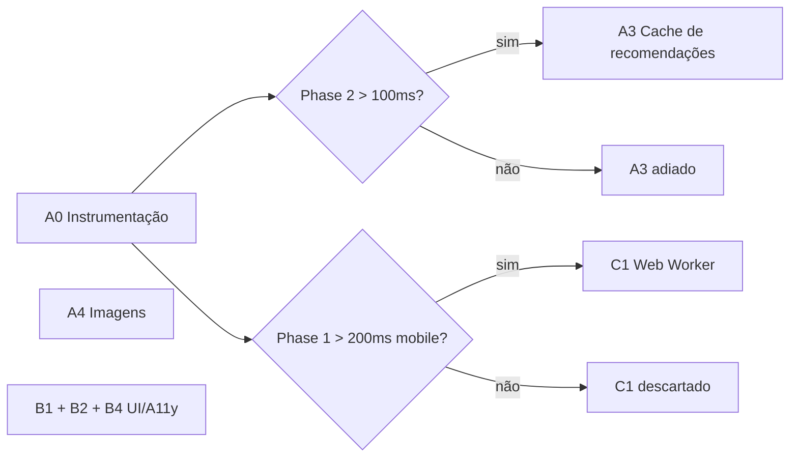
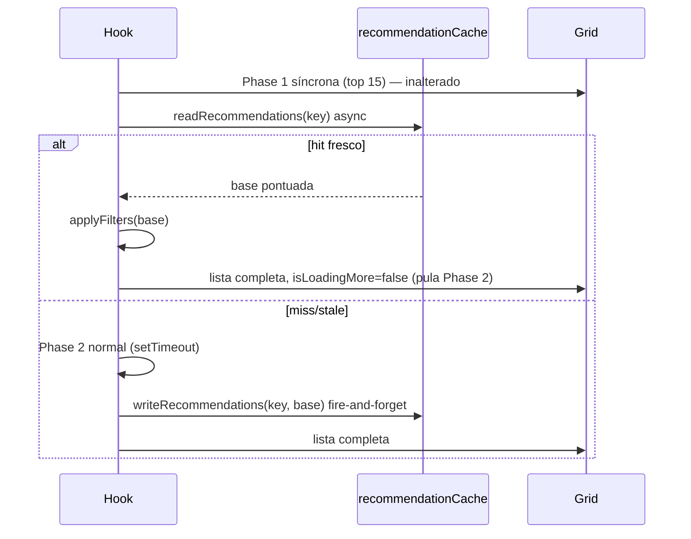

# Especificação Detalhada: Fases Restantes do Roadmap de Design

**Data:** 12/11/2026
**Status:** Planejamento antes de implementação
**Origem:** [roadmap_design.md](./roadmap_design.md) — A1 e A2 já entregues (`9cc563a`, `5def15d`)
**Escopo:** A0 (medição), A3 (cache de recomendações), A4 (imagens), B1, B2, B4, C1 (Web Worker). B3 descartado.

---

## 📋 Visão Geral e Ordem de Execução



| Item | Tipo | Esforço | Depende de | Prioridade |
|------|------|---------|------------|------------|
| **A0** Instrumentação de performance | perf/infra | 1–2h | — | 🔴 Primeiro |
| **A4** Priorização de imagens | perf | 1h | — | 🔴 Alta (dor real do usuário) |
| **B4** Acessibilidade de filtros | a11y | 1–2h | — | 🟠 Alta (WCAG) |
| **B2** Ajustes de motion/focus no card | a11y/ui | 30min | — | 🟠 Média |
| **B1** Destaque de scores excelentes | ui | 1h | — | 🟡 Baixa |
| **A3** Cache de recomendações (IDB) | perf | 3–4h | Gate A0 | 🟡 Condicional |
| **C1** Web Worker para scoring | perf | 4–6h | Gate A0 | ⚪ Condicional |
| ~~B3~~ Letter-spacing | — | — | — | ❌ Descartado |

> [!IMPORTANT]
> A3 e C1 só devem ser implementados se A0 provar necessidade. O scoring é O(N) e roda em poucos ms em desktop; o gargalo percebido pelo usuário ("demora pra aparecer") é muito mais provavelmente **rede + imagens externas** (A4) do que CPU.

---

## A0: Instrumentação de Performance (pré-requisito)

### Objetivo
Substituir as métricas *estimadas* dos docs anteriores ("1.5–2s → 200–300ms") por números **medidos**, e criar os gates de decisão para A3/C1.

### Localização
```
src/lib/perfMarks.js                                (NOVO)
src/hooks/useProgressiveRecommendationPipeline.js   (MODIFICAR)
```

### Especificação

```javascript
// src/lib/perfMarks.js
const ENABLED =
  typeof performance !== 'undefined' &&
  (import.meta.env.DEV || localStorage.getItem('animatch_debug_perf') === '1')

export function mark(name) {
  if (ENABLED) performance.mark(`animatch:${name}`)
}

export function measure(name, start, end) {
  if (!ENABLED) return null
  try {
    const m = performance.measure(`animatch:${name}`, `animatch:${start}`, `animatch:${end}`)
    console.debug(`[perf] ${name}: ${m.duration.toFixed(1)}ms`)
    return m.duration
  } catch {
    return null
  }
}
```

**Pontos de medição no hook:**

| Mark | Onde |
|------|------|
| `phase1:start` / `phase1:end` | início/fim de `computePhase1` |
| `phase2:start` / `phase2:end` | início/fim do callback do `setTimeout` |
| `measure('phase1')`, `measure('phase2')` | após cada `end` |

**Pontos no app (opcional):** `lists:fetched` (App, após `fetchUserEntries`) e `grid:first-card` (RecommendationGrid, `useEffect` quando `visibleRecommendations.length > 0` pela primeira vez).

### Protocolo de medição
1. Conta real com **500+** entradas (AniList) e uma com **~1000** (ensemble).
2. Chrome DevTools → CPU throttling **4x** + Network **Fast 4G** (simula Android médio).
3. 5 execuções cold e 5 warm (cache de listas ativo). Registrar mediana.
4. Preencher tabela em `docs/PERF_BASELINE.md`.

### Gates de decisão

| Gate | Condição | Ação |
|------|----------|------|
| **G1** | mediana `phase2` > 100ms (throttled) | Implementar A3 |
| **G2** | mediana `phase1` > 200ms (throttled) **ou** long task > 50ms visível no Performance panel | Implementar C1 |
| — | nenhum | Encerrar Frente A/C; foco em A4 |

### Critérios de aceite
- [ ] Zero overhead em produção (marks desligadas sem flag)
- [ ] `docs/PERF_BASELINE.md` com tabela medida
- [ ] Teste: `perfMarks` não lança sem `performance` (jsdom/SSR)

---

## A4: Priorização de Imagens Externas (NOVO)

### Por que
Relato original do usuário: *"as imagens e outros itens vêm de outros sites"*. A2 já reduziu o número de capas no primeiro paint (lazy + lote de 15), mas as primeiras capas ainda competem por banda e handshake TLS.

### Estado atual
- ✅ `loading="lazy"` / `eager` para `priority` (index < 4)
- ✅ `decoding="async"`
- ✅ DNS prefetch em `index.html` (verificar domínios)
- ❌ Sem `preconnect` (DNS + TCP + TLS) para o CDN principal
- ❌ Sem `fetchpriority="high"` nas capas acima da dobra

### Mudanças

**1. `index.html`** — trocar `dns-prefetch` por `preconnect` **apenas** no CDN de capas mais usado (AniList), mantendo `dns-prefetch` nos demais:
```html
<link rel="preconnect" href="https://s4.anilist.co" crossorigin>
<link rel="dns-prefetch" href="https://media.kitsu.app">
<link rel="dns-prefetch" href="https://cdn.myanimelist.net">
```
> Confirmar hosts reais inspecionando `coverImage` nas respostas de cada provider antes de aplicar. `preconnect` em excesso (>2–3) degrada performance.

**2. `AnimeCard.jsx` / `AnimeRow.jsx`** — capas prioritárias:
```jsx

```
> Verificar se React 19 aceita `fetchPriority` (camelCase) — é o nome correto do prop no React.

**3. CSP** — conferir se `img-src` em `index.html`/headers cobre os hosts (S1/A14 restringiu CSP).

### Critérios de aceite
- [ ] LCP medido (A0 protocolo) antes/depois registrado em `PERF_BASELINE.md`
- [ ] CLS < 0.1 no grid
- [ ] Teste: `AnimeCard` com `priority` renderiza `fetchpriority="high"`; sem `priority`, `lazy`

---

## A3: Cache de Recomendações em IndexedDB (condicional ao Gate G1)

### Objetivo
Ao reabrir o app com a mesma lista, pular Phase 2 e exibir a lista completa já pontuada.

### Problemas da proposta original (roadmap §A3) e correções

| Proposta original | Problema | Correção |
|-------------------|----------|----------|
| Reusar store `anime_lists` | LRU de `MAX_IDB_ENTRIES = 20` compartilhado → recomendações despejariam listas de usuários | **Store dedicada** `recommendations` (DB_VERSION 1 → 2) |
| Chave por `hash(tasteProfile)` | Calcular hash do profile exige computar o profile (já é parte do custo) | Chave por **hash das entries** (barato) |
| Recalcular se filtros mudarem | Explosão de chaves (gênero × formato × ano × badge × busca...) | Cachear só a **base pontuada sem filtros**; filtros aplicados em memória (baratos) |
| Fallback em localStorage | Lista pontuada de 500+ itens estoura cota de 5MB facilmente | **Sem** espelho em localStorage; IDB indisponível → pipeline normal |
| — | Mudança no algoritmo (ex.: A12) serviria scores antigos | Constante `RECOMMENDER_VERSION` na chave |

### Localização
```
src/cache/recommendationCache.js                    (NOVO)
src/cache/idbCache.js                               (MODIFICAR: DB_VERSION 2, nova store, clearAll)
src/lib/storageKeys.js                              (MODIFICAR: IDB_CONFIG.RECS_STORE)
src/logic/recommender.js                            (MODIFICAR: export RECOMMENDER_VERSION)
src/hooks/useProgressiveRecommendationPipeline.js   (MODIFICAR)
```

### Chave de cache

```javascript
// recs:<scope>:<entriesHash>:<RECOMMENDER_VERSION>:<optionsHash>:<genre>
// genre entra na chave porque scoreRecommendations filtra por gênero internamente
```

- `entriesHash`: FNV-1a 32-bit sobre string ordenada de `${media.id}:${status}:${score}:${progress}` de todas as entries. Qualquer anime adicionado/removido/reavaliado → nova chave.
- `RECOMMENDER_VERSION`: inteiro em `recommender.js`, incrementado a cada mudança de fórmula.
- `optionsHash`: hash de `JSON.stringify(recommenderOptions)`.

> [!NOTE]
> Username **não** entra na chave: o hash das entries já identifica a lista. Evita PII na chave e permite hit entre sessões anônimas/logadas com mesma lista.

### Valor armazenado

```javascript
{
  cacheKey,
  recommendations: [...],  // enriquecidas, SEM filtros secundários, SEM boosts de streaming
  timestamp,
  count,
}
```

Boosts (`applyStreamingBoost`, `applyMultiPresenceBoost`) e filtros continuam em `applyFilters` em memória — dependem de preferências voláteis (assinaturas, toggles).

### Política
- TTL: **24h** (scores comunitários mudam devagar).
- Máx. **5 entradas** na store `recommendations`, LRU por `timestamp`.
- `clearAllLocalData()` **deve** limpar a store nova (exclusão de conta / LGPD).
- Mudança de `sortBy`: nunca invalida (sort é na grid).

### Fluxo no hook



**Corrida:** se Phase 2 terminar antes da leitura do IDB, descartar resultado do cache (flag `settledRef`). Cleanup do effect cancela ambos (`cancelled = true`).

### Critérios de aceite
- [ ] Hit de cache elimina Phase 2 (verificado via `perfMarks`)
- [ ] Adicionar 1 anime à lista → miss
- [ ] Bump de `RECOMMENDER_VERSION` → miss
- [ ] Trocar filtro de formato/ano/busca → **hit** (filtro em memória)
- [ ] IDB indisponível → comportamento idêntico ao atual, sem erro
- [ ] `clearAllLocalData` limpa store `recommendations`
- [ ] Upgrade DB v1 → v2 preserva `anime_lists`
- [ ] Testes com `fake-indexeddb` (verificar se já está no projeto; senão mock como em `idbCache.test.js`)

---

## B4: Acessibilidade dos Filtros

### Estado atual (`FilterBar.jsx`)

| Controle | Situação | Problema |
|----------|----------|----------|
| `#filter-search` | só `placeholder` | ❌ Sem nome acessível (placeholder não substitui label — WCAG 1.3.1 / 4.1.2) |
| `#filter-genre` | `aria-label={t('filter.allGenres')}` | ⚠️ Label = texto de uma opção ("Todos os Gêneros"), não o propósito |
| `#filter-sort` | `aria-label={t('filter.sortLabel')}` | ✅ |
| Popover (formato/ano/badge) | envolvidos em `<label>` | ✅ |
| Toggles (temporada/streaming) | `<label>` + input | ✅ |
| Chips de remoção | `aria-label` com nome do filtro | ✅ |
| Contagem de resultados | só visual no `<h2>` | ❌ Leitor de tela não é avisado ao filtrar (WCAG 4.1.3) |

### Mudanças

**1. Search**
```jsx
<input
  id="filter-search"
  type="search"
  aria-label={t('filter.searchLabel')}   // "Buscar anime por nome"
  ...
/>
```

**2. Gênero**
```jsx
aria-label={t('filter.genreLabel')}      // "Filtrar por gênero"
```

**3. Live region de resultados** — em `RecommendationGrid.jsx`:
```jsx
<p className="sr-only" aria-live="polite" aria-atomic="true">
  {isLoadingMore
    ? t('recommendationGrid.srLoading')
    : t('recommendationGrid.srCount', { count: displayRecommendations.length })}
</p>
```
- Debounce implícito: só anuncia quando `isLoadingMore` muda ou contagem estabiliza (evitar anunciar a cada tecla da busca — usar `useDeferredValue` na contagem ou debounce 500ms).
- Confirmar existência da classe utilitária `.sr-only` em `index.css`; criar se faltar.

**4. i18n** — novas chaves em `en.json`, `pt-BR.json`, `ja.json`:
`filter.searchLabel`, `filter.genreLabel`, `recommendationGrid.srCount`, `recommendationGrid.srLoading`.

### Critérios de aceite
- [ ] Todos os controles com nome acessível próprio (axe DevTools: 0 violações em FilterBar)
- [ ] `getByRole('searchbox', { name: /buscar/i })` funciona no teste
- [ ] Live region anuncia contagem após filtrar (teste via `getByText` no nó `aria-live`)
- [ ] Ajustar testes existentes que dependem de `aria-label="Todos os Gêneros"` (`FilterBar.test.jsx`, `Dashboard.test.jsx`)

---

## B2: Motion e Focus no Card (escopo reduzido)

### Estado atual
Hover lift **já implementado** (`AnimeCard.module.css` L11–19): `translateY(-2px)` + glow + `--transition-default` (200ms `cubic-bezier(0.16, 1, 0.3, 1)`). Reduced-motion zera a duração em `:root`, mas **o deslocamento ainda acontece** (salto instantâneo). Card é `role="link" tabIndex={0}` sem estilo `:focus-visible` próprio.

### Mudanças (`AnimeCard.module.css`)
```css
.anime-card:hover,
.anime-card:focus-visible {
  box-shadow: 0 0 20px 2px var(--color-primary-glow);
  transform: translateY(-2px);
  z-index: 50;
}

.anime-card:focus-visible {
  outline: 2px solid var(--color-primary);
  outline-offset: 2px;
}

@media (prefers-reduced-motion: reduce) {
  .anime-card:hover,
  .anime-card:focus-visible {
    transform: none;
  }
}
```
Aplicar o mesmo padrão em `AnimeRow.module.css` se houver hover com transform.

### Critérios de aceite
- [ ] Navegação por Tab mostra foco visível em cada card (contraste ≥ 3:1 do outline — WCAG 2.4.7 / 1.4.11)
- [ ] Com reduced-motion ativo, card não se desloca
- [ ] Quick buttons revelados no hover (`.anime-card:hover .anime-card__anilist-quickbtn`) também revelados em `:focus-within`

---

## B1: Destaque para Scores Excelentes

### Objetivo
Sinal visual sutil para `predictedScore ≥ 8.5`, sem virar ruído.

### Decisões
- **Threshold relativo > absoluto?** Usuários que dão notas baixas podem nunca ter 8.5+. Proposta: tier `excellent` = `predictedScore >= 8.5` **e** no top 10% da lista atual. Calcular percentil no hook (uma vez) e marcar `rec.scoreTier`.
  - Alternativa simples (MVP): só absoluto 8.5. Decidir antes de implementar.
- **Não** usar cor como único indicador (WCAG 1.4.1): somar ícone/label textual.

### Mudanças

**Hook** (após `applyFilters`, em `useProgressiveRecommendationPipeline.js`):
```javascript
const p90 = percentile(recs.map(r => r.predictedScore), 0.9)
recs = recs.map(r => ({
  ...r,
  scoreTier: r.predictedScore >= 8.5 && r.predictedScore >= p90 ? 'excellent' : undefined,
}))
```
> Em Phase 1 (15 itens) o percentil é instável → calcular tier só na Phase 2, ou usar só critério absoluto na Phase 1.

**`AnimeCard.jsx`**:
```jsx
<article data-score-tier={anime.scoreTier} ...>
...
{anime.scoreTier === 'excellent' && (
  <span className={styles['anime-card__tier-badge']}>
    <span aria-hidden="true">★</span> {t('labels.topMatch')}
  </span>
)}
```

**CSS** (tokens existentes, sem hard-coded):
```css
.anime-card[data-score-tier='excellent'] {
  border-color: var(--color-primary);
}
.anime-card[data-score-tier='excellent']:not(:hover) {
  box-shadow: 0 0 12px var(--color-primary-glow);
}
```

### Critérios de aceite
- [ ] ≤ ~10% dos cards destacados em listas reais (evitar inflação)
- [ ] Badge com texto (não só cor)
- [ ] i18n `labels.topMatch` nos 3 idiomas
- [ ] Teste: card com `scoreTier='excellent'` renderiza badge e `data-score-tier`

---

## C1: Web Worker para Scoring (condicional ao Gate G2)

### Quando
Somente se A0 mostrar long tasks > 50ms em mobile throttled. Caso contrário, **não implementar** (roadmap §8 já argumenta overhead de `postMessage` + structured clone).

### Desenho resumido
```
src/workers/scoring.worker.js   (NOVO)  — importa recommender.js, recebe { entries, genre, options }
src/hooks/useScoringWorker.js   (NOVO)  — wrapper com fallback síncrono
```
- Vite: `new Worker(new URL('../workers/scoring.worker.js', import.meta.url), { type: 'module' })`.
- Worker calcula **só** Phase 2 (Phase 1 continua síncrona → primeiro paint imediato).
- `tasteProfile` é `Map` → structured clone suporta; validar.
- Cancelamento: `requestId` incremental; respostas obsoletas ignoradas.
- Fallback: sem `Worker` (jsdom, navegadores antigos) → `setTimeout` atual.
- CSP: adicionar `worker-src 'self'` se necessário.

### Critérios de aceite
- [ ] Zero long tasks > 50ms durante Phase 2 (Performance panel, 4x throttle)
- [ ] Resultado idêntico ao pipeline síncrono (teste de paridade)
- [ ] Testes passam em jsdom via fallback

---

## ❌ B3: Letter-spacing — Descartado

Roadmap afirmava `-0.05em` em headings. Varredura em `src/index.css` e todos `*.module.css`: **nenhuma ocorrência**. Único negativo é `SettingsPage.module.css` com `-0.02em` (já no range "ideal" proposto). Nada a fazer.

---

## 🗂️ Rastreabilidade (GitHub Issues)

O roadmap cita #34–#39, mas `gh issue list` retorna apenas #21 aberta. Criar/confirmar issues antes de implementar:

| Item | Issue sugerida |
|------|----------------|
| A0 | `perf: instrumentação de performance e baseline medido` |
| A4 | `perf: preconnect e fetchpriority nas capas acima da dobra` |
| A3 | `perf: cache de recomendações pontuadas em IndexedDB` (bloqueada por A0) |
| B4 | `a11y: nomes acessíveis e live region nos filtros` |
| B2 | `a11y: focus-visible e reduced-motion no AnimeCard` |
| B1 | `feat(ui): destaque para recomendações de score excelente` |
| C1 | `perf: Web Worker para Phase 2` (bloqueada por A0) |

---

## ✅ Checklist Global (todo item)
- [ ] `npm run lint` — 0 warnings
- [ ] `npm run test` — 100% verde
- [ ] `npm run build` — bundle ≤ 130KB gzip
- [ ] i18n nos 3 idiomas quando houver texto
- [ ] Commit referenciando issue (`Fixes #X`)
