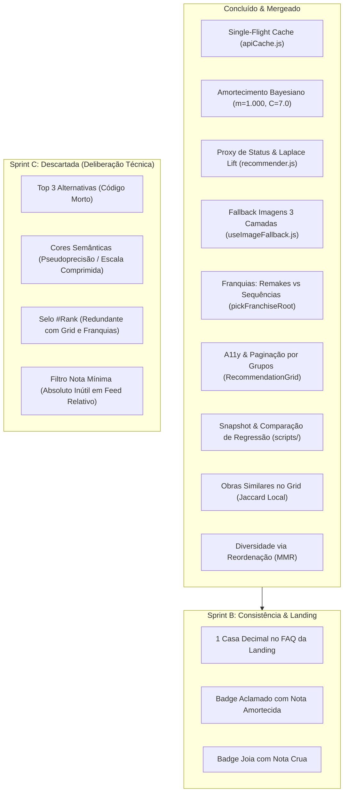

# Roadmap de Melhorias Técnicas: Animatch Web

Este documento consolida todas as melhorias técnicas, matemáticas e de interface mapeadas a partir de três bases de código de referência analisadas e das revisões técnicas de produto. Cada item possui sua **Origem**, **Racional de Decisão**, **Ação Técnica**, **Status de Implementação** e **Arquivos Afetados** para garantir rastreabilidade contínua.

---

## Fontes de Referência (Proveniência das Ideias)

| ID | Repositório / Caminho | Descrição do Conteúdo |
| :--- | :--- | :--- |
| **Fonte A** | `C:\Sistemas\ProjetosCaesb\AniMatch\lib\data\repositories\` | Motor vetorial Flutter on-device (`scoring_engine.dart`), deduplicação de rede (`anime_repository.dart`) e repositório de listas (`watchlist_repository.dart`). |
| **Fonte B** | `modelos/Animatch/src/components/Recommendations/` | Componentes React de UI (`RecommendationCard.jsx` e `SimilarAnime.jsx`) com resiliência visual e badges de afinidade. |
| **Fonte C** | `modelos/Animatch/backend/recommendation_system/` e `src/pages/` | Motor Python/ML com diversidade de gêneros (`recommender.py`) e tela detalhada de personagens/elenco (`AnimeDetails.jsx`). |
| **Fonte D** | Script standalone de Descoberta (`genres.js`) | Módulo interativo **Genre Mixer** com seleção dual de gêneros ($G_1 \times G_2$), 10 presets lendários de combo e ticker dinâmico. |

---

## 1. Motor de Recomendação & Matemática (`src/logic/recommender.js`)

> Evolui a inferência de gosto estática para um modelo sensível à confiança estatística, imune a outliers de poucos votos, tolerante a listas sem notas e organizado por franquias.

### 1.1 Amortecimento Bayesiano de Popularidade por Membros
- **Origem**: [Fonte A] `scoring_engine.dart` (`_popularityScore`).
- **Status**: ✅ **Implementado & Calibrado** (`src/logic/recommender.js`, commit `cb9704d`).
- **Racional**: O score bruto da comunidade (`media.averageScore / 10`) infla obras obscuras com pouquíssimos votos em detrimento de clássicos consolidados.
- **Conceito Matemático**: $B = \frac{v \cdot R + m \cdot C}{v + m}$, onde $C = 7.0$ (média global do catálogo), $m = 1.000$ (`DEFAULT_BAYESIAN_MIN_VOTES`), $v = \text{members}$ e $R = \text{averageScore} / 10$.
- **Resultado Prático**: Uma nota 8.5 com 5.000 membros amortiza para 8.25 (preserva nichos qualificados sem distorcer o topo).

### 1.2 Proxy de Notas por Status & Modelo Contínuo de Confiança
- **Origem**: [Fonte A] `scoring_engine.dart` (`_ratingWeight`) + Refinamento Estatístico.
- **Status**: ✅ **Implementado** (`src/logic/recommender.js`, commits `cb9704d`, `7905234`).
- **Valores e Pesos por Status & Progresso**:
  - `COMPLETED`: Nota 7.8 (peso base 0.50). Concluir é sinal positivo moderado.
  - `WATCHING`: Nota 7.0 (peso base 0.25). Ignorado se progresso $< 30\%$ (ruído de amostragem).
  - `ON_HOLD`: Nota 6.0 (peso base 0.25). Neutro para levemente negativo.
  - `DROPPED`: Peso base 0.50. Nota modulada pelo ponto de abandono ($<25\% \rightarrow 4.0$; $25\%\text{--}75\% \rightarrow 4.5$; $>75\% \rightarrow 6.0$).
  - `PLANNING`: Não entra (peso 0, apenas intenção futura).
- **Decaimento Contínuo & Teto de Contribuição**:
  - $\text{decay} = \frac{10}{n_{\text{explicit}} + 10}$.
  - $w_{\text{proxy}} = w_{\text{base}} \cdot \text{decay}$.
  - Teto de proxy: $\sum w_{\text{proxy}} \le 8.0$ notas equivalentes (impede que perfis sem notas atinjam confiança artificial alta).
  - $n_{\text{eff}} = n_{\text{explicit}} + \min(\sum w_{\text{proxy}}, 8.0)$.
- **Laplace Smoothing no Lift de Gênero**:
  - Aplicação de $\alpha = 0.25$ no cálculo do `Lift(g)` para estabilizar contagens de gêneros escassos.
- **Confiança Contínua & Banner Desacoplado**:
  - $c = \frac{n_{\text{eff}}}{n_{\text{eff}} + 10}$.
  - $\text{pesoGosto} = 0.85 \cdot c$; $\text{pesoComunidade} = 1.0 - \text{pesoGosto}$.
  - Banner de baixa confiança disparado por `nExplicit < 10 && entries.length > 0` (ponto de meia-vida do proxy, desacoplado do volume de itens não avaliados).

### 1.3 Agrupamento de Franquias & Hierarquia de Raiz (`pickFranchiseRoot`)
- **Origem**: Requisito de Usabilidade & UX de Franquias.
- **Status**: ✅ **Implementado** (`src/logic/recommender.js`, `RecommendationGrid.jsx`, commit `7905234`).
- **Racional**: Continuações e filmes da mesma obra não devem inundar o feed de recomendações.
- **Heurística de Raiz**:
  - **Remakes / Adaptações Alternativas** (`isAlternativeAdaptation`): mesmo título normalizado + sem termos sequenciais (`Season`, `Part`) + $\Delta\text{ano} \ge 5 \rightarrow$ raiz é a de **maior Match** (ex: *Hunter x Hunter 2011* > *1999*). O filho recebe tag `Adaptação alternativa (ano)`.
  - **Continuações Diretas**: raiz é a primeira entrada não vista priorizando formato `TV > MOVIE > OVA > ONA > SPECIAL > OTHER` + menor ano de lançamento + maior Match como desempate.
  - **Nota do Card Raiz**: exibe estritamente o **seu próprio Match** (sem herdar nota mais alta de continuações). O grupo é posicionado no feed pelo Match da própria raiz.
  - **Paginação e A11y**: paginação por grupos (raízes), contador `N recomendações (M animes no total)`, toggle com `aria-controls` e `aria-expanded`, e badges com SVG inline de corrente.

### 1.4 Power Sharpening ($S^\tau$) & Margin Boost
- **Origem**: [Fonte A] `scoring_engine.dart` (`_pow`, `_kMarginBoost`).
- **Status**: ❌ **Descartado / Não Implementar** (Deliberação Técnica formal).
- **Racional**:
  - **Power Sharpening**: É uma transformação monótona; não altera a ordem do ranking e distorce a escala absoluta das notas exibidas, invalidando limiares absolutos (como gaps de desempate e badges).
  - **Margin Boost**: Somar $+0.10$ ao vencedor apenas infla a nota exibida do 1º colocado (mesmo vício do boost de multipresença já eliminado). Critérios secundários de desempate (nota da comunidade, ano, 1ª temporada) são mais honestos e limpos.

### 1.5 Decaimento Temporal de Preferências ($e^{-\lambda t}$)
- **Origem**: [Fonte A] `scoring_engine.dart` (`_temporalPreferenceVector`).
- **Status**: ⏸️ **Suspenso / Reavaliar** (Viabilidade de Dados).
- **Racional**: As APIs de AniList, MAL e Kitsu raramente fornecem data confiável de conclusão do anime (`completedAt`). O uso de `updatedAt` penaliza clássicos favoritos que o usuário apenas reclassificou ou alterou metadados recentemente.

### 1.6 Fator de Diversidade (`diversity_factor`) Anti-Monotonia
- **Origem**: [Fonte C] `recommender.py` (`diversity_factor`).
- **Status**: ✅ **Implementado sob Flag Explícita** (`src/logic/diversity.js`, `FilterBar.jsx`, `RecommendationGrid.jsx`).
- **Racional**: Evitar que uma lista de planejamento seja monopolizada por 10 animes do mesmo subgênero consecutivo.
- **Diretriz Técnica**:
  - Controlado por flag/checkbox explícito na barra de filtros (`[ ] Diversificar feed`), **desativado por padrão**.
  - Padrão (desligado): ordenação estritamente decrescente em notas visíveis (8.1, 8.0, 8.0, 7.9...).
  - Ativado: aplica Maximal Marginal Relevance (MMR com $\lambda = 0.85$, janela local de 3) mantendo o #1 intocado e notas numéricas preservadas.

### 1.7 Recomendações Item-a-Item ("Obras Semelhantes" no Grid)
- **Origem**: [Fonte B] `SimilarAnime.jsx` + Reavaliação de UX.
- **Status**: ✅ **Implementado** (`src/logic/similarity.js`, `Dashboard.jsx`, `RecommendationGrid.jsx`, `AnimeCard.jsx`, `AnimeRow.jsx`).
- **Racional**: Não poluir o modal com rolagem pesada nem criar navegação aninhada (modal sobre modal). Padrão de streaming ("Mais como este").
- **Ação Técnica**:
  - Botão de ação rápida nos cards: *"✨ Similares"*.
  - Ranqueia o feed principal pela similaridade de Jaccard ($J \ge 0.05$) contra o anime selecionado.
  - Exibe chip dismissible no topo do grid: `✨ Mostrando similares a: [Título] ✕`.
  - Badge visual de percentual: `[X% similar]`.
  - **Zero chamadas de rede:** Calculado 100% in-memory sobre os dados em cache no cliente.

---

## 2. Decisão, Confiança & Explicabilidade (`src/logic/decision.js` + UI)

> Torna o recurso "Decidir por mim" assertivo, alternativo e transparente.

### 2.1 Tratamento Estruturado de Cold Start
- **Origem**: [Fonte A] `anime_repository.dart` (`getHeroRecommendation`).
- **Status**: ✅ **Implementado** (unificado pelo modelo de confiança contínua $c < 0.50$ e blend bayesiano da comunidade).

### 2.2 Runner-ups / Top 3 Alternativas no Modal de Decisão
- **Origem**: [Fonte A] `anime_repository.dart` (`alts = ranked.skip(1).take(3)`).
- **Status**: ❌ **Descartado / Código Morto** (Deliberação Técnica).
- **Racional**: O botão de acionamento ("Escolha pra mim" / `FloatingRandomizerButton`) foi desativado no `Dashboard.jsx`. O modal e a lógica de decisão tornaram-se código inerte a ser removido.
- **Arquivos**: `src/components/DecisionModal.jsx`, `src/logic/decision.js`.

### 2.3 Explicabilidade Dinâmica por Fator Dominante
- **Origem**: [Fonte A] `scoring_engine.dart` (`dominantFactor`).
- **Status**: ✅ **Parcialmente Implementado** (já exibe animes âncora e gêneros de maior contribuição).
- **Melhoria Futura**: Expor categoria semântica explícita (`taste`, `community`, `anchor`, `discovery`).

---

## 3. Interface, Resiliência Visual & UX dos Cards (`src/components/`)

> Elimina quebras de layout, padroniza escalas visuais e introduz metadados sob demanda.

### 3.1 Fallback Resiliente de Imagens em 3 Camadas
- **Origem**: [Fonte B] `RecommendationCard.jsx`.
- **Status**: ✅ **Implementado** (`src/hooks/useImageFallback.js`, `AnimeCard.jsx`, `AnimeRow.jsx`).
- **Mecanismo**: CDN original $\rightarrow$ Jikan API (on error) $\rightarrow$ SVG vetorial neutro com iniciais do título.

### 3.2 Escala Semântica de Cores para o Match Badge
- **Origem**: [Fonte B] `RecommendationCard.jsx` (`getScoreColor`).
- **Status**: ❌ **Descartado / Não Implementar** (Deliberação Técnica).
- **Racional**: A escala de Match é estatisticamente comprimida no topo (ex: 7.95 a 8.08). Faixas fixas geram pseudoprecisão (8.00 verde vs 7.99 azul), tons baixos (âmbar/carmesim) nunca apareceriam no feed ranqueado e cor isolada prejudica acessibilidade (daltonismo).
- **Arquivos**: `src/components/AnimeCard.module.css`, `src/components/AnimeRow.module.css`.

### 3.3 Badge Visual de Posição (#Rank) no Grid
- **Origem**: [Fonte B] `RecommendationCard.jsx` (`#rank badge`).
- **Status**: ❌ **Descartado / Não Implementar** (Deliberação Técnica).
- **Racional**: Redundante com a ordem natural de leitura da tela. Gera ambiguidade no agrupamento por franquias e perde sentido em ordenações secundárias e filtros.
- **Arquivos**: `src/components/AnimeCard.jsx`.

### 3.4 Filtro de Nota Mínima de Afinidade (Minimum Match Score)
- **Origem**: [Fonte C] `AIRecommendations.jsx`.
- **Status**: ❌ **Descartado / Não Implementar** (Deliberação Técnica).
- **Racional**: Faixas absolutas ($\ge 7.0, \ge 8.0, \ge 9.0$) colapsam na distribuição real (selecionam tudo ou nada). A ordenação decrescente e a paginação já cobrem a necessidade de forma relativa e sem atrito.
- **Arquivos**: `src/components/FilterBar.jsx`.

### 3.5 Personagens e Dubladores (*Seiyuus*) no Modal de Detalhes
- **Origem**: [Fonte C] `AnimeDetails.jsx`.
- **Status**: ❌ **Descartado / Não Implementar** (Deliberação Técnica).
- **Racional**: Espaço nobre do modal já contém metadados, `RecommendationReason`, sinopse, streaming e links. Adicionar elenco causaria rolagem vertical excessiva em telas mobile para um dado secundário na decisão de "o que assistir".
- **Arquivos**: `src/components/AnimeDetailModal.jsx`.

### 3.6 Sincronização de Decimais & Badges da Landing Page
- **Status**: ⏳ **Pendente (Sprint B)**.
- **Ação Técnica**:
  - Alinhar FAQ da Landing com 1 casa decimal (`toFixed(1)`: `8.5/10`, `7.2/10`, `0.7/10`).
  - Badge *Aclamado*: calcular com nota **amortecida** (evita selo em nichos de 15 votos).
  - Badge *Joia*: manter com nota **crua** (preserva mérito de comunidades de nicho).

---

## 4. Rede, Cache & Performance (`src/cache/`)

### 4.1 Single-Flight Request Deduplication (Promise Coalescing)
- **Origem**: [Fonte A] `anime_repository.dart`.
- **Status**: ✅ **Implementado** (`src/cache/apiCache.js`).

### 4.2 Pipeline Progressivo & SWR
- **Status**: ✅ **Parcialmente Implementado** (`useProgressiveRecommendationPipeline.js` com Fase 1 rápida em lote inicial de 30 e Fase 2 assíncrona).
- **Melhoria Futura**: Persistência do ranking calculado em IndexedDB para render instantâneo de re-visita.

### 4.3 Histórico de Busca Recente Persistido
- **Origem**: [Fonte A] `watchlist_repository.dart`.
- **Status**: ⏳ **Pendente (Sprint E)**.
- **Ação Técnica**: Persistir os últimos 10 termos únicos de busca no `idbCache.js`.

---

## 5. Descoberta & Gamificação (Genre Mixer)

### 5.1 Genre Mixer: Alquimia de Gêneros ($G_1 \times G_2$)
- **Origem**: [Fonte D] `genres.js`.
- **Status**: ⏸️ **Suspenso / Reavaliação de UX** (Deliberação Técnica).
- **Racional**: Cruzamentos de gêneros incompatíveis ou nichados (ex: *Gore* + *Família*) geram listas vazias frequentes ("Nenhum anime encontrado"), passando a sensação de site quebrado ou bugado no escopo de planejamento do usuário.
- **Arquivos**: `src/components/GenreMixerModal.jsx`.

---

## 6. Validação, Regressão & Qualidade (`scripts/`)

### 6.1 Snapshot de Regressão & Benchmark Automatizado
- **Status**: ✅ **Implementado** (`scripts/regression-benchmark.mjs`, `scripts/run-regression-comparison.mjs`).
- **Capacidade**: Fixture congelada com 546 animes históricos + 201 planejados.
- **Métricas Validadas**: Spearman (0.9629), MAE (0.0436), RMSE (0.0459).

---

## Plano de Execução Atualizado

### Detalhamento dos Próximos Sprints

#### **Sprint B: Consistência & Badges (Imediato)**
1. **Landing Page**: Sincronizar FAQ para 1 casa decimal (`toFixed(1)`: `8.5/10`, `7.2/10`, `0.7/10`).
2. **Badges de Discrepância**:
   - `ACCLAIMED`: disparar comparando `communityScore` amortecido com o gosto (`communityScore >= 8.5 && communityScore - baseTasteScore >= 1.0`).
   - `HIDDEN_GEM`: calcular sobre a nota crua para manter justiça a nichos.

#### **Sprint C: Descartada Formalmente**
- Itens de UI dependentes de faixas fixas, selos redundantes e código morto foram invalidados pela compressão do Match e ordenação natural.

#### **Sprint D: Similaridade & Diversidade (Em Execução)**
1. **Obras Similares no Grid**: botão de ação rápida nos cards reordenando o feed local por Jaccard com chip dismissible no topo (zero requisições de rede, sem Jikan).
2. **Fator de Diversidade (MMR)**: reordenação pura anti-monotonia sem alterar o Match exibido.
*(Genre Mixer suspenso por risco de retorno vazio; Elenco/Seiyuus descartado por poluição de UI).*

#### **Sprint E: Performance & Persistência**
1. **Histórico de Busca Recente**: persistido no IndexedDB via `idbCache.js`.
2. **Cache SWR de Recomendações**: hidratação instantânea do ranking em revisitas.
