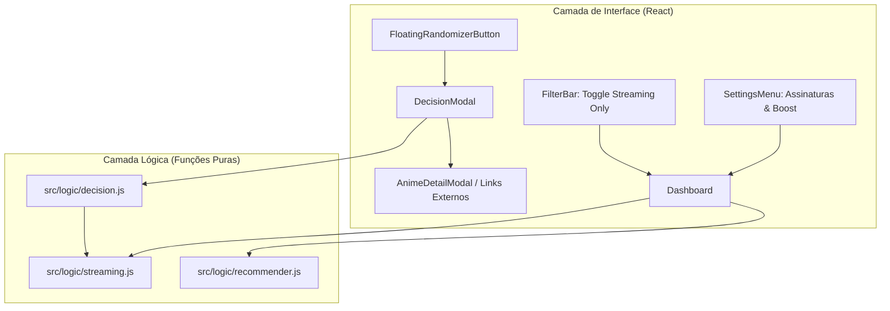

# B2 — Modo Decisão ("Escolha pra mim") & Filtro de Streaming Implementation Plan

> **For agentic workers:** REQUIRED SUB-SKILL: Use superpowers:subagent-driven-development to implement this plan task-by-task. Steps use checkbox (`- [ ]`) syntax for tracking.

**Goal:** Implementar o Modo Decisão ("Escolha pra mim") com 3 estratégias de seleção (Melhor Escolha, Surpreenda-me via amostragem ponderada Top 20, e Quero Começar Hoje), acompanhado de gerenciamento de assinaturas de streaming e filtros/boost de disponibilidade.

**Architecture:** Módulo puro `streaming.js` para normalização e matching de plataformas; módulo puro `decision.js` com algoritmos de amostragem probabilística decrescente e filtragem rápida; componentes React `DecisionModal.jsx` e `FloatingRandomizerButton.jsx` integrados ao `Dashboard.jsx`, com persistência no `useLocalStorage` e controles em `SettingsMenu.jsx` e `FilterBar.jsx`.

**Architecture Diagram:**



**Tech Stack:** React 19, CSS Modules, Vitest, Testing Library, i18next.

## Global Constraints
- Sem novas dependências externas no `package.json`.
- Compatibilidade total com dados AniList, Kitsu e MyAnimeList.
- Todos os textos e labels devem possuir chaves de i18n em `pt-BR`, `en` e `ja`.
- Testes unitários com Vitest cobrindo 100% dos fluxos de lógica e renderização.

---

### Task 1: Streaming Logic & Constantes (`streaming.js`)

**Files:**
- Create: `src/logic/streaming.js`
- Test: `src/logic/streaming.test.js`

**Interfaces:**
- Produces:
  - `STREAMING_SERVICES`: Array de serviços suportados (`['Crunchyroll', 'Netflix', 'Prime Video', 'Disney+', 'Max', 'HIDIVE']`)
  - `normalizeServiceName(name: string): string`
  - `getAnimeStreamingServices(anime: object): string[]`
  - `matchesUserSubscriptions(anime: object, userSubscriptions: string[]): boolean`
  - `applyStreamingBoost(recommendations: object[], userSubscriptions: string[], boostAmount?: number): object[]`

- [ ] **Step 1: Write the failing test**

```javascript
// src/logic/streaming.test.js
import { describe, it, expect } from 'vitest'
import {
  STREAMING_SERVICES,
  normalizeServiceName,
  getAnimeStreamingServices,
  matchesUserSubscriptions,
  applyStreamingBoost,
} from './streaming.js'

describe('streaming logic', () => {
  it('normalizes common streaming service variations', () => {
    expect(normalizeServiceName('crunchyroll')).toBe('Crunchyroll')
    expect(normalizeServiceName('Netflix')).toBe('Netflix')
    expect(normalizeServiceName('Amazon Prime Video')).toBe('Prime Video')
    expect(normalizeServiceName('HBO Max')).toBe('Max')
    expect(normalizeServiceName('Disney Plus')).toBe('Disney+')
    expect(normalizeServiceName('HIDIVE')).toBe('HIDIVE')
    expect(normalizeServiceName('Unknown Platform')).toBe('Unknown Platform')
  })

  it('extracts streaming services from anime object', () => {
    const anime = {
      streamingLinks: [
        { site: 'Crunchyroll', url: 'https://crunchyroll.com/anime' },
        { site: 'Netflix', url: 'https://netflix.com/anime' },
      ],
    }
    expect(getAnimeStreamingServices(anime)).toEqual(['Crunchyroll', 'Netflix'])
  })

  it('checks if anime matches user subscriptions', () => {
    const anime = {
      streamingLinks: [{ site: 'Crunchyroll', url: 'https://crunchyroll.com/anime' }],
    }
    expect(matchesUserSubscriptions(anime, ['Crunchyroll', 'Netflix'])).toBe(true)
    expect(matchesUserSubscriptions(anime, ['Netflix', 'Prime Video'])).toBe(false)
    expect(matchesUserSubscriptions(anime, [])).toBe(false)
  })

  it('applies boost to recommendations available on user subscriptions', () => {
    const recs = [
      { id: 1, predictedScore: 8.0, streamingLinks: [{ site: 'Netflix' }] },
      { id: 2, predictedScore: 8.2, streamingLinks: [{ site: 'Hulu' }] },
    ]
    const boosted = applyStreamingBoost(recs, ['Netflix'], 0.3)
    expect(boosted[0].id).toBe(1)
    expect(boosted[0].predictedScore).toBe(8.3)
    expect(boosted[0].hasStreamingBoost).toBe(true)
    expect(boosted[1].predictedScore).toBe(8.2)
  })
})
```

- [ ] **Step 2: Run test to verify it fails**

Run: `npx vitest run src/logic/streaming.test.js`  
Expected: FAIL (file not found)

- [ ] **Step 3: Write minimal implementation**

```javascript
// src/logic/streaming.js
export const STREAMING_SERVICES = [
  'Crunchyroll',
  'Netflix',
  'Prime Video',
  'Disney+',
  'Max',
  'HIDIVE',
]

const NORMALIZATION_MAP = {
  crunchyroll: 'Crunchyroll',
  netflix: 'Netflix',
  'prime video': 'Prime Video',
  'amazon prime video': 'Prime Video',
  amazon: 'Prime Video',
  'disney+': 'Disney+',
  'disney plus': 'Disney+',
  disney: 'Disney+',
  max: 'Max',
  'hbo max': 'Max',
  hbo: 'Max',
  hidive: 'HIDIVE',
}

export function normalizeServiceName(name) {
  if (!name || typeof name !== 'string') return ''
  const lower = name.toLowerCase().trim()
  return NORMALIZATION_MAP[lower] || name.trim()
}

export function getAnimeStreamingServices(anime) {
  if (!anime) return []
  const links = anime.streamingLinks || anime.media?.streamingLinks || []
  const services = new Set()
  for (const link of links) {
    if (link?.site) {
      services.add(normalizeServiceName(link.site))
    }
  }
  return Array.from(services)
}

export function matchesUserSubscriptions(anime, userSubscriptions = []) {
  if (!userSubscriptions || userSubscriptions.length === 0) return false
  const animeServices = getAnimeStreamingServices(anime)
  return animeServices.some((service) => userSubscriptions.includes(service))
}

export function applyStreamingBoost(recommendations = [], userSubscriptions = [], boostAmount = 0.3) {
  if (!userSubscriptions || userSubscriptions.length === 0 || !boostAmount) {
    return recommendations
  }
  return recommendations.map((rec) => {
    const isAvailable = matchesUserSubscriptions(rec, userSubscriptions)
    if (!isAvailable) return rec
    const originalScore = rec.predictedScore ?? 0
    const boostedScore = Math.round((originalScore + boostAmount) * 100) / 100
    return {
      ...rec,
      predictedScore: boostedScore,
      hasStreamingBoost: true,
    }
  })
}
```

- [ ] **Step 4: Run test to verify it passes**

Run: `npx vitest run src/logic/streaming.test.js`  
Expected: PASS

- [ ] **Step 5: Commit**

```bash
git add src/logic/streaming.js src/logic/streaming.test.js
git commit -m "feat(streaming): add streaming normalization and matching logic"
```

---

### Task 2: Decision Engine (`decision.js`)

**Files:**
- Create: `src/logic/decision.js`
- Test: `src/logic/decision.test.js`

**Interfaces:**
- Consumes: `matchesUserSubscriptions` from `src/logic/streaming.js`
- Produces:
  - `DECISION_MODES = { BEST: 'best', SURPRISE: 'surprise', QUICK: 'quick' }`
  - `pickBestRecommendation(recommendations: object[]): object | null`
  - `pickWeightedTop20(recommendations: object[], randomFn?: () => number): object | null`
  - `pickQuickStart(recommendations: object[], userSubscriptions: string[], maxEpisodes?: number, randomFn?: () => number): object | null`
  - `makeDecision(mode: string, recommendations: object[], userSubscriptions: string[], randomFn?: () => number): object | null`

- [ ] **Step 1: Write the failing test**

```javascript
// src/logic/decision.test.js
import { describe, it, expect } from 'vitest'
import {
  DECISION_MODES,
  pickBestRecommendation,
  pickWeightedTop20,
  pickQuickStart,
  makeDecision,
} from './decision.js'

describe('decision engine', () => {
  const sampleRecs = Array.from({ length: 30 }, (_, i) => ({
    id: i + 1,
    title: `Anime ${i + 1}`,
    predictedScore: 10 - i * 0.1,
    episodes: i % 2 === 0 ? 12 : 50,
    streamingLinks: i % 3 === 0 ? [{ site: 'Crunchyroll' }] : [],
  }))

  it('picks the absolute best recommendation in BEST mode', () => {
    const pick = pickBestRecommendation(sampleRecs)
    expect(pick.id).toBe(1)
    expect(pick.predictedScore).toBe(10)
  })

  it('returns null if list is empty', () => {
    expect(pickBestRecommendation([])).toBeNull()
    expect(pickWeightedTop20([])).toBeNull()
    expect(pickQuickStart([], ['Crunchyroll'])).toBeNull()
  })

  it('picks from top 20 with weighted probability', () => {
    // deterministic random = 0 picks highest weight (first item)
    const pickFirst = pickWeightedTop20(sampleRecs, () => 0.0001)
    expect(pickFirst.id).toBe(1)

    // deterministic random = 0.999 picks last item of top 20
    const pickLast = pickWeightedTop20(sampleRecs, () => 0.9999)
    expect(pickLast.id).toBe(20)
  })

  it('picks quick start (<= 24 eps and matching subscription)', () => {
    const pick = pickQuickStart(sampleRecs, ['Crunchyroll'], 24, () => 0.0001)
    expect(pick).not.toBeNull()
    expect(pick.episodes).toBeLessThanOrEqual(24)
    expect(pick.streamingLinks[0].site).toBe('Crunchyroll')
  })

  it('makeDecision dispatches correctly according to mode', () => {
    expect(makeDecision(DECISION_MODES.BEST, sampleRecs, []).id).toBe(1)
    expect(makeDecision(DECISION_MODES.SURPRISE, sampleRecs, [], () => 0.0001).id).toBe(1)
  })
})
```

- [ ] **Step 2: Run test to verify it fails**

Run: `npx vitest run src/logic/decision.test.js`  
Expected: FAIL (file not found)

- [ ] **Step 3: Write minimal implementation**

```javascript
// src/logic/decision.js
import { matchesUserSubscriptions } from './streaming.js'

export const DECISION_MODES = {
  BEST: 'best',
  SURPRISE: 'surprise',
  QUICK: 'quick',
}

export function pickBestRecommendation(recommendations = []) {
  if (!recommendations || recommendations.length === 0) return null
  return recommendations[0]
}

export function pickWeightedTop20(recommendations = [], randomFn = Math.random) {
  if (!recommendations || recommendations.length === 0) return null
  const pool = recommendations.slice(0, 20)
  if (pool.length === 1) return pool[0]

  // Decreasing power weights: w_i = (N - i)^1.5
  const n = pool.length
  const weights = pool.map((_, i) => Math.pow(n - i, 1.5))
  const totalWeight = weights.reduce((acc, w) => acc + w, 0)

  const rand = randomFn() * totalWeight
  let cumulative = 0
  for (let i = 0; i < pool.length; i++) {
    cumulative += weights[i]
    if (rand <= cumulative) {
      return pool[i]
    }
  }
  return pool[0]
}

export function pickQuickStart(
  recommendations = [],
  userSubscriptions = [],
  maxEpisodes = 24,
  randomFn = Math.random
) {
  if (!recommendations || recommendations.length === 0) return null

  // Filter <= maxEpisodes
  let candidates = recommendations.filter((r) => {
    const eps = r.episodes ?? r.media?.episodes
    return eps != null && eps > 0 && eps <= maxEpisodes
  })

  // Filter subscriptions if user provided them
  if (userSubscriptions && userSubscriptions.length > 0) {
    const withStreaming = candidates.filter((r) => matchesUserSubscriptions(r, userSubscriptions))
    if (withStreaming.length > 0) {
      candidates = withStreaming
    }
  }

  if (candidates.length === 0) {
    // Fallback to general weighted pick if no quick matches
    return pickWeightedTop20(recommendations, randomFn)
  }

  return pickWeightedTop20(candidates, randomFn)
}

export function makeDecision(
  mode = DECISION_MODES.BEST,
  recommendations = [],
  userSubscriptions = [],
  randomFn = Math.random
) {
  switch (mode) {
    case DECISION_MODES.BEST:
      return pickBestRecommendation(recommendations)
    case DECISION_MODES.QUICK:
      return pickQuickStart(recommendations, userSubscriptions, 24, randomFn)
    case DECISION_MODES.SURPRISE:
    default:
      return pickWeightedTop20(recommendations, randomFn)
  }
}
```

- [ ] **Step 4: Run test to verify it passes**

Run: `npx vitest run src/logic/decision.test.js`  
Expected: PASS

- [ ] **Step 5: Commit**

```bash
git add src/logic/decision.js src/logic/decision.test.js
git commit -m "feat(decision): add decision modes and weighted sampling engine"
```

---

### Task 3: i18n Translations para Streaming & Modo Decisão

**Files:**
- Modify: `src/locales/pt-BR.json`
- Modify: `src/locales/en.json`
- Modify: `src/locales/ja.json`

**Interfaces:**
- Produces translation keys for `decision.*`, `streaming.*`, `settings.*`

- [ ] **Step 1: Update locale JSON files with keys**
Include:
- `decision.title`: "Escolha pra mim" / "Choose for me" / "私に選んで"
- `decision.mode_best`: "🎯 Melhor Escolha" / "🎯 Best Match" / "🎯 最適な選択"
- `decision.mode_surprise`: "🎲 Surpreenda-me" / "🎲 Surprise Me" / "🎲 おまかせ抽選"
- `decision.mode_quick`: "⚡ Quero Começar Hoje" / "⚡ Start Today" / "⚡ 今日から観る"
- `decision.mode_best_desc`, `decision.mode_surprise_desc`, `decision.mode_quick_desc`
- `decision.pick_another`: "Sortear outro" / "Pick another" / "別の作品を選ぶ"
- `decision.watch_now`: "Assistir em {{service}}" / "Watch on {{service}}" / "{{service}}で観る"
- `decision.no_results`: "Nenhum anime compatível para os critérios selecionados."
- `filter.streamingOnly`: "Somente assinados" / "Streaming only" / "配信中のみ"
- `settings.streamingSubscriptions`: "Serviços de Streaming Assinados"
- `settings.streamingBoost`: "Priorizar no ranking animes disponíveis nas minhas assinaturas"

- [ ] **Step 2: Verify existing tests pass with new locale keys**

Run: `npx vitest run`  
Expected: PASS

- [ ] **Step 3: Commit**

```bash
git add src/locales/
git commit -m "i18n: add translations for decision mode and streaming settings"
```

---

### Task 4: Configuração de Assinaturas no `SettingsMenu.jsx`

**Files:**
- Modify: `src/components/SettingsMenu.jsx`
- Modify: `src/components/SettingsMenu.module.css`
- Modify: `src/components/SettingsMenu.test.jsx`

**Interfaces:**
- Consumes: `STREAMING_SERVICES` from `src/logic/streaming.js`
- Accepts props: `subscriptions`, `onSubscriptionsChange`, `streamingBoost`, `onStreamingBoostChange`

- [ ] **Step 1: Write/Update SettingsMenu test**

```javascript
// in SettingsMenu.test.jsx
it('renders streaming subscription checkboxes and triggers onSubscriptionsChange', () => {
  const onSubscriptionsChange = vi.fn()
  render(
    <SettingsMenu
      isOpen={true}
      onClose={() => {}}
      subscriptions={['Crunchyroll']}
      onSubscriptionsChange={onSubscriptionsChange}
      streamingBoost={false}
      onStreamingBoostChange={() => {}}
    />
  )
  const netflixCheck = screen.getByLabelText(/Netflix/i)
  fireEvent.click(netflixCheck)
  expect(onSubscriptionsChange).toHaveBeenCalledWith(['Crunchyroll', 'Netflix'])
})
```

- [ ] **Step 2: Run test to verify it fails**

Run: `npx vitest run src/components/SettingsMenu.test.jsx`  
Expected: FAIL

- [ ] **Step 3: Implement streaming section in `SettingsMenu.jsx` and styles**

- [ ] **Step 4: Run test to verify it passes**

Run: `npx vitest run src/components/SettingsMenu.test.jsx`  
Expected: PASS

- [ ] **Step 5: Commit**

```bash
git add src/components/SettingsMenu.jsx src/components/SettingsMenu.module.css src/components/SettingsMenu.test.jsx
git commit -m "feat(settings): add streaming subscriptions and boost toggle"
```

---

### Task 5: Componente `FloatingRandomizerButton.jsx` (FAB)

**Files:**
- Create: `src/components/FloatingRandomizerButton.jsx`
- Create: `src/components/FloatingRandomizerButton.module.css`
- Create: `src/components/FloatingRandomizerButton.test.jsx`

**Interfaces:**
- Props: `onClick: () => void`, `disabled?: boolean`

- [ ] **Step 1: Write test for FAB**

```javascript
// src/components/FloatingRandomizerButton.test.jsx
import { describe, it, expect, vi } from 'vitest'
import { render, screen, fireEvent } from '@testing-library/react'
import FloatingRandomizerButton from './FloatingRandomizerButton.jsx'

describe('FloatingRandomizerButton', () => {
  it('renders button and handles click', () => {
    const handleClick = vi.fn()
    render(<FloatingRandomizerButton onClick={handleClick} />)
    const btn = screen.getByRole('button', { name: /escolha|choose/i })
    expect(btn).toBeInTheDocument()
    fireEvent.click(btn)
    expect(handleClick).toHaveBeenCalledTimes(1)
  })
})
```

- [ ] **Step 2: Run test to verify it fails**

Run: `npx vitest run src/components/FloatingRandomizerButton.test.jsx`  
Expected: FAIL

- [ ] **Step 3: Implement FAB component and CSS**

- [ ] **Step 4: Run test to verify it passes**

Run: `npx vitest run src/components/FloatingRandomizerButton.test.jsx`  
Expected: PASS

- [ ] **Step 5: Commit**

```bash
git add src/components/FloatingRandomizerButton.*
git commit -m "feat(ui): add FloatingRandomizerButton component"
```

---

### Task 6: Componente `DecisionModal.jsx`

**Files:**
- Create: `src/components/DecisionModal.jsx`
- Create: `src/components/DecisionModal.module.css`
- Create: `src/components/DecisionModal.test.jsx`

**Interfaces:**
- Consumes: `makeDecision`, `DECISION_MODES` from `src/logic/decision.js`
- Props: `isOpen: boolean`, `onClose: () => void`, `recommendations: object[]`, `subscriptions: string[]`, `titlePref: string`

- [ ] **Step 1: Write test for DecisionModal**

```javascript
// src/components/DecisionModal.test.jsx
import { describe, it, expect, vi } from 'vitest'
import { render, screen, fireEvent } from '@testing-library/react'
import DecisionModal from './DecisionModal.jsx'

const sampleRecs = [
  {
    id: 1,
    title: 'Steins;Gate',
    predictedScore: 9.5,
    communityScore: 9.0,
    genres: ['Sci-Fi', 'Thriller'],
    episodes: 24,
    streamingLinks: [{ site: 'Crunchyroll', url: 'https://crunchyroll.com/steinsgate' }],
    coverImage: 'https://img.test/steins.jpg',
  },
]

describe('DecisionModal', () => {
  it('renders modal with mode selector and chosen anime', () => {
    render(
      <DecisionModal
        isOpen={true}
        onClose={vi.fn()}
        recommendations={sampleRecs}
        subscriptions={['Crunchyroll']}
        titlePref="english"
      />
    )
    expect(screen.getByText(/Steins;Gate/i)).toBeInTheDocument()
    expect(screen.getByText(/Crunchyroll/i)).toBeInTheDocument()
  })

  it('switches modes and can pick another anime', () => {
    render(
      <DecisionModal
        isOpen={true}
        onClose={vi.fn()}
        recommendations={sampleRecs}
        subscriptions={['Crunchyroll']}
        titlePref="english"
      />
    )
    const surpriseBtn = screen.getByText(/Surpreenda|Surprise/i)
    fireEvent.click(surpriseBtn)
    expect(screen.getByText(/Steins;Gate/i)).toBeInTheDocument()
  })
})
```

- [ ] **Step 2: Run test to verify it fails**

Run: `npx vitest run src/components/DecisionModal.test.jsx`  
Expected: FAIL

- [ ] **Step 3: Implement `DecisionModal.jsx` and CSS**
Include:
- 3 mode tabs (🎯 Melhor Escolha, 🎲 Surpreenda-me, ⚡ Quero Começar Hoje)
- Card com poster, título, predictedScore (com % de compatibilidade), badges, tags de gênero e contagem de episódios.
- Justificativa personalizada B1 (`RecommendationReason` ou resumo)
- Botões de ação: `[Assistir no {Streaming}]`, `[🎲 Sortear Outro]` e `[Fechar]`.

- [ ] **Step 4: Run test to verify it passes**

Run: `npx vitest run src/components/DecisionModal.test.jsx`  
Expected: PASS

- [ ] **Step 5: Commit**

```bash
git add src/components/DecisionModal.*
git commit -m "feat(ui): add DecisionModal with mode selection and shuffle"
```

---

### Task 7: Integração no `FilterBar.jsx` e `Dashboard.jsx`

**Files:**
- Modify: `src/components/FilterBar.jsx` & `src/components/FilterBar.test.jsx`
- Modify: `src/components/Dashboard.jsx` & `src/components/Dashboard.test.jsx`

**Interfaces:**
- Integração de `isStreamingOnly`, `subscriptions`, `streamingBoost` no pipeline de recomendações do `Dashboard.jsx`.
- Renderização de `FloatingRandomizerButton` e `DecisionModal`.
- Botão/toggle `Somente Assinados` na `FilterBar.jsx`.

- [ ] **Step 1: Write integration tests in `Dashboard.test.jsx`**

- [ ] **Step 2: Implement FilterBar streaming toggle**

- [ ] **Step 3: Implement Dashboard state wiring and streaming boost / filter**

- [ ] **Step 4: Run all tests to verify full pass**

Run: `npm test && npm run lint`  
Expected: PASS with 0 lint errors

- [ ] **Step 5: Commit**

```bash
git add src/components/FilterBar.* src/components/Dashboard.*
git commit -m "feat(dashboard): integrate decision mode and streaming filters (Fixes #9)"
```

---

## Plan Self-Review Checklist
- [x] **Spec coverage:** Cobre todos os pontos de B2 (Modo Decisão 3 modos, streaming filter e boost).
- [x] **B5 Desacoplado:** Exportação visual isolada para item independente no backlog.
- [x] **Zero placeholders:** Todos os snippets de código, comandos e arquivos especificados.
- [x] **TDD:** Ciclos claros de Red-Green-Refactor em cada tarefa.
