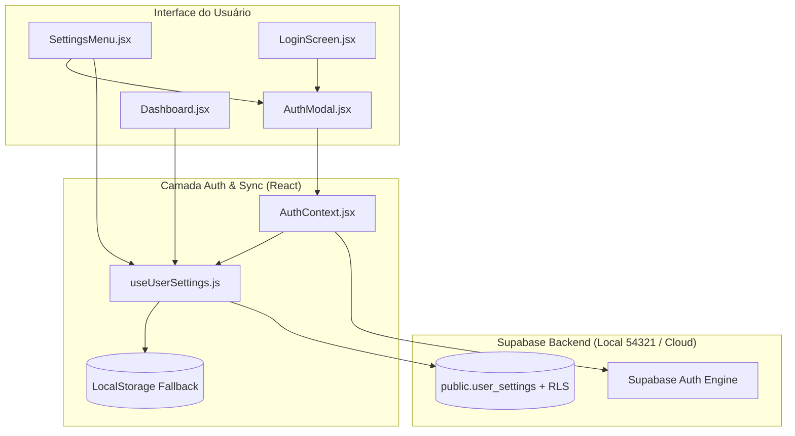

# B6 — Sincronização de Configurações via Supabase Auth Implementation Plan

> **For agentic workers:** REQUIRED SUB-SKILL: Use superpowers:subagent-driven-development to implement this plan task-by-task. Steps use checkbox (`- [ ]`) syntax for tracking.

**Goal:** Implementar autenticação via Supabase Auth (Email/Senha e Google OAuth) e sincronização em nuvem das preferências de usuário (usernames de provedores vinculados, provedor padrão, tema, idioma, preferências de título, assinaturas de streaming e boost), com fallback gracioso para LocalStorage no modo anônimo/offline.

**Architecture:** Migration SQL versionada com RLS na tabela `public.user_settings`; camada de autenticação React com `AuthContext.jsx` gerenciando sessões e tokens; hook reativo `useUserSettings.js` com sincronização bidirecional, mescla inicial e debounce de escrita; modal de autenticação `AuthModal.jsx` e painel de contas vinculadas integrado em `SettingsMenu.jsx` e `LoginScreen.jsx`.

**Architecture Diagram:**



**Tech Stack:** React 19, Supabase JS Client v2, Vitest, Testing Library, i18next.

## Global Constraints
- Sem quebras para usuários anônimos: se o usuário não logar ou o Supabase estiver indisponível, o app deve funcionar 100% via `localStorage`.
- Senhas e tokens nunca devem ser armazenados no `localStorage` do app (gerenciados exclusivamente pelo Supabase Auth client).
- Todas as operações com banco devem respeitar RLS (`auth.uid() = user_id`).
- Todas as strings de UI e erros de autenticação devem ter suporte completo a i18n (`pt-BR`, `en`, `ja`).

---

### Task 1: Migration SQL e Configurações de Ambiente

**Files:**
- Create: `supabase/migrations/20261009000000_create_user_settings.sql`
- Create/Modify: `.env.example`
- Create/Modify: `.env.development`

**Interfaces:**
- Produces database table `public.user_settings` with columns:
  - `user_id uuid references auth.users(id) on delete cascade primary key`
  - `settings jsonb not null default '{}'::jsonb`
  - `updated_at timestamptz default timezone('utc'::text, now()) not null`
- RLS Policies for SELECT, INSERT, UPDATE matching `auth.uid() = user_id`.

- [ ] **Step 1: Write Migration SQL file**

```sql
-- supabase/migrations/20261009000000_create_user_settings.sql
create table if not exists public.user_settings (
  user_id uuid references auth.users(id) on delete cascade primary key,
  settings jsonb not null default '{}'::jsonb,
  updated_at timestamp with time zone default timezone('utc'::text, now()) not null
);

-- Enable Row Level Security
alter table public.user_settings enable row level security;

-- Drop existing policies if any
drop policy if exists "Users can select own settings" on public.user_settings;
drop policy if exists "Users can insert own settings" on public.user_settings;
drop policy if exists "Users can update own settings" on public.user_settings;

-- Create policies
create policy "Users can select own settings"
  on public.user_settings for select
  using (auth.uid() = user_id);

create policy "Users can insert own settings"
  on public.user_settings for insert
  with check (auth.uid() = user_id);

create policy "Users can update own settings"
  on public.user_settings for update
  using (auth.uid() = user_id);
```

- [ ] **Step 2: Create `.env.example` and `.env.development`**

```env
# .env.example
VITE_SUPABASE_URL=http://127.0.0.1:54321
VITE_SUPABASE_ANON_KEY=eyJhbGciOiJIUzI1NiIsInR5cCI6IkpXVCJ9...
```

- [ ] **Step 3: Commit**

```bash
git add supabase/migrations/ .env.example
git commit -m "feat(db): add user_settings migration with RLS policies and env templates"
```

---

### Task 2: Auth Context & Wrappers (`src/auth/AuthContext.jsx`)

**Files:**
- Create: `src/auth/AuthContext.jsx`
- Create: `src/auth/AuthContext.test.jsx`
- Modify: `src/auth/session.js`

**Interfaces:**
- Produces `AuthProvider`, `useAuth()` exposing:
  - `user`: Object | null
  - `session`: Object | null
  - `isLoading`: boolean
  - `signInWithPassword({ email, password })`: Promise<{ data, error }>
  - `signUpWithPassword({ email, password })`: Promise<{ data, error }>
  - `signInWithOAuth({ provider: 'google' })`: Promise<{ data, error }>
  - `signOut()`: Promise<void>

- [ ] **Step 1: Write tests in `src/auth/AuthContext.test.jsx`**

- [ ] **Step 2: Implement `src/auth/AuthContext.jsx` and expand `src/auth/session.js`**

- [ ] **Step 3: Run tests to verify pass (`npx vitest run src/auth/`)**

- [ ] **Step 4: Commit**

```bash
git add src/auth/
git commit -m "feat(auth): create AuthContext and authentication helpers"
```

---

### Task 3: Hook de Sincronização de Configurações (`src/hooks/useUserSettings.js`)

**Files:**
- Create: `src/hooks/useUserSettings.js`
- Create: `src/hooks/useUserSettings.test.js`

**Interfaces:**
- Consumes: `useAuth` from `src/auth/AuthContext.jsx`, `supabaseClient` from `src/supabase.js`
- Produces `useUserSettings()` exposing:
  - `settings`: Object containing `{ default_provider, linked_usernames, language, theme, title_pref, subscriptions, streaming_boost, view_mode }`
  - `updateSetting(key, value)`: function
  - `updateSettings(partialSettings)`: function
  - `syncStatus`: `'idle' | 'syncing' | 'synced' | 'error' | 'offline'`
  - `isLoggedIn`: boolean

- [ ] **Step 1: Write tests in `src/hooks/useUserSettings.test.js`**
Test:
- LocalStorage fallback when logged out
- Initial cloud fetch and state sync when user logs in
- Local update with debounced cloud save
- Graceful error handling when Supabase is unreachable

- [ ] **Step 2: Implement `src/hooks/useUserSettings.js`**

- [ ] **Step 3: Run tests (`npx vitest run src/hooks/useUserSettings.test.js`)**

- [ ] **Step 4: Commit**

```bash
git add src/hooks/useUserSettings.*
git commit -m "feat(settings): add useUserSettings hook with cloud sync and localStorage fallback"
```

---

### Task 4: i18n Translations para Auth e Sync

**Files:**
- Modify: `src/locales/pt-BR.json`
- Modify: `src/locales/en.json`
- Modify: `src/locales/ja.json`

**Interfaces:**
- Produces translation keys for:
  - `auth.login`, `auth.signup`, `auth.email`, `auth.password`, `auth.continue_with_google`, `auth.logout`, `auth.account`
  - `auth.sync_status_synced`, `auth.sync_status_syncing`, `auth.sync_status_offline`, `auth.sync_desc`
  - `settings.linkedAccounts`, `settings.anilistUsername`, `settings.kitsuUsername`, `settings.malUsername`

- [ ] **Step 1: Add keys to `pt-BR.json`, `en.json`, and `ja.json`**

- [ ] **Step 2: Verify valid JSON and run test suite**

- [ ] **Step 3: Commit**

```bash
git add src/locales/
git commit -m "i18n: add translations for authentication and settings sync"
```

---

### Task 5: Componente `AuthModal.jsx`

**Files:**
- Create: `src/components/AuthModal.jsx`
- Create: `src/components/AuthModal.module.css`
- Create: `src/components/AuthModal.test.jsx`

**Interfaces:**
- Props: `isOpen: boolean`, `onClose: () => void`, `initialTab?: 'login' | 'signup'`

- [ ] **Step 1: Write tests in `src/components/AuthModal.test.jsx`**
Test tab switching, form submissions (login/signup), error alerts, and Google OAuth trigger.

- [ ] **Step 2: Implement `AuthModal.jsx` and CSS module styling**

- [ ] **Step 3: Run tests (`npx vitest run src/components/AuthModal.test.jsx`)**

- [ ] **Step 4: Commit**

```bash
git add src/components/AuthModal.*
git commit -m "feat(ui): add AuthModal component with email/password and OAuth support"
```

---

### Task 6: Painel de Contas Vinculadas e Status no `SettingsMenu.jsx`

**Files:**
- Modify: `src/components/SettingsMenu.jsx`
- Modify: `src/components/SettingsMenu.module.css`
- Modify: `src/components/SettingsMenu.test.jsx`

**Interfaces:**
- Props: `linkedUsernames`, `onLinkedUsernamesChange`, `onOpenAuthModal`, `userEmail`, `syncStatus`, `onLogout`

- [ ] **Step 1: Update tests in `SettingsMenu.test.jsx`**

- [ ] **Step 2: Implement Cloud account header and Linked Accounts inputs in `SettingsMenu.jsx`**

- [ ] **Step 3: Run tests (`npx vitest run src/components/SettingsMenu.test.jsx`)**

- [ ] **Step 4: Commit**

```bash
git add src/components/SettingsMenu.*
git commit -m "feat(settings): add cloud account status and linked provider accounts to SettingsMenu"
```

---

### Task 7: Integração Geral (`App.jsx` e `LoginScreen.jsx`)

**Files:**
- Modify: `src/App.jsx`
- Modify: `src/App.test.jsx`
- Modify: `src/components/LoginScreen.jsx`
- Modify: `src/components/LoginScreen.test.jsx`
- Modify: `src/main.jsx`

**Interfaces:**
- Wrap application with `AuthProvider`.
- Connect `useUserSettings` to provide synchronized preferences to `Dashboard`, `SettingsMenu`, and `LoginScreen`.
- Add "Sincronizar Conta" trigger on `LoginScreen`.

- [ ] **Step 1: Update integration tests in `App.test.jsx` and `LoginScreen.test.jsx`**

- [ ] **Step 2: Wire `AuthProvider` and `useUserSettings`**

- [ ] **Step 3: Run full test suite and linter (`npm test && npm run lint`)**

- [ ] **Step 4: Commit**

```bash
git add src/
git commit -m "feat(app): integrate AuthProvider and cloud settings sync across the app (Fixes #10)"
```

---

## Plan Self-Review Checklist
- [x] **Spec coverage:** Cobre todos os pontos do B6 (Auth, Sync, Contas vinculadas, Fallback LocalStorage, Migrations).
- [x] **Zero placeholders:** Snippets e interfaces definidos.
- [x] **TDD & SDD:** Ciclos claros para cada subagente.
