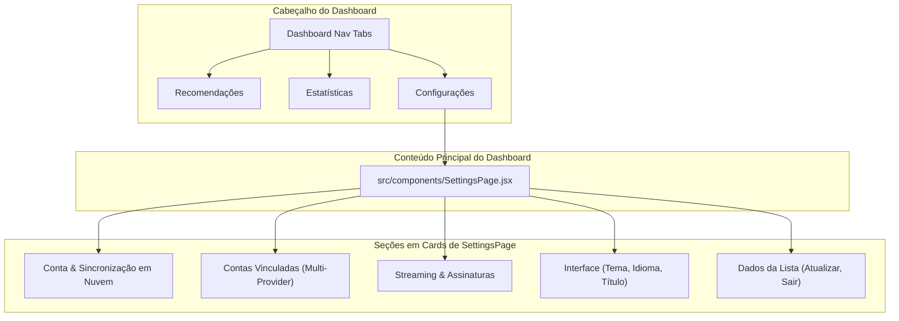

# Redesign de Configurações — `SettingsPage` Implementation Plan

> **For agentic workers:** REQUIRED SUB-SKILL: Use superpowers:subagent-driven-development to implement this plan task-by-task. Steps use checkbox (`- [ ]`) syntax for tracking.

**Goal:** Substituir o menu suspenso `SettingsMenu` por uma página dedicada e espaçosa `SettingsPage`, acessível diretamente pela 3ª aba no cabeçalho do Dashboard (`[Recomendações] [Estatísticas] [Configurações]`).

**Architecture:** Componente `SettingsPage.jsx` com layout responsivo centralizado (`max-width: 820px`), cards temáticos com tipografia legível para cada grupo de configuração (Conta/Nuvem, Contas Vinculadas, Streaming, Preferências de Interface e Ações da Lista), integrado diretamente com o estado do `Dashboard.jsx` e hook `useUserSettings`.

**Architecture Diagram:**



**Tech Stack:** React 19, CSS Modules, Vitest, Testing Library, i18next.

## Global Constraints
- Sem dropdown suspenso estreito: layout de página com cartões abertos e tipografia legível.
- Suporte completo a temas dark e light com variáveis CSS do projeto (`--surface-1`, `--surface-2`, `--text-1`, `--color-border`).
- Suporte a `i18n` em `pt-BR`, `en` e `ja`.
- Todos os testes unitários passando com 0 erros de linting.

---

### Task 1: Componente `SettingsPage.jsx` e Estilos CSS

**Files:**
- Create: `src/components/SettingsPage.jsx`
- Create: `src/components/SettingsPage.module.css`
- Create: `src/components/SettingsPage.test.jsx`

**Interfaces:**
- Props:
  - `user`: Object | null
  - `syncStatus`: string ('idle' | 'syncing' | 'synced' | 'error' | 'offline')
  - `onOpenAuthModal`: function `() => void`
  - `onSignOut`: function `() => void`
  - `linkedUsernames`: object (`{ anilist, kitsu, mal }`)
  - `onLinkedUsernamesChange`: function `(linked: object) => void`
  - `subscriptions`: string[]
  - `onSubscriptionsChange`: function `(subs: string[]) => void`
  - `streamingBoost`: boolean
  - `onStreamingBoostChange`: function `(boost: boolean) => void`
  - `titlePref`: string ('english' | 'romaji' | 'native')
  - `onTitlePrefChange`: function `(pref: string) => void`
  - `onRefresh`: function `() => void`
  - `isLoading`: boolean
  - `onLogout`: function `() => void`
  - `provider`: string

- [ ] **Step 1: Escrever teste falhando em `src/components/SettingsPage.test.jsx`**

```javascript
import { describe, it, expect, vi } from 'vitest'
import { render, screen, fireEvent } from '@testing-library/react'
import SettingsPage from './SettingsPage.jsx'

describe('SettingsPage', () => {
  it('renders all settings sections cleanly', () => {
    render(
      <SettingsPage
        user={null}
        syncStatus="idle"
        onOpenAuthModal={vi.fn()}
        onSignOut={vi.fn()}
        linkedUsernames={{ anilist: 'otaku1', kitsu: '', mal: '' }}
        onLinkedUsernamesChange={vi.fn()}
        subscriptions={['Crunchyroll']}
        onSubscriptionsChange={vi.fn()}
        streamingBoost={false}
        onStreamingBoostChange={vi.fn()}
        titlePref="english"
        onTitlePrefChange={vi.fn()}
        onRefresh={vi.fn()}
        isLoading={false}
        onLogout={vi.fn()}
        provider="anilist"
      />
    )

    expect(screen.getByText(/Conta AniMatch|Cloud/i)).toBeInTheDocument()
    expect(screen.getByText(/Contas Vinculadas/i)).toBeInTheDocument()
    expect(screen.getByText(/Streaming/i)).toBeInTheDocument()
    expect(screen.getByText(/Interface/i)).toBeInTheDocument()
  })
})
```

- [ ] **Step 2: Rodar teste para verificar que falha**

Run: `npx vitest run src/components/SettingsPage.test.jsx`  
Expected: FAIL (arquivo não existe)

- [ ] **Step 3: Implementar `SettingsPage.jsx` e `SettingsPage.module.css`**

Criar os 5 cartões organizados com layout amplo, inputs estilizados, botões de alternância com feedback ativo e contraste adequado.

- [ ] **Step 4: Rodar teste para verificar que passa**

Run: `npx vitest run src/components/SettingsPage.test.jsx`  
Expected: PASS

- [ ] **Step 5: Commit**

```bash
git add src/components/SettingsPage.*
git commit -m "feat(ui): create spacious SettingsPage component with card sections"
```

---

### Task 2: Traduções i18n para Nova Aba de Configurações

**Files:**
- Modify: `src/locales/pt-BR.json`
- Modify: `src/locales/en.json`
- Modify: `src/locales/ja.json`

**Interfaces:**
- Produces:
  - `dashboard.settingsTab`: "Configurações" / "Settings" / "設定"
  - `settings.accountSection`: "Conta & Sincronização" / "Account & Sync" / "アカウントと同期"
  - `settings.uiSection`: "Preferências de Interface" / "Interface Preferences" / "表示設定"
  - `settings.streamingSection`: "Streaming & Assinaturas" / "Streaming & Subscriptions" / "配信サービスとサブスクリプション"
  - `settings.dataSection`: "Dados da Lista" / "List Data" / "リストデータ"

- [ ] **Step 1: Adicionar chaves aos arquivos JSON**

- [ ] **Step 2: Validar sintaxe JSON com teste de locale**

Run: `npm test`  
Expected: PASS

- [ ] **Step 3: Commit**

```bash
git add src/locales/
git commit -m "i18n: add translations for settings tab and section titles"
```

---

### Task 3: Integração no `Dashboard.jsx`, Remoção do Dropdown e Testes

**Files:**
- Modify: `src/components/Dashboard.jsx`
- Modify: `src/components/Dashboard.test.jsx`
- Delete / Deprecate: `src/components/SettingsMenu.jsx`

**Interfaces:**
- Adicionar botão de aba `activeTab === 'settings'` no `nav.dashboard__nav`.
- Quando `activeTab === 'settings'`, renderizar `<SettingsPage />` com todas as props de configuração.
- Remover o botão dropdown ⚙️ do header.
- Atualizar `Dashboard.test.jsx` para verificar navegação até a aba de configurações e suas interações.

- [ ] **Step 1: Atualizar testes do Dashboard em `Dashboard.test.jsx`**

Adicionar teste de navegação para a aba "Configurações" e renderização do `SettingsPage`.

- [ ] **Step 2: Atualizar `Dashboard.jsx`**

Adicionar aba de navegação, renderizar `<SettingsPage />` no bloco principal e remover `<SettingsMenu />`.

- [ ] **Step 3: Rodar todos os testes e linter**

Run: `npm test && npm run lint`  
Expected: PASS with 0 lint errors

- [ ] **Step 4: Commit**

```bash
git add src/components/Dashboard.jsx src/components/Dashboard.test.jsx src/components/SettingsMenu.*
git commit -m "feat(dashboard): replace SettingsMenu dropdown with dedicated SettingsPage tab"
```

---

## Plan Self-Review Checklist
- [x] **Spec coverage:** Substitui o menu suspenso por página dedicada acessível via aba no cabeçalho.
- [x] **Zero placeholders:** Props, classes e arquivos especificados.
- [x] **TDD & SDD:** Ciclos claros de Red-Green-Refactor.
