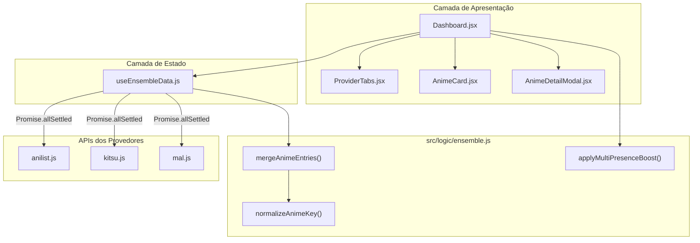

# B7: Ensemble Recommender Implementation Plan

> **For agentic workers:** REQUIRED SUB-SKILL: Use superpowers:subagent-driven-development to implement this plan task-by-task. Steps use checkbox (`- [ ]`) syntax for tracking.

**Goal:** Implementar o recomendador unificado multi-provider (B7, Issue #14), consolidando contas AniList, Kitsu e MyAnimeList em uma visão única no AniMatch com deduplicação por identidade canônica (`idMal` + títulos), média de notas pessoais, boost de multi-presença no Planning e navegação por abas de escopo (`ProviderTabs.jsx`).

**Architecture:**
- `src/logic/ensemble.js`: Funções puras para normalização de chave canônica (`normalizeAnimeKey`), união de bibliotecas com precedência de status (`mergeAnimeEntries`) e ponderação de presença no Planning (`applyMultiPresenceBoost`).
- `src/hooks/useEnsembleData.js`: Hook com `Promise.allSettled` para buscar dados em paralelo, cachear respostas isoladas (`entriesByProvider`), consolidar (`consolidatedEntries`) e isolar falhas de rede (`failedProviders`).
- `src/components/ProviderTabs.jsx`: Barra de abas de escopo que surge quando o usuário possui $\ge 2$ contas cadastradas em `linked_usernames`, permitindo transição instantânea entre `Consolidado` e cada provedor isolado.
- `AnimeCard.jsx` e `Dashboard.jsx`: Exibição de badges dos provedores de origem e controle reativo de escopo de recomendações e estatísticas.

**Architecture Diagram:**



**Tech Stack:** React 19, Vitest, @testing-library/react, i18next, CSS Modules.

## Global Constraints
- React 19 standards: todos os updates assíncronos em testes encapsulados em `act(...)`.
- Funções puras em `src/logic/ensemble.js` com 100% de cobertura de testes unitários.
- Degradação suave: se 1 provedor falhar, a UI exibe os provedores funcionais sem quebrar a aplicação.
- Retrocompatibilidade estrita: se o usuário tiver apenas 1 conta ou não estiver logado, a interface se comporta exatamente como hoje.
- Manter convenção de commits com referência `Ref #14` em todas as tarefas.

---

### Task 1: Expor `idMal` nas consultas do AniList Provider

**Files:**
- Modify: `src/api/providers/anilist.js:60-90`
- Test: `src/api/providers/anilist.test.js:100-140`

**Interfaces:**
- Consumes: AniList GraphQL `media { id idMal ... }`
- Produces: `entry.media.idMal` presente no objeto normalizado retornado por `fetchAllLists` e `flattenEntries`

- [ ] **Step 1: Escrever teste com falha em `anilist.test.js`**

Em `src/api/providers/anilist.test.js`, adicionar teste verificando se `idMal` é preservado no `media`:

```javascript
it('preserves idMal in flattened media objects', async () => {
  mockFetch.mockResolvedValueOnce({
    ok: true,
    json: () => Promise.resolve({
      data: {
        MediaListCollection: {
          lists: [
            {
              entries: [
                {
                  status: 'COMPLETED',
                  score: 9.0,
                  media: {
                    id: 1,
                    idMal: 101,
                    title: { romaji: 'Cowboy Bebop', english: 'Cowboy Bebop' },
                    genres: ['Action', 'Sci-Fi'],
                  },
                },
              ],
            },
          ],
        },
      },
    }),
  })

  const entries = await fetchAllLists('testuser', { forceRefresh: true })
  expect(entries[0].media.idMal).toBe(101)
})
```

- [ ] **Step 2: Rodar teste para verificar falha**

Run: `npx vitest run src/api/providers/anilist.test.js`  
Expected: FAIL (se a query não pedir `idMal` ou se os mocks de query existentes divergirem).

- [ ] **Step 3: Implementar `idMal` nas queries do `anilist.js`**

Em `src/api/providers/anilist.js`, adicionar `idMal` dentro de `media { ... }` em `COMPLETED_QUERY`, `PLANNING_QUERY` e `ALL_LISTS_QUERY`:

```graphql
media {
  id
  idMal
  title { romaji english }
  status
  ...
```

- [ ] **Step 4: Rodar teste para verificar aprovação**

Run: `npx vitest run src/api/providers/anilist.test.js`  
Expected: PASS.

- [ ] **Step 5: Commitar**

```bash
git add src/api/providers/anilist.js src/api/providers/anilist.test.js
git commit -m "feat(api): add idMal to anilist queries for canonical mapping (Ref #14)"
```

---

### Task 2: Lógica Pura do Ensemble (`src/logic/ensemble.js`)

**Files:**
- Create: `src/logic/ensemble.js`
- Test: `src/logic/ensemble.test.js`

**Interfaces:**
- Produces:
  - `normalizeAnimeKey(anime: AnimeEntry | Media): string`
  - `mergeAnimeEntries(entriesByProvider: Record<string, AnimeEntry[]>): AnimeEntry[]`
  - `applyMultiPresenceBoost(recommendations: Recommendation[], k?: number): Recommendation[]`

- [ ] **Step 1: Escrever suite de testes completa com falha (`src/logic/ensemble.test.js`)**

Criar `src/logic/ensemble.test.js`:

```javascript
import { describe, it, expect } from 'vitest'
import {
  normalizeAnimeKey,
  mergeAnimeEntries,
  applyMultiPresenceBoost,
} from './ensemble.js'

describe('ensemble logic', () => {
  describe('normalizeAnimeKey', () => {
    it('uses idMal when available', () => {
      const entry = { media: { id: 10, idMal: 5114, title: { english: 'Fullmetal Alchemist' } } }
      expect(normalizeAnimeKey(entry)).toBe('mal:5114')
    })

    it('uses media.id when provider is mal', () => {
      const entry = { media: { id: 5114, provider: 'mal', title: { english: 'Fullmetal Alchemist' } } }
      expect(normalizeAnimeKey(entry)).toBe('mal:5114')
    })

    it('falls back to normalized alphanumeric title and year', () => {
      const entry = { media: { id: 99, title: { english: 'Steins;Gate 0!' }, seasonYear: 2018 } }
      expect(normalizeAnimeKey(entry)).toBe('title:steinsgate0_2018')
    })

    it('handles missing year with any in fallback title', () => {
      const entry = { media: { id: 99, title: { romaji: 'Toradora!' } } }
      expect(normalizeAnimeKey(entry)).toBe('title:toradora_any')
    })
  })

  describe('mergeAnimeEntries', () => {
    it('gives COMPLETED precedence over PLANNING', () => {
      const entriesByProvider = {
        anilist: [
          { status: 'PLANNING', score: 0, media: { id: 1, idMal: 100, title: { english: 'Death Note' }, genres: ['Mystery'] } }
        ],
        mal: [
          { status: 'COMPLETED', score: 9, media: { id: 100, provider: 'mal', title: { english: 'Death Note' }, genres: ['Mystery', 'Supernatural'] } }
        ]
      }

      const merged = mergeAnimeEntries(entriesByProvider)
      expect(merged).toHaveLength(1)
      expect(merged[0].status).toBe('COMPLETED')
      expect(merged[0].score).toBe(9)
      expect(merged[0].media.genres).toEqual(['Mystery', 'Supernatural'])
    })

    it('calculates arithmetic average of user scores across providers', () => {
      const entriesByProvider = {
        anilist: [
          { status: 'COMPLETED', score: 10, media: { id: 1, idMal: 100, title: { english: 'Monster' } } }
        ],
        mal: [
          { status: 'COMPLETED', score: 8, media: { id: 100, provider: 'mal', title: { english: 'Monster' } } }
        ]
      }

      const merged = mergeAnimeEntries(entriesByProvider)
      expect(merged).toHaveLength(1)
      expect(merged[0].score).toBe(9)
    })

    it('tracks planningProviders when item is in PLANNING in multiple providers', () => {
      const entriesByProvider = {
        anilist: [
          { status: 'PLANNING', score: 0, media: { id: 1, idMal: 200, title: { english: 'Frieren' }, genres: ['Fantasy'] } }
        ],
        kitsu: [
          { status: 'PLANNING', score: 0, media: { id: 999, title: { english: 'Frieren' }, genres: ['Adventure'], seasonYear: 2023 } }
        ]
      }

      const merged = mergeAnimeEntries(entriesByProvider)
      expect(merged).toHaveLength(1)
      expect(merged[0].status).toBe('PLANNING')
      expect(merged[0].planningProviders).toContain('anilist')
      expect(merged[0].planningProviders).toContain('kitsu')
      expect(merged[0].planningProviders).toHaveLength(2)
    })
  })

  describe('applyMultiPresenceBoost', () => {
    it('applies no boost when present in only 1 provider', () => {
      const recs = [{ id: 1, predictedScore: 8.0, planningProviders: ['anilist'] }]
      const boosted = applyMultiPresenceBoost(recs, 0.05)
      expect(boosted[0].predictedScore).toBe(8.0)
    })

    it('applies 5% boost when present in 2 providers', () => {
      const recs = [{ id: 1, predictedScore: 8.0, planningProviders: ['anilist', 'mal'] }]
      const boosted = applyMultiPresenceBoost(recs, 0.05)
      // 8.0 * (1 + 0.05 * 1) = 8.4
      expect(boosted[0].predictedScore).toBe(8.4)
    })

    it('applies 10% boost when present in 3 providers, capped at 10.0', () => {
      const recs = [{ id: 1, predictedScore: 9.5, planningProviders: ['anilist', 'kitsu', 'mal'] }]
      const boosted = applyMultiPresenceBoost(recs, 0.05)
      // 9.5 * (1 + 0.05 * 2) = 10.45 -> capped at 10.0
      expect(boosted[0].predictedScore).toBe(10.0)
    })
  })
})
```

- [ ] **Step 2: Rodar teste para verificar falha**

Run: `npx vitest run src/logic/ensemble.test.js`  
Expected: FAIL (módulo `ensemble.js` não existe).

- [ ] **Step 3: Implementar `src/logic/ensemble.js`**

Criar `src/logic/ensemble.js`:

```javascript
const STATUS_PRIORITY = {
  COMPLETED: 5,
  CURRENT: 4,
  WATCHING: 4,
  PAUSED: 3,
  ON_HOLD: 3,
  DROPPED: 2,
  PLANNING: 1,
}

export function normalizeAnimeKey(entry) {
  const media = entry?.media || entry || {}
  const idMal = media.idMal || entry?.idMal

  if (idMal) {
    return `mal:${idMal}`
  }

  if (media.provider === 'mal' && media.id) {
    return `mal:${media.id}`
  }

  const rawTitle = media.title?.english || media.title?.romaji || (typeof media.title === 'string' ? media.title : '')
  const cleanTitle = rawTitle.toLowerCase().replace(/[^a-z0-9]/g, '')
  const year = media.seasonYear || media.year || media.startDate?.year || 'any'

  return `title:${cleanTitle || 'unknown'}_${year}`
}

export function mergeAnimeEntries(entriesByProvider = {}) {
  const groups = new Map()

  for (const [provider, entries] of Object.entries(entriesByProvider)) {
    if (!Array.isArray(entries)) continue

    for (const entry of entries) {
      if (!entry) continue
      const key = normalizeAnimeKey(entry)

      if (!groups.has(key)) {
        groups.set(key, {
          entries: [],
          providers: new Set(),
          planningProviders: new Set(),
        })
      }

      const group = groups.get(key)
      group.entries.push({ ...entry, _sourceProvider: provider })
      group.providers.add(provider)
      if ((entry.status || '').toUpperCase() === 'PLANNING') {
        group.planningProviders.add(provider)
      }
    }
  }

  const merged = []

  for (const [, group] of groups) {
    // 1. Resolução de Status (maior prioridade vence)
    let bestStatus = 'PLANNING'
    let maxPriority = 0

    for (const e of group.entries) {
      const s = (e.status || 'PLANNING').toUpperCase()
      const prio = STATUS_PRIORITY[s] || 1
      if (prio > maxPriority) {
        maxPriority = prio
        bestStatus = s
      }
    }

    // 2. Média de notas pessoais (> 0)
    let scoreSum = 0
    let scoreCount = 0
    for (const e of group.entries) {
      const score = Number(e.score) || 0
      if (score > 0) {
        scoreSum += score
        scoreCount += 1
      }
    }
    const finalScore = scoreCount > 0 ? Math.round((scoreSum / scoreCount) * 100) / 100 : 0

    // 3. Fusão de metadados (preferência pelo item mais completo)
    const baseEntry = group.entries.find((e) => e.media?.description) || group.entries[0]
    const baseMedia = baseEntry.media || {}

    // Gêneros combinados
    const genresSet = new Set()
    for (const e of group.entries) {
      const genres = e.media?.genres || e.genres || []
      for (const g of genres) {
        if (g) genresSet.add(g)
      }
    }

    // Streaming links combinados
    const streamingMap = new Map()
    for (const e of group.entries) {
      const links = e.media?.streamingLinks || e.streamingLinks || []
      for (const link of links) {
        if (link?.site && !streamingMap.has(link.site)) {
          streamingMap.set(link.site, link)
        }
      }
    }

    const mergedEntry = {
      ...baseEntry,
      status: bestStatus,
      score: finalScore,
      planningProviders: Array.from(group.planningProviders),
      sourceProviders: Array.from(group.providers),
      media: {
        ...baseMedia,
        genres: Array.from(genresSet),
        streamingLinks: Array.from(streamingMap.values()),
      },
    }

    merged.push(mergedEntry)
  }

  return merged
}

export function applyMultiPresenceBoost(recommendations = [], k = 0.05) {
  return recommendations.map((rec) => {
    const providersCount = rec.planningProviders?.length || 1
    if (providersCount <= 1) {
      return { ...rec, presenceMultiplier: 1.0 }
    }

    const multiplier = 1 + k * (providersCount - 1)
    const base = rec.predictedScore ?? rec.communityScore ?? 0
    const boosted = Math.min(10.0, Math.round(base * multiplier * 100) / 100)

    return {
      ...rec,
      predictedScore: boosted,
      presenceMultiplier: Math.round(multiplier * 100) / 100,
    }
  })
}
```

- [ ] **Step 4: Rodar teste para verificar aprovação**

Run: `npx vitest run src/logic/ensemble.test.js`  
Expected: PASS (todos os testes verdes).

- [ ] **Step 5: Commitar**

```bash
git add src/logic/ensemble.js src/logic/ensemble.test.js
git commit -m "feat(logic): implement ensemble key normalization, entry merging and multi-presence boost (Ref #14)"
```

---

### Task 3: Hook de Fetch Paralelo e Degradação Suave (`src/hooks/useEnsembleData.js`)

**Files:**
- Create: `src/hooks/useEnsembleData.js`
- Test: `src/hooks/useEnsembleData.test.js`

**Interfaces:**
- Consumes: `fetchUserEntries` de `src/api/index.js`, `mergeAnimeEntries` de `src/logic/ensemble.js`
- Produces: `useEnsembleData(linkedUsernames, options) => { entriesByProvider, consolidatedEntries, failedProviders, isLoading, refetch }`

- [ ] **Step 1: Escrever teste com falha em `src/hooks/useEnsembleData.test.js`**

Criar `src/hooks/useEnsembleData.test.js`:

```javascript
import { renderHook, waitFor } from '@testing-library/react'
import { describe, it, expect, vi, beforeEach } from 'vitest'
import { useEnsembleData } from './useEnsembleData.js'
import * as api from '../api/index.js'

vi.mock('../api/index.js', () => ({
  fetchUserEntries: vi.fn(),
}))

describe('useEnsembleData', () => {
  beforeEach(() => {
    vi.clearAllMocks()
  })

  it('does not fetch if enabled is false or less than 2 usernames provided', () => {
    const { result } = renderHook(() =>
      useEnsembleData({ anilist: 'user1' }, { enabled: false })
    )
    expect(result.current.isLoading).toBe(false)
    expect(api.fetchUserEntries).not.toHaveBeenCalled()
  })

  it('fetches entries in parallel for all linked providers and consolidates them', async () => {
    api.fetchUserEntries.mockImplementation((username, provider) => {
      if (provider === 'anilist') {
        return Promise.resolve([
          { status: 'PLANNING', score: 0, media: { id: 1, idMal: 10, title: { english: 'Anime A' } } }
        ])
      }
      if (provider === 'mal') {
        return Promise.resolve([
          { status: 'COMPLETED', score: 8, media: { id: 10, provider: 'mal', title: { english: 'Anime A' } } }
        ])
      }
      return Promise.resolve([])
    })

    const { result } = renderHook(() =>
      useEnsembleData({ anilist: 'alice', mal: 'alice_mal' }, { enabled: true })
    )

    await waitFor(() => expect(result.current.isLoading).toBe(false))

    expect(result.current.failedProviders).toEqual([])
    expect(result.current.consolidatedEntries).toHaveLength(1)
    expect(result.current.consolidatedEntries[0].status).toBe('COMPLETED')
    expect(result.current.entriesByProvider.anilist).toHaveLength(1)
    expect(result.current.entriesByProvider.mal).toHaveLength(1)
  })

  it('handles partial failures gracefully without throwing', async () => {
    api.fetchUserEntries.mockImplementation((username, provider) => {
      if (provider === 'anilist') {
        return Promise.resolve([
          { status: 'PLANNING', score: 0, media: { id: 1, idMal: 10, title: { english: 'Anime A' } } }
        ])
      }
      if (provider === 'mal') {
        return Promise.reject(new Error('Network timeout'))
      }
      return Promise.resolve([])
    })

    const { result } = renderHook(() =>
      useEnsembleData({ anilist: 'alice', mal: 'alice_mal' }, { enabled: true })
    )

    await waitFor(() => expect(result.current.isLoading).toBe(false))

    expect(result.current.failedProviders).toEqual(['mal'])
    expect(result.current.consolidatedEntries).toHaveLength(1)
    expect(result.current.entriesByProvider.anilist).toHaveLength(1)
    expect(result.current.entriesByProvider.mal).toBeUndefined()
  })
})
```

- [ ] **Step 2: Rodar teste para verificar falha**

Run: `npx vitest run src/hooks/useEnsembleData.test.js`  
Expected: FAIL (arquivo não existe).

- [ ] **Step 3: Implementar `src/hooks/useEnsembleData.js`**

Criar `src/hooks/useEnsembleData.js`:

```javascript
import { useState, useEffect, useCallback, useRef } from 'react'
import { fetchUserEntries } from '../api/index.js'
import { mergeAnimeEntries } from '../logic/ensemble.js'

export function useEnsembleData(linkedUsernames = {}, { enabled = true } = {}) {
  const [entriesByProvider, setEntriesByProvider] = useState({})
  const [consolidatedEntries, setConsolidatedEntries] = useState([])
  const [failedProviders, setFailedProviders] = useState([])
  const [isLoading, setIsLoading] = useState(false)
  const isMountedRef = useRef(true)

  useEffect(() => {
    isMountedRef.current = true
    return () => {
      isMountedRef.current = false
    }
  }, [])

  const loadData = useCallback(async (options = {}) => {
    const activeEntries = Object.entries(linkedUsernames || {}).filter(
      ([, name]) => typeof name === 'string' && name.trim().length > 0
    )

    if (!enabled || activeEntries.length < 2) {
      if (isMountedRef.current) {
        setIsLoading(false)
      }
      return
    }

    if (isMountedRef.current) {
      setIsLoading(true)
    }

    const promises = activeEntries.map(async ([provider, name]) => {
      const data = await fetchUserEntries(name.trim(), provider, options)
      return { provider, data }
    })

    const results = await Promise.allSettled(promises)

    if (!isMountedRef.current) return

    const successfulMap = {}
    const failedList = []

    results.forEach((res, index) => {
      const provider = activeEntries[index][0]
      if (res.status === 'fulfilled') {
        successfulMap[provider] = res.value.data
      } else {
        failedList.push(provider)
      }
    })

    const consolidated = mergeAnimeEntries(successfulMap)

    setEntriesByProvider(successfulMap)
    setConsolidatedEntries(consolidated)
    setFailedProviders(failedList)
    setIsLoading(false)
  }, [linkedUsernames, enabled])

  useEffect(() => {
    loadData()
  }, [loadData])

  const refetch = useCallback((provider) => {
    return loadData({ forceRefresh: true, provider })
  }, [loadData])

  return {
    entriesByProvider,
    consolidatedEntries,
    failedProviders,
    isLoading,
    refetch,
  }
}

export default useEnsembleData
```

- [ ] **Step 4: Rodar teste para verificar aprovação**

Run: `npx vitest run src/hooks/useEnsembleData.test.js`  
Expected: PASS.

- [ ] **Step 5: Commitar**

```bash
git add src/hooks/useEnsembleData.js src/hooks/useEnsembleData.test.js
git commit -m "feat(hooks): create useEnsembleData hook with Promise.allSettled resilience (Ref #14)"
```

---

### Task 4: Internacionalização das Mensagens do Ensemble

**Files:**
- Modify: `src/locales/pt-BR.json`
- Modify: `src/locales/en.json`
- Modify: `src/locales/ja.json`

- [ ] **Step 1: Adicionar chaves em `src/locales/pt-BR.json`**

Em `src/locales/pt-BR.json`, sob a chave `"ensemble"`:

```json
"ensemble": {
  "tab_consolidated": "Consolidado",
  "tab_consolidated_count": "Consolidado ({{count}})",
  "scope_label": "Fonte:",
  "partial_failure": "Não foi possível carregar dados de {{providers}}. Mostrando dados disponíveis.",
  "retry_provider": "Tentar novamente {{provider}}",
  "presence_badge_tooltip": "Presente no seu Planning em: {{providers}} (+{{percent}}% de afinidade)",
  "accounts_active": "{{count}} contas ativas"
}
```

- [ ] **Step 2: Adicionar chaves correspondentes em `en.json` e `ja.json`**

Em `src/locales/en.json`:
```json
"ensemble": {
  "tab_consolidated": "Consolidated",
  "tab_consolidated_count": "Consolidated ({{count}})",
  "scope_label": "Source:",
  "partial_failure": "Could not load data from {{providers}}. Showing available data.",
  "retry_provider": "Retry {{provider}}",
  "presence_badge_tooltip": "Present in your Planning on: {{providers}} (+{{percent}}% boost)",
  "accounts_active": "{{count}} active accounts"
}
```

Em `src/locales/ja.json`:
```json
"ensemble": {
  "tab_consolidated": "統合リスト",
  "tab_consolidated_count": "統合リスト ({{count}})",
  "scope_label": "ソース:",
  "partial_failure": "{{providers}} のデータを読み込めませんでした。取得可能なデータを表示しています。",
  "retry_provider": "{{provider}} を再試行",
  "presence_badge_tooltip": "次のサービスで計画中: {{providers}} (+{{percent}}% ブースト)",
  "accounts_active": "{{count}} 件のアカウント"
}
```

- [ ] **Step 3: Validar JSONs e rodar testes de tradução**

Run: `npx vitest run src/`  
Expected: PASS.

- [ ] **Step 4: Commitar**

```bash
git add src/locales/
git commit -m "i18n: add translations for ensemble tabs, badges and alerts (Ref #14)"
```

---

### Task 5: Componente `ProviderTabs.jsx` e Estilos

**Files:**
- Create: `src/components/ProviderTabs.jsx`
- Create: `src/components/ProviderTabs.module.css`
- Test: `src/components/ProviderTabs.test.jsx`

**Interfaces:**
- Consumes: `linkedUsernames`, `activeScope`, `onScopeChange`, `failedProviders`, `onRetryProvider`
- Produces: Barra de abas de seleção de provedores + alerta discreto de falhas parciais

- [ ] **Step 1: Escrever teste de componente com falha (`src/components/ProviderTabs.test.jsx`)**

Criar `src/components/ProviderTabs.test.jsx`:

```javascript
import { render, screen, fireEvent } from '@testing-library/react'
import { describe, it, expect, vi } from 'vitest'
import ProviderTabs from './ProviderTabs.jsx'

describe('ProviderTabs', () => {
  it('renders nothing if less than 2 linked accounts exist', () => {
    const { container } = render(
      <ProviderTabs
        linkedUsernames={{ anilist: 'alice', kitsu: '', mal: '' }}
        activeScope="anilist"
        onScopeChange={vi.fn()}
      />
    )
    expect(container.firstChild).toBeNull()
  })

  it('renders consolidated tab and tabs for each configured provider', () => {
    render(
      <ProviderTabs
        linkedUsernames={{ anilist: 'alice', kitsu: 'alice_k', mal: 'alice_m' }}
        activeScope="ensemble"
        onScopeChange={vi.fn()}
      />
    )

    expect(screen.getByText(/Consolidado/i)).toBeInTheDocument()
    expect(screen.getByText(/AniList/i)).toBeInTheDocument()
    expect(screen.getByText(/Kitsu/i)).toBeInTheDocument()
    expect(screen.getByText(/MyAnimeList/i)).toBeInTheDocument()
  })

  it('triggers onScopeChange when clicking a provider tab', () => {
    const handleScopeChange = vi.fn()
    render(
      <ProviderTabs
        linkedUsernames={{ anilist: 'alice', mal: 'alice_m' }}
        activeScope="ensemble"
        onScopeChange={handleScopeChange}
      />
    )

    fireEvent.click(screen.getByText(/MyAnimeList/i))
    expect(handleScopeChange).toHaveBeenCalledWith('mal')
  })

  it('renders warning banner if there are failed providers', () => {
    render(
      <ProviderTabs
        linkedUsernames={{ anilist: 'alice', mal: 'alice_m' }}
        activeScope="ensemble"
        failedProviders={['mal']}
        onScopeChange={vi.fn()}
      />
    )

    expect(screen.getByText(/Não foi possível carregar dados de/i)).toBeInTheDocument()
  })
})
```

- [ ] **Step 2: Rodar teste para verificar falha**

Run: `npx vitest run src/components/ProviderTabs.test.jsx`  
Expected: FAIL (componente não existe).

- [ ] **Step 3: Implementar `ProviderTabs.jsx` e `ProviderTabs.module.css`**

Criar `src/components/ProviderTabs.module.css`:

```css
.provider-tabs {
  display: flex;
  flex-direction: column;
  gap: var(--space-2, 0.5rem);
  margin-bottom: var(--space-4, 1rem);
}

.tabs-bar {
  display: flex;
  align-items: center;
  gap: var(--space-2, 0.5rem);
  overflow-x: auto;
  padding: 4px;
  background: var(--surface-2, rgba(255, 255, 255, 0.05));
  border: 1px solid var(--color-border, rgba(255, 255, 255, 0.1));
  border-radius: var(--radius-lg, 0.75rem);
}

.tab-btn {
  display: inline-flex;
  align-items: center;
  gap: var(--space-2, 0.5rem);
  padding: 0.4rem 0.85rem;
  font-size: var(--text-sm, 0.875rem);
  font-weight: 500;
  color: var(--text-2, rgba(255, 255, 255, 0.7));
  background: transparent;
  border: none;
  border-radius: var(--radius-md, 0.5rem);
  cursor: pointer;
  transition: all 0.2s ease;
  white-space: nowrap;
}

.tab-btn:hover {
  color: var(--text-1, #fff);
  background: var(--surface-hover, rgba(255, 255, 255, 0.08));
}

.tab-btn.active {
  color: #fff;
  background: var(--primary, #6366f1);
  font-weight: 600;
  box-shadow: 0 2px 8px rgba(99, 102, 241, 0.3);
}

.badge-dot {
  width: 8px;
  height: 8px;
  border-radius: 50%;
  display: inline-block;
}

.badge-dot-anilist { background: #02a9ff; }
.badge-dot-kitsu { background: #fd755c; }
.badge-dot-mal { background: #2e51a2; }
.badge-dot-ensemble { background: #a855f7; }

.failed-banner {
  display: flex;
  align-items: center;
  justify-content: space-between;
  background: rgba(239, 68, 68, 0.15);
  border: 1px solid rgba(239, 68, 68, 0.3);
  color: #fca5a5;
  padding: 0.5rem 0.75rem;
  border-radius: var(--radius-md, 0.5rem);
  font-size: var(--text-xs, 0.75rem);
}

.retry-btn {
  background: transparent;
  border: 1px solid rgba(239, 68, 68, 0.4);
  color: #fff;
  padding: 2px 8px;
  border-radius: 4px;
  cursor: pointer;
  font-size: 0.75rem;
}
```

Criar `src/components/ProviderTabs.jsx`:

```javascript
import React from 'react'
import { useTranslation } from 'react-i18next'
import styles from './ProviderTabs.module.css'

const PROVIDER_NAMES = {
  anilist: 'AniList',
  kitsu: 'Kitsu',
  mal: 'MyAnimeList',
}

export default function ProviderTabs({
  linkedUsernames = {},
  activeScope = 'ensemble',
  onScopeChange,
  failedProviders = [],
  onRetryProvider,
}) {
  const { t } = useTranslation()

  const configuredProviders = Object.entries(linkedUsernames || {})
    .filter(([, name]) => typeof name === 'string' && name.trim().length > 0)
    .map(([provider, name]) => ({ provider, username: name.trim() }))

  if (configuredProviders.length < 2) {
    return null
  }

  const failedDisplayNames = failedProviders
    .map((p) => PROVIDER_NAMES[p] || p)
    .join(', ')

  return (
    <div className={styles['provider-tabs']} role="region" aria-label="Escopo de Provedor">
      <div className={styles['tabs-bar']}>
        <button
          type="button"
          className={`${styles['tab-btn']} ${activeScope === 'ensemble' ? styles.active : ''}`}
          onClick={() => onScopeChange?.('ensemble')}
        >
          <span className={`${styles['badge-dot']} ${styles['badge-dot-ensemble']}`} />
          🌐 {t('ensemble.tab_consolidated_count', { count: configuredProviders.length, defaultValue: `Consolidado (${configuredProviders.length})` })}
        </button>

        {configuredProviders.map(({ provider, username }) => {
          const isFailed = failedProviders.includes(provider)
          return (
            <button
              key={provider}
              type="button"
              className={`${styles['tab-btn']} ${activeScope === provider ? styles.active : ''}`}
              onClick={() => onScopeChange?.(provider)}
              title={`@${username} (${PROVIDER_NAMES[provider]})`}
            >
              <span className={`${styles['badge-dot']} ${styles[`badge-dot-${provider}`]}`} />
              {PROVIDER_NAMES[provider] || provider}
              {isFailed && <span style={{ color: '#ef4444', fontSize: '0.7rem' }}>⚠️</span>}
            </button>
          )
        })}
      </div>

      {failedProviders.length > 0 && activeScope === 'ensemble' && (
        <div className={styles['failed-banner']} role="alert">
          <span>
            ⚠️ {t('ensemble.partial_failure', { providers: failedDisplayNames, defaultValue: `Não foi possível carregar dados de ${failedDisplayNames}. Mostrando dados disponíveis.` })}
          </span>
          {onRetryProvider && (
            <button
              type="button"
              className={styles['retry-btn']}
              onClick={() => onRetryProvider(failedProviders[0])}
            >
              {t('common.retry', 'Tentar novamente')}
            </button>
          )}
        </div>
      )}
    </div>
  )
}
```

- [ ] **Step 4: Rodar teste para verificar aprovação**

Run: `npx vitest run src/components/ProviderTabs.test.jsx`  
Expected: PASS.

- [ ] **Step 5: Commitar**

```bash
git add src/components/ProviderTabs.jsx src/components/ProviderTabs.module.css src/components/ProviderTabs.test.jsx
git commit -m "feat(ui): implement ProviderTabs component for scoped and ensemble views (Ref #14)"
```

---

### Task 6: Badges Multi-Provider nos Cards de Anime

**Files:**
- Modify: `src/components/AnimeCard.jsx`
- Modify: `src/components/AnimeDetailModal.jsx`
- Modify: `src/components/AnimeCard.test.jsx`

**Interfaces:**
- Consumes: `anime.planningProviders: string[]`
- Produces: Badges de provedor renderizados no card e modal com tooltip

- [ ] **Step 1: Adicionar teste para badges multi-provider em `AnimeCard.test.jsx`**

Em `src/components/AnimeCard.test.jsx`:

```javascript
it('renders provider badges when planningProviders has multiple services', () => {
  const anime = {
    id: 1,
    title: 'Frieren',
    planningProviders: ['anilist', 'mal'],
    presenceMultiplier: 1.05,
    badges: [],
  }

  render(<AnimeCard anime={anime} />)
  expect(screen.getByText('AniList')).toBeInTheDocument()
  expect(screen.getByText('MyAnimeList')).toBeInTheDocument()
})
```

- [ ] **Step 2: Rodar teste para verificar falha**

Run: `npx vitest run src/components/AnimeCard.test.jsx`  
Expected: FAIL.

- [ ] **Step 3: Implementar badges em `AnimeCard.jsx` e `AnimeDetailModal.jsx`**

Em `AnimeCard.jsx`, renderizar mini badges para itens de múltiplos provedores:

```jsx
{anime.planningProviders && anime.planningProviders.length > 1 && (
  <div className={styles['card-provider-badges']} title={t('ensemble.presence_badge_tooltip', {
    providers: anime.planningProviders.map(p => p === 'mal' ? 'MyAnimeList' : p === 'kitsu' ? 'Kitsu' : 'AniList').join(', '),
    percent: Math.round(((anime.presenceMultiplier || 1) - 1) * 100),
    defaultValue: `Presente no seu Planning em: ${anime.planningProviders.join(', ')}`
  })}>
    {anime.planningProviders.map((p) => (
      <span key={p} className={`${styles['provider-pill']} ${styles[`provider-pill--${p}`]}`}>
        {p === 'mal' ? 'MAL' : p === 'kitsu' ? 'Kitsu' : 'AniList'}
      </span>
    ))}
  </div>
)}
```

Adicionar estilização correspondente nos módulos CSS.

- [ ] **Step 4: Rodar teste para verificar aprovação**

Run: `npx vitest run src/components/AnimeCard.test.jsx`  
Expected: PASS.

- [ ] **Step 5: Commitar**

```bash
git add src/components/AnimeCard.jsx src/components/AnimeCard.module.css src/components/AnimeDetailModal.jsx src/components/AnimeCard.test.jsx
git commit -m "feat(ui): display multi-provider presence badges on anime cards (Ref #14)"
```

---

### Task 7: Integração Completa no `Dashboard.jsx`

**Files:**
- Modify: `src/components/Dashboard.jsx`
- Modify: `src/components/Dashboard.test.jsx`

**Interfaces:**
- Consumes: `useEnsembleData`, `ProviderTabs`, `applyMultiPresenceBoost`
- Produces: Dashboard dinamicamente chaveado entre escopo individual e escopo consolidado com re-cálculo do `tasteProfile` e recomendações

- [ ] **Step 1: Adicionar testes de escopo multi-provider em `Dashboard.test.jsx`**

Em `src/components/Dashboard.test.jsx`, adicionar testes verificando se `ProviderTabs` é renderizado quando `linkedUsernames` tem $\ge 2$ contas e se alternar de aba altera o escopo ativo.

- [ ] **Step 2: Rodar teste para verificar falha**

Run: `npx vitest run src/components/Dashboard.test.jsx`  
Expected: FAIL.

- [ ] **Step 3: Implementar a integração no `Dashboard.jsx`**

Em `src/components/Dashboard.jsx`:
1. Instanciar `useEnsembleData(linkedUsernames, { enabled: activeScope === 'ensemble' })`.
2. Criar estado `activeScope` (padrão `'ensemble'` se $\ge 2$ contas conectadas, senão `provider`).
3. Calcular `effectiveAllEntries`: se `activeScope === 'ensemble'`, usa `consolidatedEntries`; se for um provedor específico, usa `entriesByProvider[activeScope]` (ou `allEntries` padrão).
4. Em `recommendations` memo: se `activeScope === 'ensemble'`, passar o resultado de `scoreRecommendations` por `applyMultiPresenceBoost(recs)`.
5. Renderizar `<ProviderTabs>` no topo da área principal de Recomendações e Estatísticas.

- [ ] **Step 4: Rodar testes do Dashboard para verificar aprovação**

Run: `npx vitest run src/components/Dashboard.test.jsx`  
Expected: PASS.

- [ ] **Step 5: Commitar**

```bash
git add src/components/Dashboard.jsx src/components/Dashboard.test.jsx
git commit -m "feat(dashboard): integrate ensemble data hook, provider tabs and multi-presence recommendations (Ref #14)"
```

---

### Task 8: Verificação Final, Atualização de Roadmap e Fechamento

**Files:**
- Modify: `docs/roadmap_v2.md`

- [ ] **Step 1: Executar suite completa de testes**

Run: `npm run test`  
Expected: Todos os testes passando sem erros.

- [ ] **Step 2: Executar linter**

Run: `npm run lint`  
Expected: 0 erros e 0 warnings.

- [ ] **Step 3: Testar build de produção**

Run: `npm run build`  
Expected: Bundle gerado com sucesso pelo Vite/Rollup.

- [ ] **Step 4: Atualizar `docs/roadmap_v2.md`**

Marcar B7 como concluído `[x]` no corpo e na tabela de prioridades da Seção 4.

- [ ] **Step 5: Commitar finalização**

```bash
git add docs/roadmap_v2.md
git commit -m "docs(roadmap): mark B7 ensemble recommender as completed (Fixes #14)"
```
