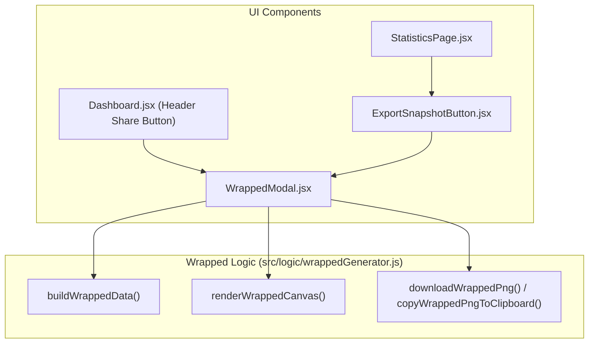

# B5: Exportação e Compartilhamento Visual de Perfil de Gosto (Wrapped) Implementation Plan

> **For agentic workers:** REQUIRED SUB-SKILL: Use superpowers:subagent-driven-development to implement this plan task-by-task. Steps use checkbox (`- [ ]`) syntax for tracking.

**Goal:** Implementar a geração, visualização em modal, download em PNG (`1200x630`) e cópia para o clipboard de um card visual estilo "Wrapped" contendo métricas globais, Top 5 gêneros (Taste Profile) e Top 3 recomendações do usuário.

**Architecture:** Um módulo puro e independente (`src/logic/wrappedGenerator.js`) agrega os dados da sessão atual (`buildWrappedData`) e desenha o card `1200x630` diretamente em um `<canvas>` HTML5 (`renderWrappedCanvas`) com fallback seguro contra CORS para imagens de capa externas. Um novo componente `src/components/WrappedModal.jsx` exibe o preview responsivo e oferece três ações (Baixar PNG, Copiar Imagem, Copiar Link), sendo acionado tanto pelo botão Compartilhar no cabeçalho do `Dashboard.jsx` quanto pelo `ExportSnapshotButton.jsx` na aba Estatísticas.

**Architecture Diagram:**



**Tech Stack:** React 19, Vite, HTML5 Canvas 2D API, Clipboard API (`ClipboardItem`), i18next (`pt-BR`, `en`, `ja`), Vitest + Testing Library.

## Global Constraints

- Zero novas dependências no `package.json`.
- Dimensões exatas do canvas exportado: `1200x630` (OpenGraph / Social Card).
- Resiliência total a CORS: se qualquer imagem de capa externa bloquear `crossOrigin="anonymous"`, renderizar placeholder gráfico de ranking (`#1`, `#2`, `#3`) sem jamais deixar o `<canvas>` *tainted*.
- Passar em 100% dos testes (`npm run test`) e linter (`npm run lint`).

---

### Task 1: Gerador de Dados e Renderizador Canvas (`src/logic/wrappedGenerator.js`)

**Files:**
- Create: `src/logic/wrappedGenerator.js`
- Test: `src/__tests__/wrappedGenerator.test.js`

**Interfaces:**
- Produces:
  - `buildWrappedData({ username, providerLabel, isEnsemble, activeProviders, entries, tasteProfile, recommendations, titlePref })`
  - `renderWrappedCanvas(canvas, wrappedData, labels, imageLoader)`
  - `canvasToPngBlob(canvas)`
  - `downloadWrappedPng(canvas, filename)`
  - `copyWrappedPngToClipboard(canvas)`

- [ ] **Step 1: Write the failing test (`src/__tests__/wrappedGenerator.test.js`)**

```javascript
import { describe, it, expect, vi } from 'vitest'
import {
  buildWrappedData,
  renderWrappedCanvas,
  canvasToPngBlob,
} from '../logic/wrappedGenerator.js'

describe('wrappedGenerator', () => {
  it('buildWrappedData aggregates metrics, top 5 genres, and top 3 recommendations', () => {
    const entries = [
      { id: 1, status: 'COMPLETED', score: 9, episodes: 24 },
      { id: 2, status: 'COMPLETED', score: 8, episodes: 12 },
      { id: 3, status: 'CURRENT', score: 0, episodes: 10 },
      { id: 4, status: 'PLANNING', score: 0, episodes: 12 },
    ]
    const tasteProfile = new Map([
      ['Action', { adjustedAverage: 8.65, average: 8.8, count: 15 }],
      ['Sci-Fi', { adjustedAverage: 8.42, average: 8.5, count: 10 }],
      ['Drama', { adjustedAverage: 8.1, average: 8.2, count: 8 }],
      ['Mystery', { adjustedAverage: 7.9, average: 8.0, count: 6 }],
      ['Comedy', { adjustedAverage: 7.5, average: 7.6, count: 12 }],
      ['Horror', { adjustedAverage: 6.8, average: 7.0, count: 4 }],
    ])
    const recommendations = [
      { id: 101, title: 'Steins;Gate', predictedScore: 9.2, communityScore: 9.1, format: 'TV', year: 2011, genres: ['Sci-Fi', 'Drama'], coverImage: 'https://example.com/sg.jpg' },
      { id: 102, title: 'Monster', predictedScore: 8.9, communityScore: 8.9, format: 'TV', year: 2004, genres: ['Mystery', 'Drama'] },
      { id: 103, title: 'Pluto', predictedScore: 8.7, communityScore: 8.6, format: 'ONA', year: 2023, genres: ['Sci-Fi', 'Mystery'] },
      { id: 104, title: 'Extra Anime', predictedScore: 8.1, communityScore: 8.0, format: 'TV', year: 2020, genres: ['Action'] },
    ]

    const data = buildWrappedData({
      username: 'wagner',
      providerLabel: 'AniList',
      isEnsemble: false,
      activeProviders: ['AniList'],
      entries,
      tasteProfile,
      recommendations,
      titlePref: 'english',
    })

    expect(data.username).toBe('wagner')
    expect(data.metrics.completedCount).toBe(2)
    expect(data.metrics.totalEpisodes).toBe(46)
    expect(data.metrics.meanScore).toBe(8.5)
    expect(data.topGenres).toHaveLength(5)
    expect(data.topGenres[0]).toMatchObject({ genre: 'Action', score: 8.65, count: 15 })
    expect(data.topRecommendations).toHaveLength(3)
    expect(data.topRecommendations[0]).toMatchObject({ rank: 1, title: 'Steins;Gate', predictedScore: 9.2 })
  })

  it('renderWrappedCanvas draws 1200x630 card without throwing even when image loader returns null', async () => {
    const ctxMock = {
      clearRect: vi.fn(),
      fillRect: vi.fn(),
      strokeRect: vi.fn(),
      beginPath: vi.fn(),
      closePath: vi.fn(),
      moveTo: vi.fn(),
      lineTo: vi.fn(),
      arc: vi.fn(),
      arcTo: vi.fn(),
      roundRect: vi.fn(),
      fill: vi.fn(),
      stroke: vi.fn(),
      clip: vi.fn(),
      save: vi.fn(),
      restore: vi.fn(),
      fillText: vi.fn(),
      drawImage: vi.fn(),
      measureText: vi.fn((text) => ({ width: String(text).length * 8 })),
      createLinearGradient: vi.fn(() => ({ addColorStop: vi.fn() })),
      createRadialGradient: vi.fn(() => ({ addColorStop: vi.fn() })),
    }
    const canvasMock = {
      width: 0,
      height: 0,
      getContext: vi.fn(() => ctxMock),
      toBlob: vi.fn((cb) => cb(new Blob(['png'], { type: 'image/png' }))),
    }

    const data = buildWrappedData({
      username: 'wagner',
      providerLabel: 'AniList',
      entries: [{ id: 1, status: 'COMPLETED', score: 9, episodes: 12 }],
      tasteProfile: new Map([['Action', { adjustedAverage: 8.5, count: 5 }]]),
      recommendations: [{ id: 10, title: 'Cowboy Bebop', predictedScore: 9.0, genres: ['Action'] }],
    })

    await renderWrappedCanvas(canvasMock, data, {}, async () => null)

    expect(canvasMock.width).toBe(1200)
    expect(canvasMock.height).toBe(630)
    expect(ctxMock.fillText).toHaveBeenCalled()

    const blob = await canvasToPngBlob(canvasMock)
    expect(blob).toBeInstanceOf(Blob)
  })
})
```

- [ ] **Step 2: Run test to verify it fails**

Run: `npx vitest run src/__tests__/wrappedGenerator.test.js`
Expected: FAIL with module not found `../logic/wrappedGenerator.js`

- [ ] **Step 3: Implement `src/logic/wrappedGenerator.js`**

Criar `src/logic/wrappedGenerator.js` com `buildWrappedData`, `renderWrappedCanvas`, `canvasToPngBlob`, `downloadWrappedPng` e `copyWrappedPngToClipboard`.

- [ ] **Step 4: Run test to verify it passes**

Run: `npx vitest run src/__tests__/wrappedGenerator.test.js`
Expected: PASS

---

### Task 2: Modal de Preview e Compartilhamento (`src/components/WrappedModal.jsx` + i18n)

**Files:**
- Create: `src/components/WrappedModal.jsx`
- Create: `src/components/WrappedModal.module.css`
- Modify: `src/locales/pt-BR.json`, `src/locales/en.json`, `src/locales/ja.json`
- Test: `src/__tests__/WrappedModal.test.jsx`

**Interfaces:**
- Consumes: `buildWrappedData`, `renderWrappedCanvas`, `downloadWrappedPng`, `copyWrappedPngToClipboard` from `src/logic/wrappedGenerator.js`
- Produces: `<WrappedModal isOpen onClose username providerLabel isEnsemble activeProviders entries tasteProfile recommendations titlePref />`

- [ ] **Step 1: Add i18n keys to `src/locales/{pt-BR,en,ja}.json`**
- [ ] **Step 2: Write the failing test (`src/__tests__/WrappedModal.test.jsx`)**
- [ ] **Step 3: Implement `src/components/WrappedModal.jsx` and `src/components/WrappedModal.module.css`**
- [ ] **Step 4: Run test to verify it passes (`npx vitest run src/__tests__/WrappedModal.test.jsx`)**

---

### Task 3: Integração no `Dashboard.jsx`, `StatisticsPage.jsx` e `ExportSnapshotButton.jsx` + Atualização do Roadmap

**Files:**
- Modify: `src/components/Dashboard.jsx`
- Modify: `src/components/StatisticsPage.jsx`
- Modify: `src/components/ExportSnapshotButton.jsx`
- Modify: `docs/roadmap_v2.md`

- [ ] **Step 1: Update `ExportSnapshotButton.jsx` and `StatisticsPage.jsx` to accept and trigger `onOpenWrapped`**
- [ ] **Step 2: Update `Dashboard.jsx` header button to open `WrappedModal` and pass `onOpenWrapped` to `StatisticsPage`**
- [ ] **Step 3: Mark B5 (`#15`) as completed in `docs/roadmap_v2.md`**
- [ ] **Step 4: Run full test suite and linter (`npm run test` & `npm run lint`)**
