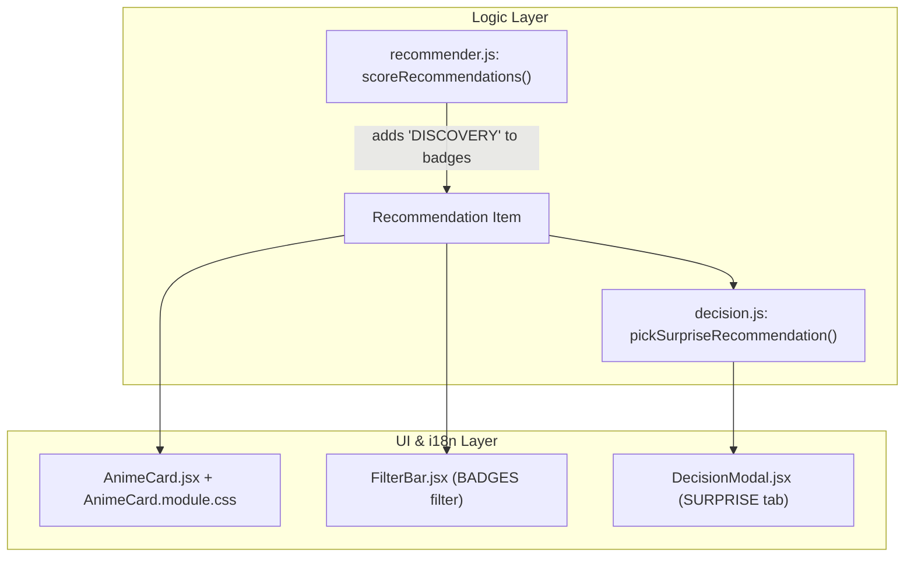

# Discovery Mode (Out of Comfort Zone) Implementation Plan

> **For agentic workers:** REQUIRED SUB-SKILL: Use superpowers:subagent-driven-development to implement this plan task-by-task. Steps use checkbox (`- [ ]`) syntax for tracking.

**Goal:** Add "Out of Comfort Zone" (`DISCOVERY`) badge detection in the recommendation engine, expose it in the `AnimeCard` and `FilterBar` UI, and evolve the `SURPRISE` decision mode to draw from `DISCOVERY` candidates first with fallback to Top 20.

**Architecture:** `scoreRecommendations` in `src/logic/recommender.js` evaluates each candidate's genres against `tasteProfile` to detect promising under-watched genres (`scoredCount <= 15` and `average >= 8.0` where `>= 50%` of the anime's genres are low-watched and `communityScore >= 7.5`) or acclaimed unexplored genres (`predictionSource === 'community'`, `genres.length > 0`, `communityScore >= 8.0`), appending `'DISCOVERY'` to `badges`. `pickSurpriseRecommendation` in `src/logic/decision.js` filters for `DISCOVERY` badges before running `pickWeightedTop20` (falling back to all recommendations if none match). `AnimeCard.jsx` and `FilterBar.jsx` render and filter the new `DISCOVERY` badge across `pt-BR`, `en`, and `ja` locales.

**Architecture Diagram:**



**Tech Stack:** React 19, Vite, Vitest, Testing Library, CSS Modules, i18next.

## Global Constraints

- Maintain `DEFAULT_CONFIDENCE_CONSTANT = 25` and `lowerBound` calculation unchanged for `predictedScore`.
- Reference GitHub Issue `#20` in all commit messages (`Ref #20` or `Fixes #20`).
- Run `npm run test` and `npm run lint` with zero errors before completion.

---

### Task 1: Badge `DISCOVERY` no Motor de Recomendação (`recommender.js`)

**Files:**
- Modify: [`src/logic/recommender.js:1-200`](file:///C:/Sistemas/Projetos/animes/src/logic/recommender.js#L1-L200)
- Test: [`src/logic/recommender.test.js`](file:///C:/Sistemas/Projetos/animes/src/logic/recommender.test.js)

**Interfaces:**
- Consumes: `tasteProfile` (`Map<string, { average, adjustedAverage, count, scoredCount }>`), `planningEntries`
- Produces: `DISCOVERY_MAX_SCORED_COUNT = 15`, `DISCOVERY_MIN_REAL_AVERAGE = 8.0`, `DISCOVERY_MIN_COMMUNITY_SCORE = 7.5`, `DISCOVERY_FALLBACK_COMMUNITY_SCORE = 8.0`, and `'DISCOVERY'` inside `recommendation.badges`

- [ ] **Step 1: Write the failing tests in `src/logic/recommender.test.js`**

Add the following `describe('DISCOVERY badge (Out of Comfort Zone)', ...)` block at the end of [`src/logic/recommender.test.js`](file:///C:/Sistemas/Projetos/animes/src/logic/recommender.test.js):

```javascript
describe('DISCOVERY badge (Out of Comfort Zone)', () => {
  const discoveryProfile = new Map([
    ['Action', { average: 8.5, adjustedAverage: 8.2, count: 60, scoredCount: 50 }],
    ['Fantasy', { average: 8.3, adjustedAverage: 8.0, count: 45, scoredCount: 40 }],
    ['Mystery', { average: 8.8, adjustedAverage: 7.4, count: 6, scoredCount: 5 }],
    ['Sports', { average: 7.2, adjustedAverage: 6.8, count: 4, scoredCount: 4 }],
  ])

  it('assigns DISCOVERY when anime has >=1 promising genre (scoredCount <= 15, average >= 8.0), >=50% low-watched genres, and communityScore >= 7.5', () => {
    const planning = [
      {
        media: {
          id: 201,
          title: { english: 'Odd Taxi' },
          genres: ['Mystery', 'Psychological'], // Mystery (5<=15, avg 8.8>=8.0), Psychological (unwatched -> <=15) => 100% low-watched
          averageScore: 86,
        },
      },
      {
        media: {
          id: 202,
          title: { english: 'Action Mystery Mix' },
          genres: ['Action', 'Mystery'], // 1 high-watched (Action: 50), 1 promising low-watched (Mystery: 5) => 50% low-watched
          averageScore: 78,
        },
      },
    ]

    const result = scoreRecommendations(planning, discoveryProfile)
    const oddTaxi = result.find((r) => r.id === 201)
    const mix = result.find((r) => r.id === 202)

    expect(oddTaxi.badges).toContain('DISCOVERY')
    expect(mix.badges).toContain('DISCOVERY')
  })

  it('does NOT assign DISCOVERY when majority (>50%) of genres are high-watched comfort zone genres', () => {
    const planning = [
      {
        media: {
          id: 203,
          title: { english: 'Comfort Zone Heavy' },
          genres: ['Action', 'Fantasy', 'Mystery'], // 2 high-watched (Action, Fantasy), only 1/3 (33.3%) low-watched
          averageScore: 85,
        },
      },
    ]

    const result = scoreRecommendations(planning, discoveryProfile)
    expect(result[0].badges).not.toContain('DISCOVERY')
  })

  it('does NOT assign DISCOVERY when low-watched genre has real average < 8.0 or communityScore < 7.5', () => {
    const planning = [
      {
        media: {
          id: 204,
          title: { english: 'Low Real Average' },
          genres: ['Sports'], // scoredCount 4 <= 15, but average 7.2 < 8.0
          averageScore: 85,
        },
      },
      {
        media: {
          id: 205,
          title: { english: 'Low Community Score' },
          genres: ['Mystery'], // promising genre, but averageScore 70 (7.0 < 7.5)
          averageScore: 70,
        },
      },
    ]

    const result = scoreRecommendations(planning, discoveryProfile)
    expect(result.find((r) => r.id === 204).badges).not.toContain('DISCOVERY')
    expect(result.find((r) => r.id === 205).badges).not.toContain('DISCOVERY')
  })

  it('assigns DISCOVERY via fallback when predictionSource is community, genres is non-empty, and communityScore >= 8.0', () => {
    const planning = [
      {
        media: {
          id: 206,
          title: { english: 'Acclaimed Unexplored' },
          genres: ['Mecha', 'Music'], // 0 matching genres in profile
          averageScore: 82,
        },
      },
      {
        media: {
          id: 207,
          title: { english: 'Mediocre Unexplored' },
          genres: ['Mecha'],
          averageScore: 78,
        },
      },
    ]

    const result = scoreRecommendations(planning, discoveryProfile)
    expect(result.find((r) => r.id === 206).badges).toContain('DISCOVERY')
    expect(result.find((r) => r.id === 207).badges).not.toContain('DISCOVERY')
  })
})
```

- [ ] **Step 2: Run test to verify it fails**

Run: `npx vitest run src/logic/recommender.test.js`
Expected: FAIL (`expected [] to contain 'DISCOVERY'`)

- [ ] **Step 3: Write minimal implementation in `src/logic/recommender.js`**

Update [`src/logic/recommender.js`](file:///C:/Sistemas/Projetos/animes/src/logic/recommender.js) to export discovery constants and push `'DISCOVERY'` into `badges`:

```diff
 export const DEFAULT_MIN_GENRE_COUNT = 2
 export const DEFAULT_CONFIDENCE_CONSTANT = 25
 export const DEFAULT_SCORE_STD_DEV = 1.2
 export const CONFIDENCE_Z = 1.96
 export const WATCHING_SCORE_WEIGHT = 0.7
+export const DISCOVERY_MAX_SCORED_COUNT = 15
+export const DISCOVERY_MIN_REAL_AVERAGE = 8.0
+export const DISCOVERY_MIN_COMMUNITY_SCORE = 7.5
+export const DISCOVERY_FALLBACK_COMMUNITY_SCORE = 8.0
```

And inside `scoreRecommendations` in [`src/logic/recommender.js`](file:///C:/Sistemas/Projetos/animes/src/logic/recommender.js#L180-L193):

```diff
       // Badges baseados em discrepância
       if (communityScore >= 8.5 && (communityScore - baseTasteScore >= 1.0)) {
         badges.push('ACCLAIMED')
       } else if (baseTasteScore - communityScore >= 1.5) {
         badges.push('PERSONAL_BET')
       } else if (baseTasteScore >= 8.0 && communityScore >= 8.0) {
         badges.push('STRONG_CONSENSUS')
       }
+
+      // Badge de Descoberta / Fora da Zona (gêneros promissores pouco assistidos)
+      const hasPromisingGenre = matchingGenres.some((g) => {
+        const stats = tasteProfile.get(g)
+        const scoredCount = stats?.scoredCount ?? stats?.count ?? 0
+        const realAvg = stats?.average ?? 0
+        return scoredCount > 0 && scoredCount <= DISCOVERY_MAX_SCORED_COUNT && realAvg >= DISCOVERY_MIN_REAL_AVERAGE
+      })
+      const lowWatchedGenresCount = genres.filter((g) => {
+        if (!tasteProfile.has(g)) return true
+        const stats = tasteProfile.get(g)
+        const scoredCount = stats?.scoredCount ?? stats?.count ?? 0
+        return scoredCount <= DISCOVERY_MAX_SCORED_COUNT
+      }).length
+      const isMajorityLowWatched = genres.length > 0 && (lowWatchedGenresCount / genres.length) >= 0.5
+
+      if (hasPromisingGenre && isMajorityLowWatched && communityScore >= DISCOVERY_MIN_COMMUNITY_SCORE) {
+        badges.push('DISCOVERY')
+      }
     } else {
       baseTasteScore = null
       predictedScore = communityScore
       predictionSource = 'community'
+      if (genres.length > 0 && communityScore >= DISCOVERY_FALLBACK_COMMUNITY_SCORE) {
+        badges.push('DISCOVERY')
+      }
     }
```

- [ ] **Step 4: Run test to verify it passes**

Run: `npx vitest run src/logic/recommender.test.js`
Expected: PASS

- [ ] **Step 5: Commit**

```bash
git add src/logic/recommender.js src/logic/recommender.test.js
git commit -m "feat(recommender): detectar badge DISCOVERY para generos promissores pouco assistidos (Ref #20)"
```

---

### Task 2: Evoluir Modo `SURPRISE` no Motor de Decisão (`decision.js`)

**Files:**
- Modify: [`src/logic/decision.js:74-148`](file:///C:/Sistemas/Projetos/animes/src/logic/decision.js#L74-L148)
- Test: [`src/logic/decision.test.js`](file:///C:/Sistemas/Projetos/animes/src/logic/decision.test.js)

**Interfaces:**
- Consumes: `recommendations` array with `badges` property
- Produces: `pickSurpriseRecommendation(recommendations, randomFn = Math.random, excludeId = null)` and updated `makeDecision` for `DECISION_MODES.SURPRISE`

- [ ] **Step 1: Write the failing tests in `src/logic/decision.test.js`**

Import `pickSurpriseRecommendation` and add unit tests in [`src/logic/decision.test.js`](file:///C:/Sistemas/Projetos/animes/src/logic/decision.test.js):

```javascript
  describe('pickSurpriseRecommendation', () => {
    it('prioritizes candidates with DISCOVERY badge over regular recommendations', () => {
      const recs = [
        { id: 1, title: 'Comfort 1', predictedScore: 9.5, badges: ['STRONG_CONSENSUS'] },
        { id: 2, title: 'Discovery 1', predictedScore: 8.1, badges: ['DISCOVERY'] },
        { id: 3, title: 'Discovery 2', predictedScore: 7.9, badges: ['ACCLAIMED', 'DISCOVERY'] },
      ]

      const firstPick = pickSurpriseRecommendation(recs, () => 0.0001)
      expect(firstPick?.id).toBe(2)

      const secondPick = pickSurpriseRecommendation(recs, () => 0.9999)
      expect(secondPick?.id).toBe(3)
    })

    it('falls back to general pickWeightedTop20 when no anime has DISCOVERY badge', () => {
      const recs = [
        { id: 10, title: 'Comfort 1', predictedScore: 9.5, badges: [] },
        { id: 11, title: 'Comfort 2', predictedScore: 9.0, badges: ['STRONG_CONSENSUS'] },
      ]

      const pick = pickSurpriseRecommendation(recs, () => 0.0001)
      expect(pick?.id).toBe(10)
    })

    it('respects excludeId within DISCOVERY pool', () => {
      const recs = [
        { id: 1, title: 'Comfort 1', predictedScore: 9.5, badges: [] },
        { id: 2, title: 'Discovery 1', predictedScore: 8.1, badges: ['DISCOVERY'] },
        { id: 3, title: 'Discovery 2', predictedScore: 7.9, badges: ['DISCOVERY'] },
      ]

      const pick = pickSurpriseRecommendation(recs, () => 0.0001, 2)
      expect(pick?.id).toBe(3)
    })
  })
```

- [ ] **Step 2: Run test to verify it fails**

Run: `npx vitest run src/logic/decision.test.js`
Expected: FAIL (`pickSurpriseRecommendation is not a function`)

- [ ] **Step 3: Implement `pickSurpriseRecommendation` in `src/logic/decision.js`**

Add `pickSurpriseRecommendation` and wire it in `makeDecision` in [`src/logic/decision.js`](file:///C:/Sistemas/Projetos/animes/src/logic/decision.js):

```diff
+/**
+ * Draws an out-of-comfort-zone recommendation from items carrying the DISCOVERY badge.
+ * Falls back to pickWeightedTop20 across all recommendations when no DISCOVERY items exist.
+ * @param {Array<Object>} recommendations
+ * @param {Function} [randomFn=Math.random]
+ * @param {number|string|null} [excludeId=null]
+ * @returns {Object|null}
+ */
+export function pickSurpriseRecommendation(
+  recommendations = [],
+  randomFn = Math.random,
+  excludeId = null
+) {
+  if (!recommendations || recommendations.length === 0) {
+    return null
+  }
+
+  const discoveryCandidates = recommendations.filter(
+    (anime) => Array.isArray(anime?.badges) && anime.badges.includes('DISCOVERY')
+  )
+
+  if (discoveryCandidates.length > 0) {
+    return pickWeightedTop20(discoveryCandidates, randomFn, excludeId)
+  }
+
+  return pickWeightedTop20(recommendations, randomFn, excludeId)
+}
```

And in `makeDecision`:

```diff
     case DECISION_MODES.BEST:
       return pickBestRecommendation(recommendations, excludeId)
     case DECISION_MODES.SURPRISE:
-      return pickWeightedTop20(recommendations, randomFn, excludeId)
+      return pickSurpriseRecommendation(recommendations, randomFn, excludeId)
     case DECISION_MODES.QUICK:
       return pickQuickStart(recommendations, userSubscriptions, 24, randomFn, excludeId)
     default:
-      return pickWeightedTop20(recommendations, randomFn, excludeId)
+      return pickSurpriseRecommendation(recommendations, randomFn, excludeId)
```

- [ ] **Step 4: Run test to verify it passes**

Run: `npx vitest run src/logic/decision.test.js`
Expected: PASS

- [ ] **Step 5: Commit**

```bash
git add src/logic/decision.js src/logic/decision.test.js
git commit -m "feat(decision): priorizar animes DISCOVERY no modo Surpreenda-me (Ref #20)"
```

---

### Task 3: UI (`AnimeCard`, `FilterBar`) e Traduções (`pt-BR`, `en`, `ja`)

**Files:**
- Modify: [`src/locales/pt-BR.json:95-136`](file:///C:/Sistemas/Projetos/animes/src/locales/pt-BR.json#L95-L136)
- Modify: [`src/locales/en.json:95-136`](file:///C:/Sistemas/Projetos/animes/src/locales/en.json#L95-L136)
- Modify: [`src/locales/ja.json:95-136`](file:///C:/Sistemas/Projetos/animes/src/locales/ja.json#L95-L136)
- Modify: [`src/components/AnimeCard.jsx:131-161`](file:///C:/Sistemas/Projetos/animes/src/components/AnimeCard.jsx#L131-L161)
- Modify: [`src/components/AnimeCard.module.css:160-175`](file:///C:/Sistemas/Projetos/animes/src/components/AnimeCard.module.css#L160-L175)
- Modify: [`src/components/FilterBar.jsx:25-31`](file:///C:/Sistemas/Projetos/animes/src/components/FilterBar.jsx#L25-L31)
- Test: [`src/components/AnimeCard.test.jsx`](file:///C:/Sistemas/Projetos/animes/src/components/AnimeCard.test.jsx), [`src/components/FilterBar.test.jsx`](file:///C:/Sistemas/Projetos/animes/src/components/FilterBar.test.jsx)

**Interfaces:**
- Consumes: `anime.badges` containing `'DISCOVERY'`, i18n keys `labels.badge_DISCOVERY` and `decision.mode_surprise_desc`
- Produces: Floating badge `🧭 Fora da Zona` in `AnimeCard` and badge filter option `DISCOVERY` in `FilterBar`

- [ ] **Step 1: Write the failing tests in `AnimeCard.test.jsx` and `FilterBar.test.jsx`**

Add to [`src/components/AnimeCard.test.jsx`](file:///C:/Sistemas/Projetos/animes/src/components/AnimeCard.test.jsx):

```javascript
  it('renders DISCOVERY floating badge on taste and community predictions', () => {
    const anime = {
      id: 99,
      title: 'Discovery Anime',
      predictionSource: 'community',
      badges: ['DISCOVERY'],
    }

    render(<AnimeCard anime={anime} />)
    expect(screen.getByTitle('🧭 Fora da Zona')).toBeInTheDocument()
  })
```

Add to [`src/components/FilterBar.test.jsx`](file:///C:/Sistemas/Projetos/animes/src/components/FilterBar.test.jsx):

```javascript
  it('renders DISCOVERY badge option in badge selector and triggers onSelectBadge', () => {
    const handleBadgeChange = vi.fn()
    render(
      <FilterBar
        selectedBadge="ALL"
        onSelectBadge={handleBadgeChange}
      />
    )

    expect(screen.getByText('🧭 Fora da Zona')).toBeInTheDocument()
    const badgeSelect = screen.getByDisplayValue('Todos os Destaques')
    fireEvent.change(badgeSelect, { target: { value: 'DISCOVERY' } })
    expect(handleBadgeChange).toHaveBeenCalledWith('DISCOVERY')
  })
```

- [ ] **Step 2: Run tests to verify they fail**

Run: `npx vitest run src/components/AnimeCard.test.jsx src/components/FilterBar.test.jsx`
Expected: FAIL

- [ ] **Step 3: Update locale files, `AnimeCard.jsx`, `AnimeCard.module.css`, and `FilterBar.jsx`**

In [`src/locales/pt-BR.json`](file:///C:/Sistemas/Projetos/animes/src/locales/pt-BR.json):
```diff
-    "mode_surprise_desc": "Sorteio ponderado entre os Top 20 mais compatíveis.",
+    "mode_surprise_desc": "Animes fora da sua zona de conforto: gêneros pouco explorados com notas altas.",
```
```diff
     "badge_ACCLAIMED": "💎 Aclamado pela crítica",
     "badge_PERSONAL_BET": "🧪 Aposta Pessoal",
     "badge_STRONG_CONSENSUS": "🔥 Recomendação Forte",
+    "badge_DISCOVERY": "🧭 Fora da Zona",
```

In [`src/locales/en.json`](file:///C:/Sistemas/Projetos/animes/src/locales/en.json):
```diff
-    "mode_surprise_desc": "Weighted draw among your Top 20 recommendations.",
+    "mode_surprise_desc": "Out of your comfort zone: under-explored genres with high ratings.",
```
```diff
     "badge_ACCLAIMED": "💎 Highly Acclaimed",
     "badge_PERSONAL_BET": "🧪 Personal Bet",
     "badge_STRONG_CONSENSUS": "🔥 Strong Consensus",
+    "badge_DISCOVERY": "🧭 Out of Comfort Zone",
```

In [`src/locales/ja.json`](file:///C:/Sistemas/Projetos/animes/src/locales/ja.json):
```diff
-    "mode_surprise_desc": "おすすめTop 20からの確率的抽選。",
+    "mode_surprise_desc": "コンフォートゾーンの外へ：視聴数が少なく高評価なジャンルのアニメ。",
```
```diff
     "badge_ACCLAIMED": "💎 大好評の話題作",
     "badge_PERSONAL_BET": "🧪 個人的な穴場",
     "badge_STRONG_CONSENSUS": "🔥 鉄板のおすすめ",
+    "badge_DISCOVERY": "🧭 新境地",
```

In [`src/components/AnimeCard.jsx`](file:///C:/Sistemas/Projetos/animes/src/components/AnimeCard.jsx#L131-L161):
```diff
           <div className={styles['anime-card__badges-overlay']}>
-            {anime?.predictionSource === 'community' ? (
+            {anime?.predictionSource === 'community' && (
               <span
                 className={`${styles['anime-card__badge-floating']} ${styles['anime-card__badge-floating--community']}`}
                 title={t('labels.fallbackTooltip')}
               >
                 <span className={styles['anime-card__badge-icon']}>🌐</span>
                 <span className={styles['anime-card__badge-label']}>{t('labels.fallbackBadge')}</span>
               </span>
-            ) : (
-              anime?.badges?.map((badgeKey) => {
-                const iconMap = {
-                  ACCLAIMED: '💎',
-                  PERSONAL_BET: '🧪',
-                  STRONG_CONSENSUS: '🔥',
-                }
-                const labelText = t(`labels.badge_${badgeKey}`).replace(/^[^\w\s\u00C0-\u00FF]+/u, '').trim()
-                const modifierClass = styles[`anime-card__badge-floating--${badgeKey.toLowerCase()}`] || ''
-                return (
-                  <span
-                    key={badgeKey}
-                    className={`${styles['anime-card__badge-floating']} ${modifierClass}`}
-                    title={t(`labels.badge_${badgeKey}`)}
-                  >
-                    <span className={styles['anime-card__badge-icon']}>{iconMap[badgeKey] || '⭐'}</span>
-                    <span className={styles['anime-card__badge-label']}>{labelText}</span>
-                  </span>
-                )
-              })
             )}
+            {anime?.badges?.map((badgeKey) => {
+              const iconMap = {
+                ACCLAIMED: '💎',
+                PERSONAL_BET: '🧪',
+                STRONG_CONSENSUS: '🔥',
+                DISCOVERY: '🧭',
+              }
+              const labelText = t(`labels.badge_${badgeKey}`).replace(/^[^\w\s\u00C0-\u00FF]+/u, '').trim()
+              const modifierClass = styles[`anime-card__badge-floating--${badgeKey.toLowerCase()}`] || ''
+              return (
+                <span
+                  key={badgeKey}
+                  className={`${styles['anime-card__badge-floating']} ${modifierClass}`}
+                  title={t(`labels.badge_${badgeKey}`)}
+                >
+                  <span className={styles['anime-card__badge-icon']}>{iconMap[badgeKey] || '⭐'}</span>
+                  <span className={styles['anime-card__badge-label']}>{labelText}</span>
+                </span>
+              )
+            })}
           </div>
```

In [`src/components/AnimeCard.module.css`](file:///C:/Sistemas/Projetos/animes/src/components/AnimeCard.module.css#L164-L175):
```diff
 .anime-card__badge-floating--strong_consensus {
   border-color: #f87171;
   background: rgba(220, 38, 38, 0.85);
   color: #ffffff;
 }
+
+.anime-card__badge-floating--discovery {
+  border-color: #2dd4bf;
+  background: rgba(13, 148, 136, 0.88);
+  color: #ffffff;
+}
```

In [`src/components/FilterBar.jsx`](file:///C:/Sistemas/Projetos/animes/src/components/FilterBar.jsx#L25-L31):
```diff
 const BADGES = [
   { id: 'ALL', key: 'filter.allBadges' },
   { id: 'ACCLAIMED', key: 'labels.badge_ACCLAIMED' },
   { id: 'PERSONAL_BET', key: 'labels.badge_PERSONAL_BET' },
   { id: 'STRONG_CONSENSUS', key: 'labels.badge_STRONG_CONSENSUS' },
+  { id: 'DISCOVERY', key: 'labels.badge_DISCOVERY' },
 ]
```

- [ ] **Step 4: Run full test suite and linter**

Run: `npm run test && npm run lint`
Expected: All tests PASS and zero lint errors.

- [ ] **Step 5: Commit and close issue**

```bash
git add src/locales/pt-BR.json src/locales/en.json src/locales/ja.json src/components/AnimeCard.jsx src/components/AnimeCard.module.css src/components/FilterBar.jsx src/components/AnimeCard.test.jsx src/components/FilterBar.test.jsx
git commit -m "feat(ui): adicionar badge e filtro Fora da Zona (DISCOVERY) (Fixes #20)"
```
