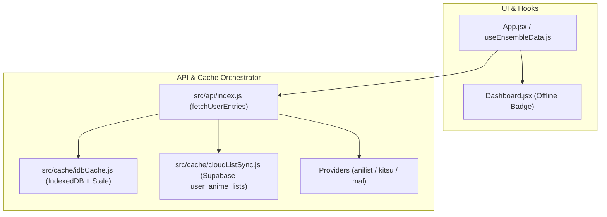

# B8: Persistência Offline-First (IndexedDB) e Supabase Sync Implementation Plan

> **For agentic workers:** REQUIRED SUB-SKILL: Use superpowers:subagent-driven-development to implement this plan task-by-task. Steps use checkbox (`- [ ]`) syntax for tracking.

**Goal:** Migrar o cache de listas de animes para uma arquitetura Offline-First com IndexedDB (TTL de 6h + fallback Stale-While-Revalidate), sincronização multi-dispositivo em nuvem no Supabase (`user_anime_lists` com RLS) e indicador visual de modo offline no Dashboard.

**Architecture:** Camada L1/L2 local em `src/cache/idbCache.js` (IndexedDB assíncrono com fallback `localStorage` via `apiCache.js`), sincronização em nuvem em `src/cache/cloudListSync.js` (Supabase `user_anime_lists`), e orquestração transparente em `src/api/index.js` (`IndexedDB Fresco -> Supabase Cloud Fresco -> API Externa -> Stale Fallback`).

**Architecture Diagram:**

**Tech Stack:** React 19, Vite, IndexedDB API nativa, Supabase JS v2 (Postgres + RLS), Vitest, i18next.

## Global Constraints

- Zero novas dependências externas em `package.json` (usar API nativa `window.indexedDB`).
- `DEFAULT_CACHE_TTL = 6 * 60 * 60 * 1000` (6 horas = 21.600.000 ms).
- Manter `MAX_CACHED_USERS = 15` em `src/cache/apiCache.js` para preservar compatibilidade com `src/cache/apiCache.test.js`.
- Erros de negócio (`UserNotFoundError`, `PrivateListError`) nunca devem ser mascarados por cache expirado.

---

### Task 1: Migration Supabase (`user_anime_lists`) + Evolução de `apiCache.js` (TTL 6h e `readStaleCache`)

**Files:**
- Create: `supabase/migrations/20261017000000_create_user_anime_lists.sql`
- Modify: `src/cache/apiCache.js`
- Modify: `src/api/providers/anilist.js`
- Modify: `src/api/providers/kitsu.js`
- Modify: `src/api/providers/mal.js`
- Test: `src/cache/apiCache.test.js`

- [x] **Step 1: Criar migration SQL para `user_anime_lists` com RLS**
- [x] **Step 2: Exportar `DEFAULT_CACHE_TTL` (6h) e `readStaleCache(cacheKey)` em `src/cache/apiCache.js` e atualizar TTL nos providers**
- [x] **Step 3: Adicionar testes unitários de `readStaleCache` e `DEFAULT_CACHE_TTL` em `src/cache/apiCache.test.js`**

---

### Task 2: Módulo `src/cache/idbCache.js` (IndexedDB Offline-First + LRU + Stale)

**Files:**
- Create: `src/cache/idbCache.js`
- Test: `src/cache/idbCache.test.js`

- [x] **Step 1: Implementar `src/cache/idbCache.js` com suporte a IndexedDB nativo, espelho de metadados, LRU eviction e fallback seguro quando IndexedDB não está disponível**
- [x] **Step 2: Criar suíte `src/cache/idbCache.test.js` testando leitura fresca (< 6h), leitura stale (>= 6h), limpeza e fallback**

---

### Task 3: Módulo `src/cache/cloudListSync.js` (Supabase Cloud Sync c/ Debounce e Last-Write-Wins)

**Files:**
- Create: `src/cache/cloudListSync.js`
- Test: `src/cache/cloudListSync.test.js`

- [x] **Step 1: Implementar `fetchCloudAnimeList` e `scheduleCloudAnimeListSync` em `src/cache/cloudListSync.js`**
- [x] **Step 2: Criar suíte `src/cache/cloudListSync.test.js` validando leitura fresca (< 6h), leitura stale (>= 6h), upsert debounced e tolerância a falhas/offline**

---

### Task 4: Orquestração Offline-First e Cloud Sync em `src/api/index.js`

**Files:**
- Modify: `src/api/index.js`
- Test: `src/api/index.test.js`

- [x] **Step 1: Atualizar `fetchUserEntries` e `clearProviderCache` em `src/api/index.js` integrando `idbCache`, `cloudListSync` e fallback Stale em caso de falha de rede/offline, anexando `_cacheMeta` não-enumerável ao array retornado**
- [x] **Step 2: Expandir `src/api/index.test.js` com cenários de hit no IndexedDB, hit no Supabase Cloud, fallback Stale quando offline/erro de rede e propagação imediata de `UserNotFoundError`**

---

### Task 5: Indicador Visual de Modo Offline / Dados Locais no Dashboard + i18n

**Files:**
- Modify: `src/hooks/useEnsembleData.js`
- Modify: `src/App.jsx`
- Modify: `src/components/Dashboard.jsx`
- Modify: `src/locales/pt-BR.json`
- Modify: `src/locales/en.json`
- Modify: `src/locales/ja.json`
- Modify: `src/components/Dashboard.test.jsx`

- [x] **Step 1: Adicionar chaves `offline.*` em `pt-BR.json`, `en.json` e `ja.json`**
- [x] **Step 2: Propagar estado `isStaleData` / monitorar `online`/`offline` em `App.jsx`, `useEnsembleData.js` e exibir badge discreto `data-testid="offline-mode-badge"` no header do `Dashboard.jsx` com ação de reconectar/atualizar**
- [x] **Step 3: Adicionar teste em `src/components/Dashboard.test.jsx` verificando renderização e clique do badge de modo offline**
