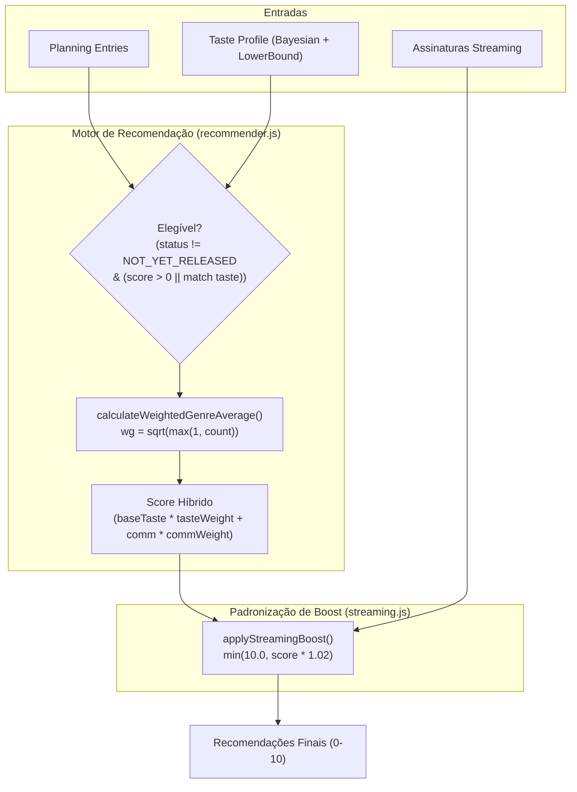

# A12: Evolução do Algoritmo de Recomendação — Implementation Plan

> **For agentic workers:** REQUIRED SUB-SKILL: Use superpowers:subagent-driven-development to implement this plan task-by-task. Steps use checkbox (`- [ ]`) syntax for tracking.

**Goal:** Aprimorar o algoritmo de recomendação com ponderação sublinear de gêneros por volume, pesos híbridos configuráveis, padronização do boost de streaming para 1.02 com teto em 10.0 e recomendação de animes cults/independentes sem nota da comunidade.

**Architecture:** Modifica as funções puras de cálculo em `src/logic/recommender.js` e `src/logic/streaming.js` adicionando helpers matemáticos isolados com fallback retrocompatível. Em seguida, conecta os novos parâmetros em `src/hooks/useRecommendationPipeline.js` e atualiza a suíte de testes unitários e de integração.

**Architecture Diagram:**



**Tech Stack:** JavaScript (ESM), React 19, Vitest, Testing Library.

## Global Constraints
- Sem dependências externas adicionais (apenas `Math` nativo).
- Todas as funções devem permanecer puras e determinísticas.
- Manter compatibilidade com os tipos e propriedades de `entry.media`.
- 100% de aprovação na suíte de testes (`npm run test`) e `0 warnings` no `oxlint`.

---

### Task 1: Ponderação Sublinear de Gêneros por Volume (`calculateWeightedGenreAverage`)

**Files:**
- Modify: `src/logic/recommender.js`
- Test: `src/logic/recommender.test.js`

**Interfaces:**
- Produces: `calculateWeightedGenreAverage(matchingGenres, tasteProfile): number | null`

- [ ] **Step 1: Escrever teste falhando para `calculateWeightedGenreAverage`**
  Em `src/logic/recommender.test.js`:
  ```javascript
  it('pondera nota de gêneros pela raiz quadrada do volume de avaliações (scoredCount)', () => {
    const tasteProfile = new Map([
      ['Action', { adjustedAverage: 9.0, scoredCount: 50 }],
      ['Psychological', { adjustedAverage: 6.0, scoredCount: 2 }],
    ])
    const matchingGenres = [
      { genre: 'Action', score: 9.0 },
      { genre: 'Psychological', score: 6.0 },
    ]
    // sqrt(50) = 7.071; sqrt(2) = 1.414. Total weight = 8.485
    // (9.0 * 7.071 + 6.0 * 1.414) / 8.485 = (63.639 + 8.484) / 8.485 = 8.50
    const weightedAvg = calculateWeightedGenreAverage(matchingGenres, tasteProfile)
    expect(weightedAvg).toBe(8.5)
  })
  ```

- [ ] **Step 2: Rodar o teste para confirmar falha**
  `npx vitest run src/logic/recommender.test.js`

- [ ] **Step 3: Implementar `calculateWeightedGenreAverage` e adotar em `scoreRecommendations`**
  Em `src/logic/recommender.js`:
  ```javascript
  export function calculateWeightedGenreAverage(scoredMatchingGenres, tasteProfile) {
    if (!scoredMatchingGenres || scoredMatchingGenres.length === 0) return null
    let weightedSum = 0
    let totalWeight = 0

    for (const item of scoredMatchingGenres) {
      const stats = tasteProfile?.get?.(item.genre)
      const count = stats?.scoredCount ?? stats?.count ?? 1
      const weight = Math.sqrt(Math.max(1, count))
      weightedSum += item.score * weight
      totalWeight += weight
    }

    return totalWeight > 0 ? Math.round((weightedSum / totalWeight) * 100) / 100 : null
  }
  ```
  Substituir `const sum = scoredMatchingGenres.reduce(...)` por `calculateWeightedGenreAverage`.

- [ ] **Step 4: Atualizar asserções de testes existentes que esperavam média simples**
  Ajustar testes pontuais em `recommender.test.js` para a nova média ponderada.

- [ ] **Step 5: Rodar testes e commitar**
  `npx vitest run src/logic/recommender.test.js`
  `git commit -m "feat(recommender): implementa ponderacao sublinear de generos por volume"`

---

### Task 2: Pesos Híbridos Configuráveis (`DEFAULT_TASTE_WEIGHT` e `DEFAULT_COMMUNITY_WEIGHT`)

**Files:**
- Modify: `src/logic/recommender.js`
- Test: `src/logic/recommender.test.js`

**Interfaces:**
- Produces: `DEFAULT_TASTE_WEIGHT`, `DEFAULT_COMMUNITY_WEIGHT`
- Consumes: `scoreRecommendations(planningEntries, tasteProfile, selectedGenre, options)`

- [ ] **Step 1: Escrever teste falhando para pesos customizados via options**
  Em `src/logic/recommender.test.js`:
  ```javascript
  it('permite sobrescrever pesos híbridos via options.tasteWeight e options.communityWeight', () => {
    const planning = [{
      media: { id: 1, title: { romaji: 'Test' }, genres: ['Action'], averageScore: 80 }
    }]
    const tasteProfile = new Map([['Action', { adjustedAverage: 10.0, scoredCount: 10 }]])
    // baseTasteScore = 10.0; communityScore = 8.0
    // Com 50% / 50%: 10 * 0.5 + 8 * 0.5 = 9.0
    const recs = scoreRecommendations(planning, tasteProfile, 'ALL', { tasteWeight: 0.5, communityWeight: 0.5 })
    expect(recs[0].predictedScore).toBe(9.0)
  })
  ```

- [ ] **Step 2: Rodar teste para verificar falha**
  `npx vitest run src/logic/recommender.test.js`

- [ ] **Step 3: Implementar constantes e leitura de `options` em `scoreRecommendations`**
  Em `src/logic/recommender.js`:
  ```javascript
  export const DEFAULT_TASTE_WEIGHT = 0.85
  export const DEFAULT_COMMUNITY_WEIGHT = 0.15
  ```
  Extrair de `options` com fallback para os padrões.

- [ ] **Step 4: Rodar testes e commitar**
  `npx vitest run src/logic/recommender.test.js`
  `git commit -m "feat(recommender): exporta pesos hibridos configuraveis com defaults"`

---

### Task 3: Padronização do Boost de Streaming (`STREAMING_BOOST_MULTIPLIER = 1.02` com teto 10.0)

**Files:**
- Modify: `src/logic/streaming.js`
- Test: `src/logic/streaming.test.js`

**Interfaces:**
- Produces: `STREAMING_BOOST_MULTIPLIER = 1.02`
- Consumes: `applyStreamingBoost(recommendations, userSubscriptions)`

- [ ] **Step 1: Escrever testes falhando para o novo multiplicador e teto 10.0**
  Em `src/logic/streaming.test.js`:
  ```javascript
  it('aplica multiplicador 1.02 com teto rigoroso em 10.0', () => {
    const recs = [
      { id: 1, predictedScore: 8.0, streamingLinks: [{ site: 'Netflix', url: 'https://netflix.com' }] },
      { id: 2, predictedScore: 9.9, streamingLinks: [{ site: 'Netflix', url: 'https://netflix.com' }] },
    ]
    const boosted = applyStreamingBoost(recs, ['Netflix'])
    expect(boosted[0].predictedScore).toBe(8.16) // 8.0 * 1.02
    expect(boosted[1].predictedScore).toBe(10.0) // 9.9 * 1.02 = 10.098 -> cap 10.0
  })
  ```

- [ ] **Step 2: Rodar teste para verificar falha**
  `npx vitest run src/logic/streaming.test.js`

- [ ] **Step 3: Implementar novo cálculo em `applyStreamingBoost`**
  Em `src/logic/streaming.js`:
  Substituir `rec.predictedScore + 0.3` por `Math.min(10.0, Math.round(rec.predictedScore * STREAMING_BOOST_MULTIPLIER * 100) / 100)`.

- [ ] **Step 4: Atualizar asserções legadas em `streaming.test.js`**
  Ajustar testes existentes para esperar o novo multiplicador `1.02`.

- [ ] **Step 5: Rodar testes e commitar**
  `npx vitest run src/logic/streaming.test.js`
  `git commit -m "feat(streaming): padroniza streaming boost multiplicativo 1.02 com teto em 10.0"`

---

### Task 4: Resgate e Recomendação de Animes sem Média Comunitária

**Files:**
- Modify: `src/logic/recommender.js`
- Test: `src/logic/recommender.test.js`

**Interfaces:**
- Consumes: `isEligiblePlanningMedia(entry, tasteProfile)`
- Produces: animes sem `averageScore` recebem `predictedScore = baseTasteScore` e `communityScore = null`.

- [ ] **Step 1: Escrever teste falhando para animes sem média comunitária**
  Em `src/logic/recommender.test.js`:
  ```javascript
  it('recomenda animes lançados sem média comunitária se houver compatibilidade com tasteProfile', () => {
    const planning = [{
      media: {
        id: 99,
        title: { romaji: 'Cult Classic' },
        genres: ['Mystery'],
        averageScore: null,
        status: 'FINISHED',
      }
    }]
    const tasteProfile = new Map([['Mystery', { adjustedAverage: 8.8, scoredCount: 12 }]])
    const recs = scoreRecommendations(planning, tasteProfile)
    expect(recs).toHaveLength(1)
    expect(recs[0].predictedScore).toBe(8.8)
    expect(recs[0].communityScore).toBeNull()
    expect(recs[0].predictionSource).toBe('taste')
  })
  ```

- [ ] **Step 2: Rodar teste para verificar falha**
  `npx vitest run src/logic/recommender.test.js`

- [ ] **Step 3: Implementar regras em `isEligiblePlanningMedia` e `scoreRecommendations`**
  Em `src/logic/recommender.js`:
  - Permitir animes com `averageScore == null` se `status !== 'NOT_YET_RELEASED'` e houver `matchingGenres.length > 0`.
  - Calcular `predictedScore = baseTasteScore` quando `communityScore == null`.

- [ ] **Step 4: Rodar testes e commitar**
  `npx vitest run src/logic/recommender.test.js`
  `git commit -m "feat(recommender): resgata animes sem media comunitaria compativeis com o perfil"`

---

### Task 5: Integração no Pipeline e Verificação Global

**Files:**
- Modify: `src/hooks/useRecommendationPipeline.js`
- Modify: `docs/roadmap_v2.md`
- Test: Suíte completa (`npm run test`) e lint (`npm run lint`)

- [ ] **Step 1: Atualizar `useRecommendationPipeline.js` para passar `options` e `tasteProfile`**
  Garantir que a filtragem do pipeline use as novas regras.

- [ ] **Step 2: Executar testes de integração**
  `npx vitest run src/hooks/useRecommendationPipeline.test.js src/components/Dashboard.test.jsx`

- [ ] **Step 3: Executar validação global de testes e lint**
  `npm run lint`
  `npm run test`

- [ ] **Step 4: Atualizar status de A12 em `docs/roadmap_v2.md` e fechar Issue #23**
  Marcar A12 como `[x]` e fechar via `gh issue close 23`.

- [ ] **Step 5: Commit final e push**
  `git commit -m "feat(algo): A12 - evolucao do algoritmo de recomendacao (Fixes #23)"`
  `git push origin master`
