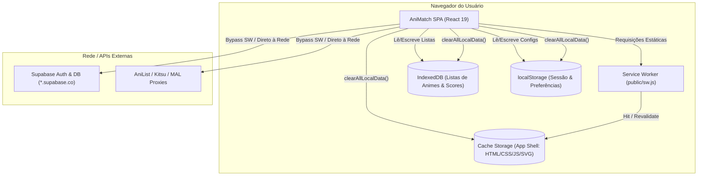

# C1: PWA (App Shell & Offline) com Hardening Legal e Minimização de Dados Implementation Plan

> **For agentic workers:** REQUIRED SUB-SKILL: Use superpowers:subagent-driven-development to implement this plan task-by-task. Steps use checkbox (`- [ ]`) syntax for tracking.

**Goal:** Transformar o AniMatch em um Progressive Web App (PWA) instalável e resiliente offline, garantindo conformidade legal estrita (LGPD/GDPR): Cache Storage restrito a arquivos do App Shell (zero dados pessoais ou tokens), purga total de caches no `clearAllLocalData` e atualização da Política de Privacidade.

**Architecture:**
- **App Shell Cache (PWA):** O Service Worker (`public/sw.js`) opera com estratégia Stale-While-Revalidate estritamente para assets estáticos locais (HTML, CSS, JS, manifest, ícones SVG e fontes locais).
- **Strict API & Data Bypass:** Toda e qualquer chamada a APIs de terceiros (`graphql.anilist.co`, `kitsu.io`, `myanimelist.net`, `/mal-proxy`) e infraestrutura de nuvem/autenticação (`*.supabase.co`) bypassa o Cache Storage completamente, garantindo que nenhum dado pessoal, lista ou token trafegue ou persista no Service Worker.
- **Armazenamento de Listas:** Permanecem 100% sob a responsabilidade do `IndexedDB` (`animatch_db`), já protegido por TTL e criptografia do navegador.
- **Direito à Eliminação Completa (LGPD Art. 18 / GDPR Art. 17):** A função `clearAllLocalData()` (`src/cache/idbCache.js`) é expandida para purgar todas as instâncias de `caches` do navegador via `caches.delete()`, garantindo que "Limpar dados locais", `signOut` ou "Excluir conta" eliminem 100% dos resíduos de arquivos e dados.
- **Transparência na Política de Privacidade:** Atualização do modal legal e textos de privacidade para explicitar o uso do Cache Storage exclusivamente para o App Shell.

**Architecture Diagram:**



**Tech Stack:**
- React 19, Vite 5, Service Worker API, Cache Storage API, IndexedDB API, Vitest 2.1, i18next.

## Global Constraints
- Nenhuma dependência pesada de terceiros para o Service Worker (manter vanilla SW em `public/sw.js`, compatível com GitHub Pages `/animatch/`).
- Zero armazenamento de dados pessoais ou listas de animes no Cache Storage.
- `clearAllLocalData()` deve suportar ambientes onde `window.caches` é undefined (ex: jsdom em testes).
- Todos os 480 testes existentes devem continuar passando (`npm run test` e `npm run lint`).

---

### Task 1: Expansão de `clearAllLocalData()` com Purga do Cache Storage

**Files:**
- Modify: `src/cache/idbCache.js:200-245`
- Test: `src/cache/idbCache.test.js:180-202`

**Interfaces:**
- Consumes: `globalThis.caches` (CacheStorage Web API).
- Produces: `clearAllLocalData(): Promise<void>` com remoção atômica de localStorage, IndexedDB e CacheStorage.

- [ ] **Step 1: Escrever teste falhando para purga do Cache Storage em `idbCache.test.js`**

Em `src/cache/idbCache.test.js`, adicionar teste cobrindo a chamada a `caches.keys()` e `caches.delete()`:

```javascript
  it('limpa todas as caches do CacheStorage em clearAllLocalData quando disponivel', async () => {
    const deletedCaches = []
    const mockCaches = {
      keys: vi.fn().mockResolvedValue(['animatch-v1', 'animatch-v2']),
      delete: vi.fn().mockImplementation((name) => {
        deletedCaches.push(name)
        return Promise.resolve(true)
      }),
    }
    vi.stubGlobal('caches', mockCaches)

    try {
      await clearAllLocalData()
      expect(mockCaches.keys).toHaveBeenCalledTimes(1)
      expect(mockCaches.delete).toHaveBeenCalledWith('animatch-v1')
      expect(mockCaches.delete).toHaveBeenCalledWith('animatch-v2')
      expect(deletedCaches).toEqual(['animatch-v1', 'animatch-v2'])
    } finally {
      vi.unstubAllGlobals()
    }
  })
```

- [ ] **Step 2: Rodar teste para verificar que falha**

Run: `npx vitest run src/cache/idbCache.test.js`
Expected: FAIL porque `clearAllLocalData()` ainda não chama `caches.keys()`.

- [ ] **Step 3: Implementar a limpeza de CacheStorage em `src/cache/idbCache.js`**

Em `src/cache/idbCache.js`, atualizar `clearAllLocalData()`:

```javascript
export async function clearAllLocalData() {
  try {
    clearAllApiCache()
    if (typeof localStorage !== 'undefined') {
      for (const knownKey of KNOWN_LOCAL_STORAGE_KEYS) {
        localStorage.removeItem(knownKey)
      }
      const keysToRemove = []
      if (typeof localStorage.length === 'number' && typeof localStorage.key === 'function') {
        for (let i = 0; i < localStorage.length; i++) {
          const key = localStorage.key(i)
          if (key && key.startsWith('animatch_')) {
            keysToRemove.push(key)
          }
        }
      }
      for (const key of Object.keys(localStorage)) {
        if (key && key.startsWith('animatch_')) {
          keysToRemove.push(key)
        }
      }
      for (const key of keysToRemove) {
        localStorage.removeItem(key)
      }
    }
  } catch {
    // ignore storage errors
  }

  // Purga completa de caches do Service Worker (PWA) para conformidade legal (LGPD Art. 18 / GDPR Art. 17)
  if (typeof caches !== 'undefined' && typeof caches.keys === 'function' && typeof caches.delete === 'function') {
    try {
      const cacheNames = await caches.keys()
      await Promise.all(cacheNames.map((name) => caches.delete(name)))
    } catch {
      // ignore cache storage errors
    }
  }

  const db = await openDatabase()
  if (!db) return

  await new Promise((resolve) => {
    try {
      const tx = db.transaction(STORE_NAME, 'readwrite')
      const store = tx.objectStore(STORE_NAME)
      if (typeof store.clear === 'function') {
        const req = store.clear()
        req.onsuccess = () => resolve()
        req.onerror = () => resolve()
      } else {
        resolve()
      }
    } catch {
      resolve()
    }
  })
}
```

- [ ] **Step 4: Rodar teste para verificar que passa**

Run: `npx vitest run src/cache/idbCache.test.js`
Expected: PASS com 8 testes passando.

- [ ] **Step 5: Commit da Task 1**

```bash
git add src/cache/idbCache.js src/cache/idbCache.test.js
git commit -m "feat(pwa): purga CacheStorage em clearAllLocalData para conformidade legal"
```

---

### Task 2: Service Worker com Bloqueio Estrito de Dados Pessoais e Cache Shell

**Files:**
- Modify: `public/sw.js`
- Create: `src/sw.test.js`

**Interfaces:**
- Consumes: ServiceWorkerGlobalScope events (`install`, `activate`, `fetch`).
- Produces: Estratégia Stale-While-Revalidate com bypass estrito de chamadas de API externas e auth.

- [ ] **Step 1: Escrever teste unitário para lógica de bypass e regras do Service Worker em `src/sw.test.js`**

Criar `src/sw.test.js` para testar os critérios de bypass de URLs e segurança do cache:

```javascript
import { describe, it, expect } from 'vitest'

// Helper que espelha as regras de filtragem do Service Worker
function shouldBypassCache(url, method = 'GET') {
  if (method !== 'GET') return true
  if (!url.startsWith('http')) return true

  const BYPASS_PATTERNS = [
    'graphql.anilist.co',
    'kitsu.io',
    'kitsu.app',
    'myanimelist.net',
    'supabase.co',
    '/mal-proxy',
    '/anilist-api',
  ]

  return BYPASS_PATTERNS.some((pattern) => url.includes(pattern))
}

describe('Service Worker Security & Privacy Bypass Rules', () => {
  it('bypassa qualquer metodo que nao seja GET', () => {
    expect(shouldBypassCache('https://wagnergsantos.github.io/animatch/', 'POST')).toBe(true)
    expect(shouldBypassCache('https://wagnergsantos.github.io/animatch/', 'PUT')).toBe(true)
    expect(shouldBypassCache('https://wagnergsantos.github.io/animatch/', 'DELETE')).toBe(true)
  })

  it('bypassa estritamente APIs de anime externas para impedir armazenamento de dados pessoais no CacheStorage', () => {
    expect(shouldBypassCache('https://graphql.anilist.co/')).toBe(true)
    expect(shouldBypassCache('https://kitsu.io/api/edge/users')).toBe(true)
    expect(shouldBypassCache('https://media.kitsu.app/anime/poster.jpg')).toBe(true)
    expect(shouldBypassCache('https://api.myanimelist.net/v2/users/test/animelist')).toBe(true)
    expect(shouldBypassCache('https://wagnergsantos.github.io/animatch/mal-proxy')).toBe(true)
    expect(shouldBypassCache('https://wagnergsantos.github.io/animatch/anilist-api')).toBe(true)
  })

  it('bypassa chamadas do Supabase (Auth, RLS, Edge Functions)', () => {
    expect(shouldBypassCache('https://xyz.supabase.co/auth/v1/token')).toBe(true)
    expect(shouldBypassCache('https://xyz.supabase.co/rest/v1/user_settings')).toBe(true)
    expect(shouldBypassCache('https://xyz.supabase.co/functions/v1/mal-proxy')).toBe(true)
  })

  it('permite caching apenas para assets estaticos locais do App Shell', () => {
    expect(shouldBypassCache('https://wagnergsantos.github.io/animatch/')).toBe(false)
    expect(shouldBypassCache('https://wagnergsantos.github.io/animatch/index.html')).toBe(false)
    expect(shouldBypassCache('https://wagnergsantos.github.io/animatch/manifest.json')).toBe(false)
    expect(shouldBypassCache('https://wagnergsantos.github.io/animatch/favicon.svg')).toBe(false)
    expect(shouldBypassCache('https://wagnergsantos.github.io/animatch/assets/index-abc.js')).toBe(false)
    expect(shouldBypassCache('https://wagnergsantos.github.io/animatch/assets/index-xyz.css')).toBe(false)
  })
})
```

- [ ] **Step 2: Rodar teste para verificar que passa**

Run: `npx vitest run src/sw.test.js`
Expected: PASS com 4 testes passando.

- [ ] **Step 3: Atualizar `public/sw.js` com estratégia Stale-While-Revalidate segura e bypass estrito**

Substituir o conteúdo de `public/sw.js`:

```javascript
const CACHE_NAME = 'animatch-app-shell-v2'

// Arquivos do App Shell pré-cacheados na instalação
const APP_SHELL_ASSETS = [
  './',
  './index.html',
  './manifest.json',
  './favicon.svg'
]

// Padrões estritamente excluídos do Cache Storage (LGPD / Segurança / Privacidade)
const BYPASS_PATTERNS = [
  'graphql.anilist.co',
  'kitsu.io',
  'kitsu.app',
  'myanimelist.net',
  'supabase.co',
  '/mal-proxy',
  '/anilist-api'
]

function shouldBypassCache(url, method) {
  if (method !== 'GET') return true
  if (!url.startsWith('http')) return true
  return BYPASS_PATTERNS.some((pattern) => url.includes(pattern))
}

self.addEventListener('install', (event) => {
  event.waitUntil(
    caches
      .open(CACHE_NAME)
      .then((cache) => cache.addAll(APP_SHELL_ASSETS))
      .then(() => self.skipWaiting())
  )
})

self.addEventListener('activate', (event) => {
  event.waitUntil(
    caches
      .keys()
      .then((keys) => {
        return Promise.all(
          keys
            .filter((key) => key !== CACHE_NAME)
            .map((key) => caches.delete(key))
        )
      })
      .then(() => self.clients.claim())
  )
})

self.addEventListener('fetch', (event) => {
  const { request } = event

  // Ignora requisições não elegíveis ou APIs externas/auth
  if (shouldBypassCache(request.url, request.method)) {
    return
  }

  // Stale-While-Revalidate estrito para arquivos do App Shell (mesma origem)
  event.respondWith(
    caches.match(request).then((cachedResponse) => {
      const fetchPromise = fetch(request)
        .then((networkResponse) => {
          if (
            networkResponse &&
            networkResponse.status === 200 &&
            (networkResponse.type === 'basic' || networkResponse.type === 'cors')
          ) {
            const clone = networkResponse.clone()
            caches.open(CACHE_NAME).then((cache) => {
              cache.put(request, clone)
            })
          }
          return networkResponse
        })
        .catch(() => {
          // Se estiver offline e navegar para página inicial, devolve o index.html em cache
          if (request.mode === 'navigate') {
            return caches.match('./index.html')
          }
        })

      return cachedResponse || fetchPromise
    })
  )
})
```

- [ ] **Step 4: Rodar suite de testes para verificar integridade**

Run: `npx vitest run src/sw.test.js`
Expected: PASS.

- [ ] **Step 5: Commit da Task 2**

```bash
git add public/sw.js src/sw.test.js
git commit -m "feat(pwa): atualiza sw.js com stale-while-revalidate e bypass estrito de APIs e auth"
```

---

### Task 3: Metadados PWA no Manifest e Cabeçalhos HTML

**Files:**
- Modify: `public/manifest.json`
- Modify: `index.html:1-35`

**Interfaces:**
- Produces: `manifest.json` e tags meta para suporte PWA em iOS, Android e Chromium.

- [ ] **Step 1: Atualizar `public/manifest.json` com metadados PWA completos**

Substituir o conteúdo de `public/manifest.json`:

```json
{
  "short_name": "AniMatch",
  "name": "AniMatch — Recomendador de Anime",
  "description": "Recomendações personalizadas de anime baseadas no seu gosto real.",
  "id": "/animatch/",
  "start_url": "/animatch/",
  "scope": "/animatch/",
  "display": "standalone",
  "orientation": "portrait-primary",
  "background_color": "#0e1117",
  "theme_color": "#0e1117",
  "icons": [
    {
      "src": "/animatch/favicon.svg",
      "type": "image/svg+xml",
      "sizes": "any",
      "purpose": "any maskable"
    }
  ],
  "categories": ["entertainment", "utilities"]
}
```

- [ ] **Step 2: Atualizar `index.html` com meta tags para PWA e iOS**

Em `index.html`, adicionar tags `mobile-web-app-capable`, `apple-mobile-web-app-status-bar-style`, `apple-mobile-web-app-title` e `apple-touch-icon`:

```diff
     <meta property="og:image" content="/animatch/favicon.svg" />
 
     <!-- Twitter Cards -->
     <meta name="twitter:card" content="summary" />
     <meta name="twitter:title" content="AniMatch — Descubra o que assistir agora" />
     <meta name="twitter:description" content="Recomendações personalizadas de anime baseadas no seu gosto real, não no que é popular." />
     <meta name="twitter:image" content="/animatch/favicon.svg" />
 
+    <!-- PWA / Mobile Web App -->
+    <meta name="mobile-web-app-capable" content="yes" />
+    <meta name="apple-mobile-web-app-capable" content="yes" />
+    <meta name="apple-mobile-web-app-status-bar-style" content="black-translucent" />
+    <meta name="apple-mobile-web-app-title" content="AniMatch" />
+    <link rel="apple-touch-icon" href="/animatch/favicon.svg" />
+
     <link rel="manifest" href="/animatch/manifest.json" />
```

- [ ] **Step 3: Verificar registro do SW em `src/main.jsx`**

Garantir que `src/main.jsx` registra o Service Worker usando URL absoluta ou relativa consistente com o basePath `/animatch/`:
`src/main.jsx` já possui:
```javascript
if (typeof navigator !== 'undefined' && 'serviceWorker' in navigator && window.location.protocol !== 'file:') {
  window.addEventListener('load', () => {
    navigator.serviceWorker.register('/animatch/sw.js').catch((err) => {
      console.log('SW registration failed:', err)
    })
  })
}
```

- [ ] **Step 4: Executar validação de build**

Run: `npm run build`
Expected: Build com sucesso gerando a pasta `dist/` com manifest e sw.

- [ ] **Step 5: Commit da Task 3**

```bash
git add public/manifest.json index.html
git commit -m "feat(pwa): adiciona metadados PWA completos e suporte para instalacao mobile/desktop"
```

---

### Task 4: Atualização da Política de Privacidade e Transparência Legal

**Files:**
- Modify: `src/components/LegalModal.jsx:170-220`
- Modify: `src/locales/pt-BR.json:310-320`
- Modify: `src/locales/en.json:310-320`
- Modify: `src/locales/ja.json:310-320`
- Test: `src/components/LegalModal.test.jsx`

**Interfaces:**
- Produces: Textos jurídicos e de transparência cobrindo o Cache Storage da PWA e a garantia de zero dados pessoais no SW.

- [ ] **Step 1: Atualizar seções de armazenamento em `src/components/LegalModal.jsx`**

Em `src/components/LegalModal.jsx` (Aba "Política de Privacidade"):

```diff
               <ul className={styles.list}>
                 <li><strong>IndexedDB:</strong> armazenamento das listas de animes e informações associadas;</li>
-                <li><strong>localStorage:</strong> armazenamento de configurações, preferências e um espelho recente do cache.</li>
+                <li><strong>localStorage:</strong> armazenamento de configurações, preferências e um espelho recente do cache;</li>
+                <li><strong>Cache Storage (PWA):</strong> armazenamento estrito dos arquivos da aplicação (App Shell: HTML, CSS, JavaScript e ícones) para permitir funcionamento rápido e inicialização offline. O Cache Storage não armazena listas de animes, tokens ou dados pessoais.</li>
               </ul>
```

E na subseção 8:
```diff
               <h4 className={styles.subHeading}>8. Cookies e tecnologias de armazenamento</h4>
               <p className={styles.paragraph}>
-                O AniMatch utiliza apenas recursos de armazenamento do próprio navegador (localStorage e IndexedDB) estritamente necessários ao funcionamento. O AniMatch não utiliza cookies publicitários nem ferramentas de rastreamento de terceiros para publicidade comportamental.
+                O AniMatch utiliza apenas recursos de armazenamento do próprio navegador (localStorage, IndexedDB e Cache Storage da PWA) estritamente necessários ao funcionamento e à inicialização offline. O AniMatch não utiliza cookies publicitários nem ferramentas de rastreamento de terceiros para publicidade comportamental.
               </p>
```

- [ ] **Step 2: Atualizar chaves em `src/locales/*.json`**

Em `src/locales/pt-BR.json`:
```diff
-    "privacyText": "Consultamos apenas listas públicas de animes (com filtro +18 / Safe Mode ativo por padrão). Para funcionamento rápido e offline, os dados são armazenados localmente no seu navegador (localStorage e IndexedDB), sem cookies publicitários ou rastreadores de terceiros. A criação de conta na nuvem é opcional e sincroniza apenas contas vinculadas confirmadas pelo próprio usuário (infraestrutura Supabase em sa-east-1 e subprocessadores nos EUA como GitHub Pages e Google OAuth sob Cláusulas-Padrão Contratuais — SCCs). Você pode limpar os dados locais, desvincular provedores, revogar o acesso OAuth na sua conta Google ou excluir permanentemente sua conta e dados da nuvem a qualquer momento nas Configurações.",
+    "privacyText": "Consultamos apenas listas públicas de animes (com filtro +18 / Safe Mode ativo por padrão). Para funcionamento rápido e offline, os dados são armazenados localmente no seu navegador (localStorage, IndexedDB e Cache Storage da PWA estritamente para arquivos da aplicação, sem guardar dados pessoais), sem cookies publicitários ou rastreadores de terceiros. A criação de conta na nuvem é opcional e sincroniza apenas contas vinculadas confirmadas pelo próprio usuário (infraestrutura Supabase em sa-east-1 e subprocessadores nos EUA como GitHub Pages e Google OAuth sob Cláusulas-Padrão Contratuais — SCCs). Você pode limpar os dados locais, desvincular provedores, revogar o acesso OAuth na sua conta Google ou excluir permanentemente sua conta e dados da nuvem a qualquer momento nas Configurações.",
```

Em `src/locales/en.json`:
```diff
-    "privacyText": "We only query public anime lists (with +18 / Safe Mode filter enabled by default). For fast offline operation, data is stored locally in your browser (localStorage and IndexedDB), with no advertising cookies or third-party trackers. Cloud account creation is optional and syncs only linked accounts confirmed by you (Supabase infrastructure in sa-east-1 and US subprocessors such as GitHub Pages and Google OAuth under Standard Contractual Clauses — SCCs). You can clear local data, unlink providers, revoke OAuth access in your Google account, or permanently delete your cloud account and data at any time in Settings.",
+    "privacyText": "We only query public anime lists (with +18 / Safe Mode filter enabled by default). For fast offline operation, data is stored locally in your browser (localStorage, IndexedDB, and PWA Cache Storage strictly for application files without storing personal data), with no advertising cookies or third-party trackers. Cloud account creation is optional and syncs only linked accounts confirmed by you (Supabase infrastructure in sa-east-1 and US subprocessors such as GitHub Pages and Google OAuth under Standard Contractual Clauses — SCCs). You can clear local data, unlink providers, revoke OAuth access in your Google account, or permanently delete your cloud account and data at any time in Settings.",
```

Em `src/locales/ja.json`:
```diff
-    "privacyText": "公開されているアニメリストのみを参照します（+18 / セーフモードフィルタが標準で有効）。高速なオフライン動作のため、データはブラウザ（localStorageおよびIndexedDB）にローカル保存され、広告Cookieや第三者トラッカーは使用しません。クラウドアカウント作成は任意であり、本人が確認した連携アカウントのみを同期します。設定画面からいつでもローカルデータの消去、連携解除、クラウドアカウントとデータの完全削除が可能です。",
+    "privacyText": "公開されているアニメリストのみを参照します（+18 / セーフモードフィルタが標準で有効）。高速なオフライン動作のため、データはブラウザ（localStorage、IndexedDB、および個人情報を保存せずアプリ本体ファイルのみを保持するPWA Cache Storage）にローカル保存され、広告Cookieや第三者トラッカーは使用しません。クラウドアカウント作成は任意であり、本人が確認した連携アカウントのみを同期します。設定画面からいつでもローカルデータの消去、連携解除、クラウドアカウントとデータの完全削除が可能です。",
```

- [ ] **Step 3: Atualizar e rodar testes de `LegalModal.test.jsx`**

Run: `npx vitest run src/components/LegalModal.test.jsx`
Expected: PASS com 2 testes passando.

- [ ] **Step 4: Commit da Task 4**

```bash
git add src/components/LegalModal.jsx src/locales/pt-BR.json src/locales/en.json src/locales/ja.json
git commit -m "docs(legal): atualiza politica de privacidade com clausula de Cache Storage da PWA"
```

---

### Task 5: Atualização do Roadmap e Pruning de Escopo (Frente C)

**Files:**
- Modify: `docs/roadmap_v2.md:250-310`

**Interfaces:**
- Produces: Documentação atualizada do ciclo v2/v3 marcando C1 como concluído, C2 no backlog e descartando formalmente C3–C7.

- [ ] **Step 1: Atualizar tabela da Frente C em `docs/roadmap_v2.md`**

Na seção "4. Frente C — Sugestões de Funcionalidades (Candidatas ao Roadmap v3)":
- Marcar `C1` como `✅ Concluído (PWA com Hardening Legal)`.
- Manter `C2` como `🔥 Alta / Esforço P` (Exportação XML MAL).
- Marcar `C3`, `C4`, `C5`, `C6`, `C7` como `🛑 Arquivado / Descartado` (baixa utilidade e prevenção de feature creep).

Na tabela de resumo da seção 5:
- Atualizar a linha correspondente a C1 e Frente C.

- [ ] **Step 2: Commit da Task 5**

```bash
git add docs/roadmap_v2.md
git commit -m "docs(roadmap): conclui C1 PWA e arquiva features descartadas da Frente C"
```

---

### Task 6: Verificação Final e Testes Completos

**Files:**
- All touched files.

- [ ] **Step 1: Executar suite de testes completa**

Run: `npm run test`
Expected: 46 arquivos de teste passando, zero falhas.

- [ ] **Step 2: Executar lint**

Run: `npm run lint`
Expected: Zero warnings e zero erros.

- [ ] **Step 3: Executar build de produção**

Run: `npm run build`
Expected: Build do Vite concluído com sucesso gerando `dist/` com `sw.js` e `manifest.json`.
