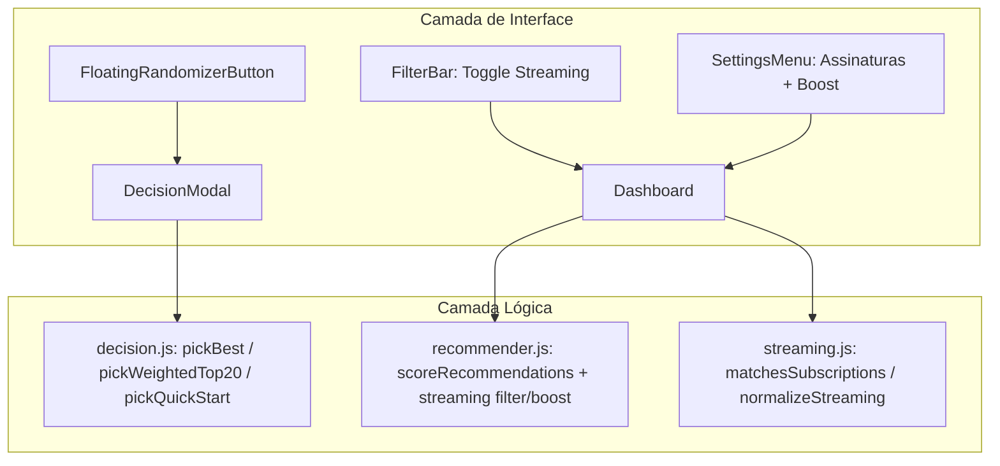

# Especificação Técnica — B2: Modo Decisão ("Escolha pra mim") & Filtro de Streaming

**Issue:** #9  
**Data:** 09/10/2026  
**Status:** Aprovado para Planejamento  

---

## 1. Visão Geral

Implementação do módulo B2 do roadmap AniMatch:
1. **Filtros e Preferências de Streaming:**
   - Seleção de assinaturas ativas (`Crunchyroll`, `Netflix`, `Prime Video`, `Disney+`, `Max`, `HIDIVE`) no `SettingsMenu.jsx`.
   - Filtro rápido na `FilterBar.jsx` (`☑ Somente nas minhas assinaturas`).
   - Boost opcional de nota previsto (`animatch_streaming_boost`) ativado nas configurações para valorizar títulos disponíveis imediatamente.
2. **Modo Decisão & Descoberta ("Escolha pra mim"):**
   - Botão flutuante animado (FAB - `FloatingRandomizerButton.jsx`) no Dashboard + gatilho direto na FilterBar.
   - Modal interativo (`DecisionModal.jsx`) com 3 modos:
     - 🎯 **Melhor Escolha**: Seleciona o anime #1 absoluto da lista de recomendações.
     - 🎲 **Surpreenda-me**: Amostragem probabilística ponderada sobre o Top 20 (pesos decrescentes $(21 - i)^{1.5}$, garantindo variabilidade sem perder qualidade).
     - ⚡ **Quero Começar Hoje**: Filtra animes curtos ($\le$ 24 episódios) disponíveis em streamings assinados pelo usuário e faz amostragem ponderada no topo desse subconjunto.
   - Justificativas ricas Nível 3/4 ("Por que este anime?"), badges de compatibilidade %, botões de link direto de streaming (`[Assistir na Crunchyroll]`) e botão de re-sorteio (`[🎲 Sortear outro]`).

---

## 2. Arquitetura de Componentes e Módulos

---

## 3. Estrutura de Arquivos

- `src/logic/streaming.js`: Constantes (`STREAMING_SERVICES`), normalização de nomes de plataforma e verificação de disponibilidade (`matchesUserSubscriptions`, `filterBySubscriptions`, `applyStreamingBoost`).
- `src/logic/streaming.test.js`: Testes de matching e boost.
- `src/logic/decision.js`: Algoritmos de decisão (`pickBestRecommendation`, `pickWeightedTop20`, `pickQuickStart`).
- `src/logic/decision.test.js`: Testes com mock de sementes/probabilidade e filtros de episódios/streaming.
- `src/components/FloatingRandomizerButton.jsx` + `.module.css` + `.test.jsx`: Botão FAB flutuante no Dashboard.
- `src/components/DecisionModal.jsx` + `.module.css` + `.test.jsx`: Modal do sorteio com os 3 modos, animação e justificativas.
- `src/components/SettingsMenu.jsx`: Seção para gerenciar assinaturas ativas e ativar/desativar streaming boost.
- `src/components/FilterBar.jsx`: Botão/toggle para filtrar apenas streaming assinado.
- `src/locales/{pt-BR,en,ja}.json`: Traduções completas para todos os novos recursos.
