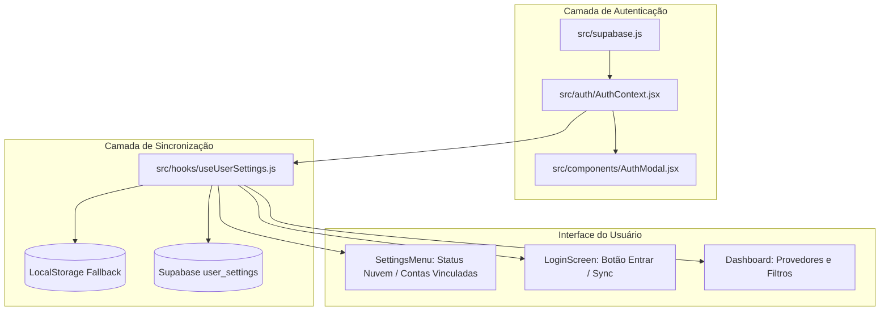

# Especificação Técnica — B6: Sincronização de Configurações via Supabase Auth

**Issue:** #10  
**Data:** 09/10/2026  
**Status:** Em Revisão  

---

## 1. Visão Geral

Permitir que usuários do AniMatch criem conta ou façam login (Email/Senha ou Google OAuth) para manter suas preferências sincronizadas automaticamente na nuvem entre múltiplos navegadores e dispositivos, preservando o fallback automático para `localStorage` para usuários anônimos ou offline.

---

## 2. Configurações Sincronizadas

1. `default_provider`: Provedor padrão (`'anilist'`, `'kitsu'`, `'mal'`).
2. `linked_usernames`: Objeto com usernames em cada plataforma (`{ anilist: '...', kitsu: '...', mal: '...' }`). *(Fundamental para o B7 Multi-Provider).*
3. `language`: Idioma ativo (`'pt-BR'`, `'en'`, `'ja'`).
4. `theme`: Tema (`'dark'`, `'light'`).
5. `title_pref`: Preferência de títulos (`'english'`, `'romaji'`, `'native'`).
6. `subscriptions`: Array de serviços de streaming assinados (`['Crunchyroll', 'Netflix', ...]`).
7. `streaming_boost`: Booleano de boost de pontuação.
8. `view_mode`: Modo de visualização (`'grid'`, `'row'`).

---

## 3. Modelo de Banco de Dados (Supabase Migration)

Arquivo: `supabase/migrations/20261009000000_create_user_settings.sql`

```sql
create table if not exists public.user_settings (
  user_id uuid references auth.users(id) on delete cascade primary key,
  settings jsonb not null default '{}'::jsonb,
  updated_at timestamp with time zone default timezone('utc'::text, now()) not null
);

-- RLS
alter table public.user_settings enable row level security;

create policy "Users can select own settings"
  on public.user_settings for select
  using (auth.uid() = user_id);

create policy "Users can insert own settings"
  on public.user_settings for insert
  with check (auth.uid() = user_id);

create policy "Users can update own settings"
  on public.user_settings for update
  using (auth.uid() = user_id);
```

---

## 4. Arquitetura Frontend



### 4.1. Fluxo de Precedência & Sincronização
1. **Usuário Não Logado (Anônimo/Offline)**:
   - Lê e grava diretamente no `localStorage` (comportamento atual sem quebra).
2. **Login Bem-Sucedido**:
   - Busca `user_settings` no Supabase.
   - Se existir na nuvem: mescla/atualiza o `localStorage` local.
   - Se for o primeiro login da conta: envia as configurações locais atuais do `localStorage` para a nuvem.
3. **Alteração de Configurações**:
   - Atualiza `localStorage` imediatamente (zero lag na UI).
   - Se logado, envia update com debounce (500ms) para o Supabase.

---

## 5. Componentes e UI

1. `src/auth/AuthContext.jsx`:
   - Provider React com `user`, `session`, `loading`, `signInWithPassword`, `signUpWithPassword`, `signInWithOAuth`, `signOut`.
2. `src/components/AuthModal.jsx`:
   - Modal com abas `Entrar` / `Criar Conta` (Email e Senha).
   - Botão `Continuar com Google`.
   - Mensagens de erro com suporte a i18n.
3. `src/components/SettingsMenu.jsx`:
   - Seção no topo com status de conta:
     - Logado: `👤 user@email.com` + Badge `☁️ Sincronizado` + Botão `Sair da Conta`.
     - Deslogado: Botão `☁️ Entrar / Sincronizar Configurações`.
   - Seção para **Contas Vinculadas** (Campos para salvar username AniList, Kitsu e MAL).
4. `src/locales/{pt-BR,en,ja}.json`:
   - Novas chaves para `auth.*` e `settings.linkedAccounts`.

---

## 6. Configuração de Ambientes

- **Local (Docker / Supabase CLI)**:
  - `supabase start` expõe `http://127.0.0.1:54321`.
  - `.env.development` com chaves locais.
- **Produção**:
  - `supabase db push` para aplicar migrations na nuvem.
  - `.env.production` com URL e anon key do projeto remoto.
