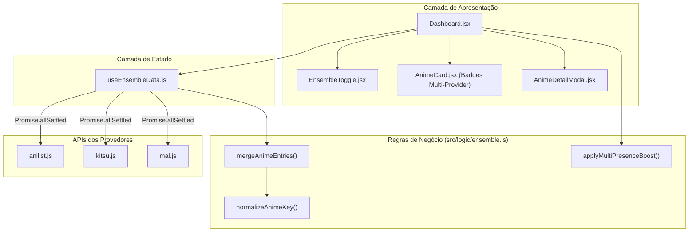

# Especificação Técnica — B7: Recomendação Unificada Multi-Provider (Ensemble Recommender)

**Issue:** #14  
**Data:** 13/10/2026  
**Status:** Aprovado para Planejamento  

---

## 1. Visão Geral

Permitir que usuários com contas em múltiplos serviços de anime (AniList, Kitsu, MyAnimeList) consolidem suas bibliotecas em uma visão integrada no AniMatch, gerando recomendações com maior densidade estatística e priorização inteligente.

### Objetivos:
1. **Deduplicação & Identidade Canônica:** Mapear e agrupar animes usando `idMal` preferencialmente, com fallback em título normalizado e ano.
2. **Perfil de Gosto Bayesiano Consolidado:** Unir históricos de `Completed` dos serviços cadastrados, calculando a média aritmética de notas pessoais para cada obra.
3. **Planning Agregado & Resolução de Conflitos:** Se uma obra já foi concluída em qualquer plataforma, ela prevalece como assistida e não é sugerida no Planning.
4. **Multi-Presence Boost:** Conceder bonificação percentual de 5% por serviço adicional onde a obra constar no Planning ($\text{Score} \times [1 + 0.05 \cdot (n - 1)]$).
5. **Degradação Suave de Rede:** Consolidar resultados dos provedores bem-sucedidos mesmo se algum falhar, sinalizando o ocorrido na interface.
6. **Experiência de Uso (UX):** Toggle no Dashboard permitindo alternar fluidamente entre o provedor ativo individual e a visão consolidada "Ensemble".

---

## 2. Arquitetura e Estrutura de Módulos



---

## 3. Especificação Detalhada de Módulos

### 3.1. `src/logic/ensemble.js` (Funções Puras)

#### `normalizeAnimeKey(anime)`
- Extrai chave única de identificação da obra:
  1. Se `anime.media?.idMal` ou `anime.idMal` estiver definido $\rightarrow$ `mal:${idMal}`.
  2. Se provedor for `mal` e `anime.media?.id` existir $\rightarrow$ `mal:${media.id}`.
  3. Fallback: string normalizada `title:${cleanTitle}_${year || 'any'}` onde `cleanTitle` remove pontuação e caracteres não alfanuméricos (`/[^a-z0-9]/g`), em minúsculas.

#### `mergeAnimeEntries(entriesByProvider)`
- Parâmetro: `{ [provider: string]: AnimeEntry[] }` (ex: `{ anilist: [...], kitsu: [...], mal: [...] }`).
- Agrupa itens pelo identificador canônico gerado por `normalizeAnimeKey`.
- **Hierarquia de Status:** `COMPLETED` > `CURRENT` (`WATCHING`) > `PAUSED` (`ON_HOLD`) > `DROPPED` > `PLANNING`.
  - Se um anime estiver `COMPLETED` em qualquer provedor, o status final é `COMPLETED`.
- **Média de Notas:**
  - Acumula todas as notas $> 0$ dadas pelo usuário e calcula a média aritmética: $\text{score} = \frac{\sum \text{scores}}{\text{countScores}}$.
- **Fusão de Metadados:**
  - Títulos: retém o título em inglês/romaji mais longo/descritivo.
  - Gêneros: união de gêneros válidos (`Set`).
  - Capa: prioriza imagem em alta resolução disponível.
  - Streaming links: união sem duplicar serviços de streaming.
  - `planningProviders`: lista de provedores em que o anime está com status `PLANNING` (ex: `['anilist', 'mal']`).

#### `applyMultiPresenceBoost(recommendations, k = 0.05)`
- Para cada recomendação no Planning:
  - $n = \text{item.planningProviders.length} \ge 1$.
  - Multiplicador: $M = 1 + k \cdot (n - 1)$.
  - Nota final recalculada: $\min(10.0, \text{predictedScore} \times M)$.
  - Registra metadados `presenceMultiplier: M` para exibição em tooltips.

---

### 3.2. `src/hooks/useEnsembleData.js` (Gestão de Fetch e Cache)

- Recebe: `linkedUsernames = { anilist, kitsu, mal }`, `enabled = boolean`.
- Dispara requisições simultâneas via `Promise.allSettled(providers.map(p => fetchUserEntries(username, p)))`.
- Separa respostas em:
  - `successfulEntries`: repassadas para `mergeAnimeEntries`.
  - `failedProviders`: lista de provedores com falha (ex: `['mal']`).
- Retorna:
  - `allEntries`: lista unificada consolidada.
  - `planningEntries`: subconjunto com status `PLANNING`.
  - `isLoading`: booleano indicando carregamento paralelo.
  - `failedProviders`: array de strings com provedores que falharam.
  - `refresh()`: função para forçar recarregamento ignorando caches.

---

### 3.3. Integração na Interface (UI / UX)

#### `Dashboard.jsx`
- Exibe o toggle **Modo Ensemble** na `FilterBar` ou topo do dashboard caso `linkedUsernames` contenha 2 ou mais contas preenchidas.
- Quando ativado:
  - Substitui `allEntries` pelo retorno de `useEnsembleData`.
  - Exibe banner de aviso sutil caso `failedProviders.length > 0`: *"Não foi possível conectar ao MyAnimeList. Exibindo dados consolidados de AniList e Kitsu."*
  - Exibe no cabeçalho o resumo das fontes: *"Consolidando 3 plataformas: AniList (@user), Kitsu (@user), MyAnimeList (@user)"*.

#### `AnimeCard.jsx` e `AnimeDetailModal.jsx`
- Quando `item.planningProviders?.length > 1`:
  - Exibe mini badges no canto superior do card:
    - 🔵 AniList
    - 🟠 Kitsu
    - 🔷 MAL
  - Tooltip informativo: *"Presente no seu Planning em AniList e MyAnimeList (+5% afinidade)"*.

---

## 4. Internacionalização (i18n)

Adicionar chaves aos arquivos `src/locales/{pt-BR,en,ja}.json`:

```json
{
  "ensemble": {
    "toggle_label": "Visão Unificada (Ensemble)",
    "toggle_subtitle": "Consolidando {{count}} plataformas",
    "partial_failure": "Não foi possível carregar dados de {{providers}}. Mostrando dados disponíveis.",
    "presence_badge_tooltip": "Presente no seu Planning em: {{providers}} (+{{percent}}% de afinidade)",
    "accounts_active": "{{count}} contas ativas"
  }
}
```

---

## 5. Estratégia de Testes

1. **`src/logic/ensemble.test.js`**:
   - `normalizeAnimeKey`: correspondência por `idMal`, id do MAL nativo e fallback de títulos normalizados.
   - `mergeAnimeEntries`: precedência de `COMPLETED` sobre `PLANNING`, média aritmética de notas, fusão de metadados e deduplicação.
   - `applyMultiPresenceBoost`: 1 provedor (1.0x), 2 provedores (1.05x), 3 provedores (1.10x), teto de 10.0.
2. **`src/hooks/useEnsembleData.test.js`**:
   - Sucesso total com 3 provedores.
   - Degradação suave com 1 falha e 2 sucessos.
   - Falha de todos os provedores disparando erro unificado.
3. **`AnimeCard.test.jsx`**:
   - Renderização correta dos badges de provedor quando `planningProviders` estiver presente.
