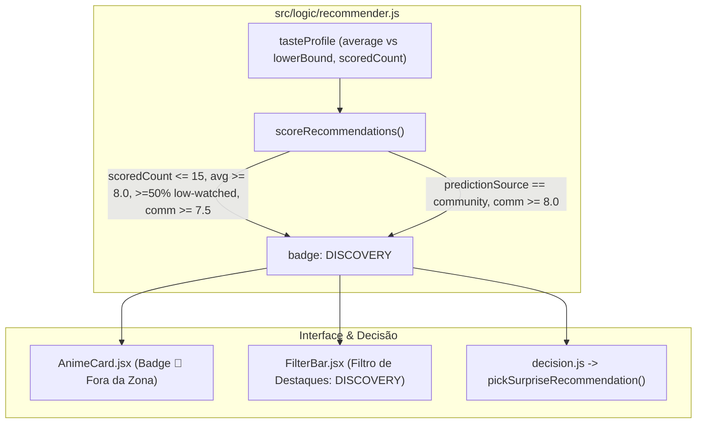

# Especificação Técnica — Modo Descoberta / Fora da Zona de Conforto (Serendipidade)

**Issue:** #20  
**Data:** 16/10/2026  
**Status:** Aguardando Revisão da Spec  

---

## 1. Contexto e Problema

Com a introdução do **Lower Confidence Bound** (`C = 25`, `Z = 1.96`) no cálculo do Perfil de Gosto (`buildTasteProfile`), o algoritmo principal passou a refletir com alta fidelidade a **zona de conforto** do usuário (gêneros muito assistidos e bem avaliados). Contudo, gêneros onde o usuário assistiu poucos animes (`scoredCount <= 15`), mesmo com média real excelente (`average >= 8.0`), sofrem forte regressão à média global e penalidade de erro padrão.

O objetivo desta feature é criar um mecanismo dedicado de **Serendipidade / Exploração ("Fora da Zona")** que identifique esses animes de alto potencial oculto sem distorcer o ranking principal de compatibilidade.

---

## 2. Regras de Negócio e Critérios Matemáticos (`src/logic/recommender.js`)

### 2.1. Constantes de Descoberta
- `DISCOVERY_MAX_SCORED_COUNT = 15`: Limite máximo de animes avaliados para um gênero ser considerado **pouco assistido**.
- `DISCOVERY_MIN_REAL_AVERAGE = 8.0`: Média real mínima (`stats.average >= 8.0`) para um gênero pouco assistido ser considerado **promissor**.
- `DISCOVERY_MIN_COMMUNITY_SCORE = 7.5`: Nota mínima da comunidade (`communityScore >= 7.5`) para validar a qualidade de recomendações baseadas em gêneros promissores.
- `DISCOVERY_FALLBACK_COMMUNITY_SCORE = 8.0`: Nota mínima da comunidade (`communityScore >= 8.0`) para animes cujos gêneros são 100% inéditos no perfil do usuário (`predictionSource === 'community'`).

### 2.2. Atribuição da Badge `DISCOVERY`
Em `scoreRecommendations`, um anime recebe `'DISCOVERY'` no array `badges` se atender a **qualquer uma** das duas condições abaixo:

1. **Gênero Promissor + Maioria Fora da Zona (`matchingGenres.length > 0`)**:
   - Possui ao menos **1 gênero promissor** no `tasteProfile` (`stats.scoredCount <= 15` e `stats.average >= 8.0`); **E**
   - Pelo menos **50% de todos os gêneros do anime** (`genres`) são pouco assistidos (não constam no `tasteProfile` ou possuem `stats.scoredCount <= 15`); **E**
   - `communityScore >= 7.5`.
2. **Inédito Aclamado (`matchingGenres.length === 0`)**:
   - Nenhum gênero do anime possui histórico suficiente no `tasteProfile` (`predictionSource === 'community'`) e o anime possui `genres.length > 0`; **E**
   - `communityScore >= 8.0`.

---

## 3. Evolução do Modo "Surpreenda-me" (`src/logic/decision.js`)

- Nova função exportada `pickSurpriseRecommendation(recommendations, randomFn = Math.random, excludeId = null)`:
  1. Filtra o pool de `recommendations` buscando itens com `anime.badges?.includes('DISCOVERY')`.
  2. Se houver candidatos `DISCOVERY`, realiza o sorteio ponderado via `pickWeightedTop20(discoveryCandidates, randomFn, excludeId)`.
  3. **Fallback seguro**: Caso não haja nenhum candidato com `DISCOVERY` na lista filtrada atual, executa `pickWeightedTop20(recommendations, randomFn, excludeId)` sobre a lista geral.
- `makeDecision(DECISION_MODES.SURPRISE, ...)` passa a delegar para `pickSurpriseRecommendation`.

---

## 4. Camada de Interface (UI) e Internacionalização (i18n)

### 4.1. `AnimeCard.jsx` e `AnimeCard.module.css`
- Adicionar `DISCOVERY: '🧭'` no `iconMap` de `AnimeCard.jsx`.
- Exibir badges `anime.badges` mesmo quando `predictionSource === 'community'` (abaixo do badge de nota da comunidade), permitindo visualizar `🧭 Fora da Zona` em inéditos aclamados.
- Adicionar classe `.anime-card__badge-floating--discovery` em `AnimeCard.module.css` com destaque visual em tom turquesa/esmeralda (`border-color: #2dd4bf; background: rgba(13, 148, 136, 0.88); color: #ffffff;`).

### 4.2. `FilterBar.jsx`
- Adicionar `{ id: 'DISCOVERY', key: 'labels.badge_DISCOVERY' }` na constante `BADGES`.

### 4.3. Traduções (`src/locales/{pt-BR,en,ja}.json`)
- `labels.badge_DISCOVERY`:
  - `pt-BR`: `"🧭 Fora da Zona"`
  - `en`: `"🧭 Out of Comfort Zone"`
  - `ja`: `"🧭 新境地"`
- `decision.mode_surprise_desc`:
  - `pt-BR`: `"Animes fora da sua zona de conforto: gêneros pouco explorados com notas altas."`
  - `en`: `"Out of your comfort zone: under-explored genres with high ratings."`
  - `ja`: `"コンフォートゾーンの外へ：視聴数が少なく高評価なジャンルのアニメ。"`

---

## 5. Estratégia de Testes

- `src/logic/recommender.test.js`:
  - Testar atribuição da badge `DISCOVERY` quando o anime tem gênero com `scoredCount <= 15`, `average >= 8.0`, `>= 50%` gêneros pouco vistos e `communityScore >= 7.5`.
  - Testar que um anime dominado por gêneros muito assistidos (`scoredCount > 15` em mais de 50% dos gêneros) **não** recebe `DISCOVERY`.
  - Testar fallback de inéditos aclamados (`predictionSource === 'community'` com `communityScore >= 8.0` recebe `DISCOVERY`; `< 8.0` não recebe).
- `src/logic/decision.test.js`:
  - Testar que `DECISION_MODES.SURPRISE` prioriza candidatos com badge `DISCOVERY`.
  - Testar fallback para `pickWeightedTop20` geral quando nenhum item possui `DISCOVERY`.
- `src/components/FilterBar.test.jsx` e `src/components/AnimeCard.test.jsx`:
  - Verificar presença da opção `DISCOVERY` no filtro de destaques e renderização do badge no card.
