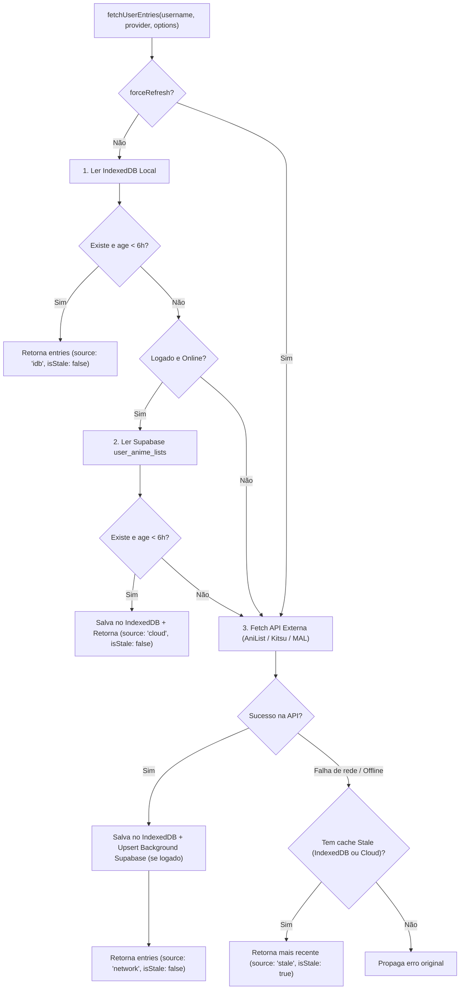

# Spec de Design — B8: Persistência Offline-First (IndexedDB) e Supabase Sync (#16)

**Data:** 17/10/2026
**Issue:** #16
**Status:** Aprovado

---

## 1. Contexto e Motivação

O cache atual em `src/cache/apiCache.js` utiliza apenas `localStorage` com cota restrita (~5MB) e TTL curto de 5 minutos, descartando leituras expiradas. Isso gera três limitações:
1. Listas grandes ou múltiplos provedores (Ensemble) podem atingir o limite de armazenamento síncrono do `localStorage`.
2. Como o usuário não conclui animes a cada 5 minutos, reconsultas frequentes às APIs externas (AniList, Kitsu, MyAnimeList) são desnecessárias — e quando o usuário altera sua lista, já dispõe do botão de atualização manual (`forceRefresh`).
3. Em caso de queda de conexão (`navigator.onLine === false`) ou instabilidade dos provedores externos após o TTL, o app falha ao carregar em vez de exibir a última versão salva localmente ou na nuvem.

---

## 2. Objetivos e Decisões de Design

- **TTL de Cache Fresco de 6 Horas (`6 * 60 * 60 * 1000` ms)**:
  - Reflete o ritmo real de consumo de animes (dias ou semanas por obra).
  - Reduz drasticamente chamadas de rede redundantes e rate-limits.
  - O botão de sincronização manual (`forceRefresh: true`) ignora o TTL sempre que o usuário finalizar um anime e quiser recalcular recomendações imediatamente.
- **Camada 1 — IndexedDB Local com Stale-While-Revalidate (SWR)**:
  - Banco `animatch_db` (versão 1), Object Store `anime_lists` (`keyPath: 'cacheKey'`).
  - Mantém espelho leve ou fallback seguro para ambientes sem IndexedDB (ex.: testes JSDOM sem mock explícito).
  - Entradas expiradas (`age >= 6h`) permanecem armazenadas e podem ser servidas como fallback `stale` se a rede/API falhar.
  - Eviction LRU de até `MAX_CACHED_USERS = 20` chaves para evitar crescimento infinito.
- **Camada 2 — Supabase Cloud Sync (`user_anime_lists`)**:
  - Para usuários autenticados via Supabase Auth, sincroniza as listas normalizadas por `(user_id, provider, username)`.
  - Atua tanto como **cache compartilhado multi-dispositivo** (se `updated_at < 6h`, outro aparelho carrega direto do Supabase sem consultar as APIs externas) quanto como **backup em nuvem** (se a API externa cair ou o cache local estiver vazio).
  - Escrita em background com debounce (`500ms`) e estratégia *last-write-wins* (`updated_at`).
- **Indicador Visual de Modo Offline / Dados Locais**:
  - Badge discreto no cabeçalho do `Dashboard.jsx` (`📴 Modo Offline · dados locais`) exibido quando `navigator.onLine === false` ou quando os dados exibidos vierem de fallback expirado (`isStale === true`), acompanhado de botão rápido para tentar reconectar/atualizar (`onRefresh`).

---

## 3. Arquitetura e Fluxo de Dados

### 3.1 Hierarquia de Leitura (`fetchUserEntries(username, provider, options)`)



> **Exceção de segurança na falha da API**: Erros de negócio definitivos (`UserNotFoundError` e `PrivateListError`) **não** acionam fallback stale e são propagados imediatamente. Apenas falhas de conectividade, timeout, rate limit ou indisponibilidade (`RetryableError`, `RateLimitError` ou `navigator.onLine === false`) acionam o fallback stale.

### 3.2 Modelo de Dados no Supabase (`supabase/migrations/20261017000000_create_user_anime_lists.sql`)

```sql
create table if not exists public.user_anime_lists (
  user_id uuid references auth.users(id) on delete cascade not null,
  provider text not null,
  username text not null,
  entries jsonb not null default '[]'::jsonb,
  updated_at timestamp with time zone default timezone('utc'::text, now()) not null,
  primary key (user_id, provider, username)
);

alter table public.user_anime_lists enable row level security;
```

Políticas RLS (`SELECT`, `INSERT`, `UPDATE`, `DELETE`) garantem `auth.uid() = user_id`.

### 3.3 Metadados de Cache Não-Intrusivos

Para manter 100% de retrocompatibilidade com todo o código que espera que `fetchUserEntries` retorne um `Array` de `entries`:
- O array retornado recebe uma propriedade não-enumerável (ou simbólica/auxiliar via `Object.defineProperty(entries, '_cacheMeta', { value: { source, isStale, timestamp }, enumerable: false })`), além de um helper `getLastCacheMeta(provider, username)`.
- Assim, `Array.isArray(entries)` e `expect(entries).toEqual([...])` nos testes existentes continuam funcionando sem quebras, enquanto `App.jsx`, `useEnsembleData.js` e `Dashboard.jsx` podem inspecionar `entries._cacheMeta?.isStale`.

---

## 4. Componentes Afetados

1. **`src/cache/idbCache.js` (Novo)**:
   - Operações assíncronas `readIdbCache(cacheKey, ttlMs)`, `writeIdbCache(cacheKey, value, meta)`, `clearIdbCache(cacheKey)`.
   - Retorna `{ value, timestamp, isFresh, isStale }`.
   - Eviction LRU mantendo as 20 chaves mais recentes.
2. **`src/cache/apiCache.js` (Atualizado)**:
   - Exporta `DEFAULT_CACHE_TTL = 6 * 60 * 60 * 1000` (6 horas).
   - Mantém `readCache`, `writeCache`, `clearCache` síncronos como camada L1 rápida/fallback compatível com testes unitários de providers, adicionando `readStaleCache(cacheKey)` para recuperar entradas expiradas em caso de falha de rede.
3. **`src/cache/cloudListSync.js` (Novo)**:
   - `fetchCloudAnimeList(userId, provider, username, ttlMs)`: busca registro em `user_anime_lists` e informa `{ entries, timestamp, isFresh, isStale }`.
   - `scheduleCloudAnimeListSync(userId, provider, username, entries, debounceMs = 500)`: faz `upsert` assíncrono debounced respeitando *last-write-wins*.
4. **`src/api/index.js` (Atualizado)**:
   - Orquestra a hierarquia completa (IndexedDB → Supabase Cloud → Provider API → Fallback Stale IDB/Cloud) e anexa `_cacheMeta` ao array retornado.
5. **`src/hooks/useEnsembleData.js`, `src/App.jsx` e `src/components/Dashboard.jsx`**:
   - Propagam estado `isOfflineMode` (`!navigator.onLine` ou `isStale === true`) e exibem badge discreto no header do Dashboard com botão de reconexão/refresh.
6. **`src/locales/{pt-BR,en,ja}.json`**:
   - Traduções para o indicador de modo offline / dados locais.

---

## 5. Estratégia de Testes

- **`src/cache/__tests__/idbCache.test.js`**: Testes de escrita, leitura fresca (< 6h), leitura stale (>= 6h), eviction LRU e fallback quando IndexedDB está indisponível.
- **`src/cache/__tests__/cloudListSync.test.js`**: Testes de leitura fresca/stale do Supabase, debounce de escrita e tratamento gracioso de erros/offline.
- **`src/api/__tests__/offlineFallback.test.js`**: Testes de `fetchUserEntries` validando a cascata `IndexedDB → Cloud → API Externa → Stale Fallback` e garantindo que `UserNotFoundError` não seja mascarado por cache antigo.
- **Testes de UI (`Dashboard`)**: Verificação do badge `📴 Modo Offline · dados locais` quando offline ou com dados `isStale`.
